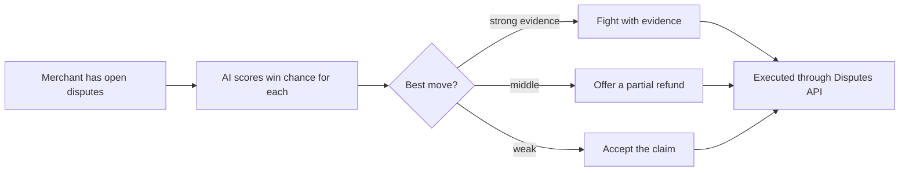

# #16 Dispute EV Triage

> [!tldr] In one breath
> For every PayPal dispute, estimate the expected value (EV) of fighting it, offering a partial refund or just accepting, then carry out the best move with the right evidence. Score 91, the best evidenced problem in the bank. **Eliminated** with kill code K2 because the headline is crowded. Its mechanism lives on inside #20 and #23.

> [!example] Picture this
> A shop owner gets 5 disputes in a day: a $12 sticker order, a $300 jacket, and so on. Fighting costs time, and each fight has a different chance of winning. Think of an emergency room nurse sorting patients: this idea is the triage nurse for disputes. "Fight this one, it is a sure win. Offer half back on this one. Accept this one, it is cheaper than the effort."

> [!warning] Crowd check, Oct 23 2026
> Crowded. The scan found about 16 dispute and chargeback copilots: witness, dispute-defender, dispute-copilot (AG Grid), rebuttal, dispute-radar (LightGBM), dispute-autopilot, two disputedesk, dispute-steward, Docket, two payguard-ai. Close cousins include preflight-for-paypal, subguard, returngate and clippay (partial refunds). The "fight, offer or accept" framing is the twist, but the headline looks the same as many others.

**Theme:** E3 Evidence economy · **Group:** Evidence economy · **Crowding on Devpost:** Disputes cluster (about 7)

## What the kill code means
**K2 means "too crowded, or sounds like something already out there, so we cannot defend that it is new."** The problem is real. The headline is just everywhere. See [[41 Brutal Elimination]].

## The problem
**Small merchants fight only 60.3% of friendly fraud chargebacks, and evidence collection is the** (the source text is cut off here; the Chargebacks911 report cited below names evidence collection the number 1 pain).

## The idea
Pull every open dispute. Score the chance of winning from the reason, amount and available evidence. Recommend one of three moves: fight, make a partial refund offer, or accept. Then do it through the Disputes API with the evidence put together.

**Who it is for:** small merchants on PayPal.

**What the AI does:** scores win probability, assembles evidence and sizes the offer.

## How PayPal is used
The full Disputes API (list, get, make offer, provide evidence, accept claim, escalate). The sandbox factory. Tracking. Webhooks.

**Building blocks used** (see [[30 Primitives Legend]]):
* `P14` Disputes API (get, messages, make offer, accept offer, provide evidence)
* `P15` Disputes sandbox factory (create, adjudicate)
* `P17` Shipment Tracking API (add tracking, releases holds)
* `P20` Webhooks (events, retries, verification)
* `A05` Structured decision and classification (most common)
* `A01` Document and image extraction (OCR, validation)
* `A03` Intent and rationale reasoning (LLM as judge)

## Who else is doing this
Chargeflow, Justt, Chargebacks911, Disputifier.

Mature vendors (contingency fees of about 20 to 30%) already automate representment. About 7 Devpost entries target disputes.

**Verification status:** ⚠️ desk research only. The competitor names come from landscape and Devpost scans, not from a per idea novelty hunt. Treat "no competitor found" as unproven.

## What makes it different
The expected value framing and offer making are the twist. Otherwise it is a known category.

## Can we build it?
High. The sandbox dispute life cycle is rich.

## Demo plan (MVP)
5 sandbox disputes across different reasons, with different recommended moves carried out live.

## Risks
Crowded. It must avoid auto accepting disputes (PayPal's own skill warns about this).

## Sources
* [Chargebacks911 2026 Field Report: small businesses represent only 60.3%; evidence collection is the number 1 pain](https://chargebacks911.com/chargeback-field-report/) ✅
* [Mastercard and Datos 2025 State of Chargebacks: 261M to 324M by 2028; 45% fraudulent](https://www.mastercard.com/us/en/news-and-trends/Insights/2025/2025-global-chargebacks-outlook.html) ✅
* [LexisNexis True Cost of Fraud 2026: $5.13 per $1 (US retail)](https://risk.lexisnexis.com/about-us/press-room/press-release/20260624-tcof-retail-and-commerce) ✅
* [PayPal merchant fees (3.49% + $0.49; +1.5% international; 3 to 4% FX)](https://www.paypal.com/us/webapps/mpp/merchant-fees) ✅
* [PayPal Disputes test and go live: sandbox create, chargeback and adjudicate endpoints](https://developer.paypal.com/disputes/test-go-live.md) ✅
* [Devpost "Built with PayPal" listing (early entry clustering, about 72 reviewed)](https://devpost.com/software/built-with/paypal) ⚠️

## Scores
"Risk⁻¹" means a higher number is a safer idea.

| Axis | Weight | Desk score |
|---|---|---|
| Tech | ×2 | 9 |
| Design | ×2 | 8 |
| Impact | ×2 | 9 |
| Innovation | ×2 | 4 |
| Demo | ×2 | 7 |
| Feasibility | ×1 | 9 |
| Risk⁻¹ | ×1 | 8 |
| **Total /120** | | **91** |

_Why (desk):_ The best evidenced problem, but a crowded headline.

**Kill codes triggered:** `K2` Crowded cluster or derivative headline; innovation cannot be defended. See [[41 Brutal Elimination]].

> [!info]- Jargon decoder
> **Expected value (EV)**: the average payoff of a choice. If you win $100 half the time, EV is $50. It lets you compare "fight" with "settle" using one number.
> **Dispute and chargeback**: a buyer asking to take money back, with both sides sending proof to a referee.
> **Friendly fraud**: a real buyer who got the goods and still claims they did not.
> **Representment**: the merchant's formal reply that fights a chargeback.
> **Triage**: sorting cases by urgency and best use of effort, like an emergency room.
> **Make offer, accept claim, escalate**: the merchant's three dispute moves: propose a fix, give in, or push the case higher.
> **Contingency fee**: the vendor only gets paid a share when you win.
> **Sandbox dispute factory**: PayPal's tool for creating fake disputes to practise on.
> **Webhook**: a doorbell. PayPal rings your server when something happens.

## Where to next
* ⬆️ Up: [[Idea Index]]
* ⬅️ Previous: [[I015 Commitment Contract to Charity]] · ➡️ Next: [[I017 Digital-Goods Proof Ledger]]
* 🧭 Theme: [[Theme E3 Evidence economy]]
* 🔗 Related: [[I020 Dispute-to-Listing Fixer]], [[I023 Seller Protection Preflight]], [[41 Brutal Elimination]], [[00 PayPal AI Hackathon Hub]]
