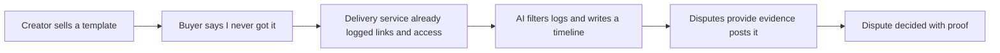

# #17 Digital-Goods Proof Ledger

> [!tldr] In one breath
> A small service that logs when a digital product was sent and opened, then turns those logs into the "compelling evidence" PayPal asks for when a buyer disputes an intangible item. Score 79 (desk only). Solid use, low novelty.

> [!example] Picture this
> Lena sells a $40 design template. A buyer disputes it: "I never got it." Lena has nothing but an email. Now imagine a guest book at a hotel: it shows "download link sent 10:02, opened 10:03, file downloaded 10:04, license activated 10:09." Lena clicks one button and PayPal receives that timeline as evidence.

> [!warning] Crowd check, Oct 23 2026
> The dispute area is busy: about 16 dispute and chargeback copilots in the scan (witness, dispute-defender, dispute-copilot, rebuttal, Docket and others). None were seen collecting digital delivery logs as their core job, but the evidence gathering side of disputes will look familiar to judges.

**Theme:** E3 Evidence economy · **Group:** Evidence economy · **Crowding on Devpost:** Disputes cluster

## The problem
**PayPal's Seller Protection for intangibles needs a system of record showing the item was sent and accessed,** and small digital sellers rarely have one.

## The idea
A lightweight delivery service (signed download links, license activation, access pings). When a dispute arrives, it automatically builds a timeline and posts it as evidence.

**Who it is for:** creators who sell courses, templates and software licenses.

**What the AI does:** writes the timeline story and filters the logs to what matters.

## How PayPal is used
Orders. Disputes provide evidence. Webhooks.

**Building blocks used** (see [[30 Primitives Legend]]):
* `P01` Orders v2 (create, capture, get)
* `P14` Disputes API (get, messages, make offer, accept offer, provide evidence)
* `P20` Webhooks (events, retries, verification)
* `A01` Document and image extraction (OCR, validation)

## Who else is doing this
Gumroad, Lemon Squeezy, Sellfy. Digital storefronts keep logs but lock them inside their own platform.

**Verification status:** ⚠️ desk research only. The competitor names come from landscape and Devpost scans, not from a per idea novelty hunt. Treat "no competitor found" as unproven.

## What makes it different
Portable, and built for PayPal disputes.

## Can we build it?
High.

## Demo plan (MVP)
Sell a template, access it, open a dispute, and see the evidence posted.

## Risks
Modest novelty and limited AI depth.

## Sources
* [PayPal Seller Protection Program (ship to address rule, SNAD excluded, intangibles evidence)](https://www.paypal.com/us/legalhub/paypal/seller-protection) ✅
* [PayPal Disputes test and go live: sandbox create, chargeback and adjudicate endpoints](https://developer.paypal.com/disputes/test-go-live.md) ✅
* [Chargebacks911 2026 Field Report: small businesses represent only 60.3%; evidence collection is the number 1 pain](https://chargebacks911.com/chargeback-field-report/) ✅

## Scores
"Risk⁻¹" means a higher number is a safer idea.

| Axis | Weight | Desk score |
|---|---|---|
| Tech | ×2 | 7 |
| Design | ×2 | 7 |
| Impact | ×2 | 6 |
| Innovation | ×2 | 5 |
| Demo | ×2 | 6 |
| Feasibility | ×1 | 9 |
| Risk⁻¹ | ×1 | 8 |
| **Total /120** | | **79** |

_Why (desk):_ Solid usefulness, low novelty.

**Kill codes:** none triggered.

> [!info]- Jargon decoder
> **Digital goods and intangibles**: things you cannot hold, like files, courses and licenses.
> **Seller Protection**: PayPal's promise to cover a seller's loss in some disputes if they follow the rules.
> **Compelling evidence**: strong proof that an item was delivered and used.
> **System of record**: the one trusted place where the facts are kept, like a ledger.
> **Signed download link**: a web link that only works for one buyer and cannot be forged.
> **License activation**: the moment software is switched on with a key.
> **Dispute provide evidence**: the seller uploading proof to a PayPal dispute.
> **Webhook**: a doorbell. PayPal rings your server when something happens.

## Where to next
* ⬆️ Up: [[Idea Index]]
* ⬅️ Previous: [[I016 Dispute EV Triage]] · ➡️ Next: [[I018 Service-Proof Ledger]]
* 🧭 Theme: [[Theme E3 Evidence economy]]
* 🔗 Related: [[00 PayPal AI Hackathon Hub]]
