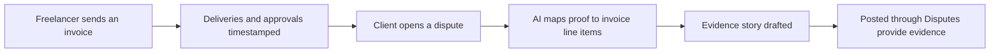

# #18 Service-Proof Ledger

> [!tldr] In one breath
> Freelancer deliverables, client approvals and change requests get timestamped and become dispute ready evidence. PayPal Seller Protection does not cover services, so freelancers need their own proof. Score 79 (desk only). Real pain, moderate novelty.

> [!example] Picture this
> Dev is a freelance web designer. The client pays, then claims "the site was not what we agreed." Dev has fifty emails and three chat apps to dig through. Now picture a shared folder with a stamped receipt on every step: "logo delivered Tuesday, client said looks great," "extra page requested, price agreed." When the dispute lands, AI lines the receipts up against the invoice line items and writes a tidy story.

> [!warning] Crowd check, Oct 23 2026
> Mixed crowd. Freelancer and small business invoicing is busy (about 25 repos in the scan: ledgerbird, ledgerly, two invoicepilot, chaser, owed, docket, clause-and-pay, paceline and others), and the dispute copilot area has about 16. The evidence side for services, tied to invoice line items, was not seen as a core job.

**Theme:** E3 Evidence economy · **Group:** Evidence economy · **Crowding on Devpost:** Escrow and disputes adjacent

## The problem
**85% of freelancers are paid late at least sometimes, and PayPal Seller Protection covers physical goods,** leaving services exposed to SNAD (Significantly Not As Described) disputes.

## The idea
An invoice linked workspace where client approvals, file deliveries and messages are timestamped. AI maps them to invoice line items and builds the evidence story when a dispute arrives.

**Who it is for:** freelancers and micro agencies who invoice through PayPal.

**What the AI does:** maps deliverables to the agreed scope and drafts the story.

## How PayPal is used
Invoicing. Disputes evidence. Webhooks.

**Building blocks used** (see [[30 Primitives Legend]]):
* `P08` Invoicing v2 (create, send, partial payment)
* `P14` Disputes API (get, messages, make offer, accept offer, provide evidence)
* `P20` Webhooks (events, retries, verification)
* `A01` Document and image extraction (OCR, validation)
* `A06` Entity matching and narrative drafting

## Who else is doing this
Bonsai, HoneyBook, Upwork. Freelancer suites manage contracts. Marketplaces offer escrow at fees of 10% or more.

**Verification status:** ⚠️ desk research only. The competitor names come from landscape and Devpost scans, not from a per idea novelty hunt. Treat "no competitor found" as unproven.

## What makes it different
Evidence first, for freelancers who work off platform.

## Can we build it?
High.

## Demo plan (MVP)
Invoice, deliverables, client approval, dispute, evidence.

## Risks
Escrow adjacent framing. Evidence alone may not win service disputes.

## Sources
* [Remote 2025: 85% of freelancers paid late sometimes](https://remote.com/blog/contractor-management/reversing-late-payment-culture) ✅
* [PayPal Seller Protection Program (ship to address rule, SNAD excluded, intangibles evidence)](https://www.paypal.com/us/legalhub/paypal/seller-protection) ✅
* [PayPal Disputes test and go live: sandbox create, chargeback and adjudicate endpoints](https://developer.paypal.com/disputes/test-go-live.md) ✅

## Scores
"Risk⁻¹" means a higher number is a safer idea.

| Axis | Weight | Desk score |
|---|---|---|
| Tech | ×2 | 7 |
| Design | ×2 | 7 |
| Impact | ×2 | 7 |
| Innovation | ×2 | 5 |
| Demo | ×2 | 6 |
| Feasibility | ×1 | 8 |
| Risk⁻¹ | ×1 | 7 |
| **Total /120** | | **79** |

_Why (desk):_ Real pain, moderate novelty.

**Kill codes:** none triggered.

> [!info]- Jargon decoder
> **Seller Protection**: PayPal's promise to cover some seller losses if they follow its rules. It does not cover services.
> **SNAD**: Significantly Not As Described. The buyer says what they got is not what was promised.
> **Deliverable**: a piece of finished work handed to the client.
> **Change request**: the client asking for something extra after the deal was made.
> **Line items**: the separate rows on an invoice.
> **Escrow**: a neutral party holds the money until the work is accepted.
> **Dispute evidence**: proof a seller uploads when a buyer challenges a payment.
> **Webhook**: a doorbell. PayPal rings your server when something happens.

## Where to next
* ⬆️ Up: [[Idea Index]]
* ⬅️ Previous: [[I017 Digital-Goods Proof Ledger]] · ➡️ Next: [[I019 Compelling Evidence Linker]]
* 🧭 Theme: [[Theme E3 Evidence economy]]
* 🔗 Related: [[00 PayPal AI Hackathon Hub]]
