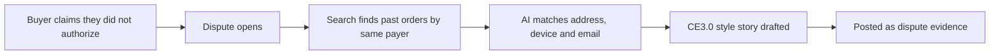

# #19 Compelling Evidence Linker

> [!tldr] In one breath
> Defends "I did not authorize this payment" claims by linking the disputed payment to the same buyer's earlier undisputed purchases. Score 73. **Eliminated** with kill code K2: useful but derivative, since card networks already have this trick.

> [!example] Picture this
> A customer says "I never bought this." The shop owner says "but you bought from us five times before, from the same address, with the same email, and never complained." That is the idea: a clerk who finds the old receipts that look exactly like the new one and staples them into one convincing file.

> [!warning] Crowd check, Oct 23 2026
> Crowded headline. The scan found about 16 dispute and chargeback copilots (witness, dispute-defender, dispute-copilot, rebuttal, dispute-radar, Docket and others). A PayPal version of Visa's linking trick was not specifically seen, but judges will file it under "dispute helper".

**Theme:** E3 Evidence economy · **Group:** Evidence economy · **Crowding on Devpost:** Disputes cluster

## What the kill code means
**K2 means "too crowded, or sounds like something already out there, so we cannot defend that it is new."** Card networks already have Compelling Evidence 3.0 tools. See [[41 Brutal Elimination]].

## The problem
**Friendly fraud is the largest dispute category for merchants** (45% of chargebacks are judged fraudulent).

## The idea
Search the transaction history for a matching payer, address, and device or email patterns. Build a CE3.0 style story for the PayPal evidence upload.

**Who it is for:** merchants with repeat customers.

**What the AI does:** matches records to the same person and drafts the narrative.

## How PayPal is used
Transaction Search. Disputes evidence.

**Building blocks used** (see [[30 Primitives Legend]]):
* `P18` Transaction Search and Reporting
* `P14` Disputes API (get, messages, make offer, accept offer, provide evidence)
* `A06` Entity matching and narrative drafting

## Who else is doing this
Visa Compelling Evidence 3.0 tools, Chargeflow. Card network CE3.0 automation exists through vendors.

**Verification status:** ⚠️ desk research only. The competitor names come from landscape and Devpost scans, not from a per idea novelty hunt. Treat "no competitor found" as unproven.

## What makes it different
A PayPal native port of a known card network technique.

## Can we build it?
High. The 3 hour Transaction Search lag is fine.

## Demo plan (MVP)
Seeded history, a dispute and evidence.

## Risks
Low novelty.

## Sources
* [Mastercard and Datos 2025 State of Chargebacks: 261M to 324M by 2028; 45% fraudulent](https://www.mastercard.com/us/en/news-and-trends/Insights/2025/2025-global-chargebacks-outlook.html) ✅
* [PayPal Transaction Search v1 (3 hour lag at most, 31 day window)](https://developer.paypal.com/docs/api/transaction-search/v1/) ✅
* [PayPal Disputes test and go live: sandbox create, chargeback and adjudicate endpoints](https://developer.paypal.com/disputes/test-go-live.md) ✅

## Scores
"Risk⁻¹" means a higher number is a safer idea.

| Axis | Weight | Desk score |
|---|---|---|
| Tech | ×2 | 7 |
| Design | ×2 | 5 |
| Impact | ×2 | 7 |
| Innovation | ×2 | 4 |
| Demo | ×2 | 5 |
| Feasibility | ×1 | 9 |
| Risk⁻¹ | ×1 | 8 |
| **Total /120** | | **73** |

_Why (desk):_ Useful, derivative.

**Kill codes triggered:** `K2` Crowded cluster or derivative headline; innovation cannot be defended. See [[41 Brutal Elimination]].

> [!info]- Jargon decoder
> **Friendly fraud**: a real buyer who got the goods and still claims they did not authorize the payment.
> **Chargeback**: the buyer's bank forces the money back from the merchant.
> **Compelling Evidence 3.0 (CE3.0)**: a Visa rule where a merchant can win by showing the same buyer made earlier undisputed purchases, like proving "this is clearly the same customer".
> **Transaction Search**: PayPal's lookup for past payments, like scrolling an old bank statement.
> **Entity matching**: working out that two records belong to the same person even if details differ slightly.
> **Narrative drafting**: writing the story that goes with the evidence.

## Where to next
* ⬆️ Up: [[Idea Index]]
* ⬅️ Previous: [[I018 Service-Proof Ledger]] · ➡️ Next: [[I020 Dispute-to-Listing Fixer]]
* 🧭 Theme: [[Theme E3 Evidence economy]]
* 🔗 Related: [[41 Brutal Elimination]], [[00 PayPal AI Hackathon Hub]]
