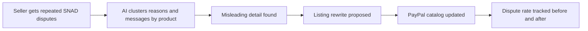

# #20 Dispute-to-Listing Fixer

> [!tldr] In one breath
> Reads "not as described" disputes and buyer messages, finds the listings that cause them, and rewrites those listings so the next dispute never happens. Desk 97, post deep dive 80. Verdict: **demote**, because the PayPal side of the fix is cosmetic and a Shopify tool already does the same loop.

> [!example] Picture this
> A shop sells a jacket and keeps getting complaints: "runs small." The owner answers each complaint one by one, forever. Now picture a doctor who notices that fifty patients all ate at the same restaurant. The fixer finds the pattern ("sizing runs small on this one product"), rewrites the listing to say "order one size up," and then watches whether the complaints drop.

> [!warning] Crowd check, Oct 23 2026
> The dispute area is crowded (about 16 dispute and chargeback copilots in the scan, such as witness, dispute-defender, dispute-copilot, rebuttal, dispute-radar), but they mostly defend cases. A "prevent the next one" loop was not seen. The nearest relatives are preflight-for-paypal (a Seller Protection checker, near duplicate of idea #23), returngate and subguard. The deep dive found ReasonWhy (Shopify, Jun 2026) doing a similar loop on returns.

**Theme:** E3 Evidence economy · **Group:** Evidence economy · **Crowding on Devpost:** Disputes cluster adjacent, but a different mechanism

## The problem
**Disputes are handled one at a time, while the root cause keeps creating new ones** (a misleading photo, a missing dimension). Seller Protection does not cover SNAD claims at all.

## The idea
Cluster dispute reasons and messages by product. Find the misleading attribute. Propose listing edits and image notes. Update the catalog. Track the dispute rate before and after.

**Who it is for:** small merchants and marketplace sellers.

**What the AI does:** clusters and pulls root causes out of dispute text, rewrites the listing, and checks photos against the claims with vision.

## How PayPal is used
Disputes list and get (messages, reasons). Catalog Products API update. Transaction Search for rates. Webhooks.

**Building blocks used** (see [[30 Primitives Legend]]):
* `P14` Disputes API (get, messages, make offer, accept offer, provide evidence)
* `P15` Disputes sandbox factory (create, adjudicate)
* `P30` Catalog products and billing plans
* `P18` Transaction Search and Reporting
* `P20` Webhooks (events, retries, verification)
* `A06` Entity matching and narrative drafting
* `A05` Structured decision and classification (most common)
* `A02` Classification with explanation and vision estimation

## Who else is doing this
Chargeflow, Yotpo, Amazon Voice of the Customer.

Marketplaces show listing quality dashboards internally (Amazon's Voice of the Customer). Dispute vendors fight cases rather than prevent the next one. No PayPal native closed loop was found.

**Verification status:** adversarially deep dived. Full competitor table: [[D020 Dispute-to-Listing Fixer (Deep Dive)]].

## What makes it different
It moves disputes from "defend" to "prevent", using the dispute API as a product feedback channel.

## Can we build it?
High. The sandbox dispute factory can seed realistic SNAD clusters.

## Demo plan (MVP)
Seed 20 sandbox disputes over 4 products. The fixer finds "sizing runs small" on one, rewrites the listing and shows a projected drop in disputes.

## Risks
The before and after impact can only be simulated within the hackathon.

## Sources
* [PayPal Seller Protection Program (ship to address rule, SNAD excluded, intangibles evidence)](https://www.paypal.com/us/legalhub/paypal/seller-protection) ✅
* [PayPal Disputes test and go live: sandbox create, chargeback and adjudicate endpoints](https://developer.paypal.com/disputes/test-go-live.md) ✅
* [Mastercard and Datos 2025 State of Chargebacks: 261M to 324M by 2028; 45% fraudulent](https://www.mastercard.com/us/en/news-and-trends/Insights/2025/2025-global-chargebacks-outlook.html) ✅
* [Chargebacks911 2026 Field Report: small businesses represent only 60.3%; evidence collection is the number 1 pain](https://chargebacks911.com/chargeback-field-report/) ✅

## Scores
"Risk⁻¹" means a higher number is a safer idea.

| Axis | Weight | Desk score | Post deep dive |
|---|---|---|---|
| Tech | ×2 | 8 | 7 |
| Design | ×2 | 8 | 7 |
| Impact | ×2 | 8 | 6 |
| Innovation | ×2 | 8 | 6 |
| Demo | ×2 | 8 | 7 |
| Feasibility | ×1 | 9 | 7 |
| Risk⁻¹ | ×1 | 8 | 7 |
| **Total /120** | | **97** | **80** |

_Why (desk):_ The prevention loop is fresh and deeply PayPal native.

**Kill codes:** none triggered.

## Deep dive verdict: demote
**The data is real but the PayPal side of the fix is cosmetic,** and ReasonWhy already does the same loop on returns. It is better as a prevention tab inside a dispute or ship safe product.

_What changed the score:_ Dispute data is rich enough to cluster: GET dispute returns reason, sub_reasons, buyer product_details.description, purchase_url, items[] and messages[]. But the PayPal "fix" step is cosmetic: /v1/catalogs/products backs Subscriptions, not storefronts, so the real fix goes to Shopify or Woo. ReasonWhy (Shopify, Jun 2026) already ships the cluster, page fix and before and after loop on returns, and Return Insights AI, Vortex IQ ASIN clusters and Amazon VoC are adjacent. No primary figure was found for the SNAD share of disputes. The competitor search was cut short by the shared search budget.

> [!info]- Jargon decoder
> **SNAD**: Significantly Not As Described. The item arrived but is not what the listing promised.
> **Seller Protection**: PayPal's promise to cover some seller losses if they follow its rules. It does not cover SNAD.
> **Clustering**: grouping similar things together, like sorting laundry into piles.
> **Root cause**: the real reason behind a repeated problem, not just the symptom.
> **Catalog Products API**: PayPal's list of items a merchant sells.
> **Vision check**: AI looking at a photo to see whether it matches what customers say.
> **Sandbox dispute factory**: PayPal's tool for creating fake disputes to practise on.
> **Transaction Search**: PayPal's lookup for past payments.
> **Webhook**: a doorbell. PayPal rings your server when something happens.

## Where to next
* ⬆️ Up: [[Idea Index]]
* ⬅️ Previous: [[I019 Compelling Evidence Linker]] · ➡️ Next: [[I021 Proactive INR Deflector]]
* 🧭 Theme: [[Theme E3 Evidence economy]]
* 🔬 Deep dive: [[D020 Dispute-to-Listing Fixer (Deep Dive)]]
* 🔗 Related: [[I023 Seller Protection Preflight]], [[00 PayPal AI Hackathon Hub]]
