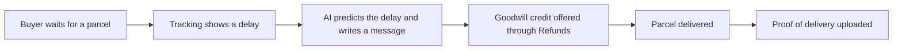

# #21 Proactive INR Deflector

> [!tldr] In one breath
> Watches parcel tracking and messages buyers before "item not received" worry turns into a dispute. Score 67. **Eliminated** with kill code K2: the market already solved this.

> [!example] Picture this
> You order a gift and the parcel stalls for three days. You get nervous and file a dispute. If the shop had texted "Your parcel is delayed by the courier, here is a $3 credit, we are on it," you would have relaxed. This idea is that calm, early text, plus automatic proof of delivery once the parcel lands.

> [!success] Crowd check, Oct 23 2026
> Thin in the 266 repo scan (partial coverage): no repo was seen focused on item not received prevention. The scan lists close cousins in the dispute area (subguard, returngate, clippay). Outside the scan, the deep research note says post purchase tracking messaging is a mature market (AfterShip, Route, Narvar, parcelLab).

**Theme:** E3 Evidence economy · **Group:** Evidence economy · **Crowding on Devpost:** none on Devpost; mature market

## What the kill code means
**K2 means "too crowded, or sounds like something already out there, so we cannot defend that it is new."** Here the crowd is real companies, not hackathon entries. See [[41 Brutal Elimination]].

## The problem
INR (item not received) disputes cost fees and hurt dispute ratios even when the parcel is simply late.

## The idea
A tracking aware agent sends proactive updates, offers small goodwill credits when delays pass set limits, and uploads proof of delivery when the parcel arrives.

**Who it is for:** e-commerce small businesses.

**What the AI does:** predicts delays and personalises the messages.

## How PayPal is used
Tracking API. Refunds (goodwill). Disputes send message.

**Building blocks used** (see [[30 Primitives Legend]]):
* `P17` Shipment Tracking API (add tracking, releases holds)
* `P16` Refunds (full or partial)
* `P14` Disputes API (get, messages, make offer, accept offer, provide evidence)
* `A04` Forecasting and pricing suggestion
* `A12` Eligibility reasoning and messaging

## Who else is doing this
AfterShip, Route, Narvar, parcelLab. Post purchase tracking messages are a mature category.

**Verification status:** ⚠️ desk research only. The competitor names come from landscape and Devpost scans, not from a per idea novelty hunt. Treat "no competitor found" as unproven.

## What makes it different
It knows about PayPal disputes, but it is mostly known ground.

## Can we build it?
High.

## Demo plan (MVP)
Simulated delays and messages.

## Risks
Low novelty.

## Sources
* [PayPal Add Tracking API: "fastest way to access on hold funds"](https://developer.paypal.com/api/tracking/track-orders/integrate.md) ✅

## Scores
"Risk⁻¹" means a higher number is a safer idea.

| Axis | Weight | Desk score |
|---|---|---|
| Tech | ×2 | 6 |
| Design | ×2 | 6 |
| Impact | ×2 | 5 |
| Innovation | ×2 | 3 |
| Demo | ×2 | 5 |
| Feasibility | ×1 | 9 |
| Risk⁻¹ | ×1 | 8 |
| **Total /120** | | **67** |

_Why (desk):_ The market already solved this.

**Kill codes triggered:** `K2` Crowded cluster or derivative headline; innovation cannot be defended. See [[41 Brutal Elimination]].

> [!info]- Jargon decoder
> **INR**: Item Not Received. A buyer says the parcel never came.
> **Dispute ratio**: the share of a merchant's orders that become disputes. High numbers make payment companies nervous.
> **Tracking API**: lets a seller tell PayPal where a parcel is.
> **Goodwill credit**: a small gift of money to say sorry for a delay.
> **Proof of delivery**: a carrier record showing the parcel arrived.
> **Forecasting**: predicting what will happen next, like a weather forecast for parcels.

## Where to next
* ⬆️ Up: [[Idea Index]]
* ⬅️ Previous: [[I020 Dispute-to-Listing Fixer]] · ➡️ Next: [[I022 Don't Recognize This Charge Resolver]]
* 🧭 Theme: [[Theme E3 Evidence economy]]
* 🔗 Related: [[41 Brutal Elimination]], [[00 PayPal AI Hackathon Hub]]
