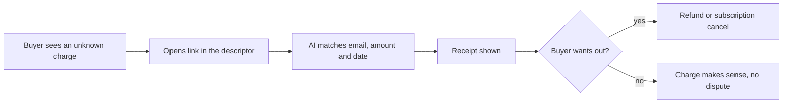

# #22 "Don't Recognize This Charge" Resolver

> [!tldr] In one breath
> A buyer facing lookup page, reachable from the short text on their statement, that identifies the purchase and offers cancel or refund before the buyer calls their bank. Score 81 (desk only). Practical, with moderate novelty.

> [!example] Picture this
> Your statement says "SUBSCR*PLANX 8.99" and you have no idea what it is. Your first thought is "fraud," so you call the bank. Now imagine the statement text includes a short link. You open it, type your email, and see "Plan X annual, bought 12 March, here is your receipt, cancel or refund?" You tap refund and the bank never hears about it. The merchant is relieved too, since a dispute costs more than a refund.

> [!warning] Crowd check, Oct 23 2026
> Some crowd nearby. The scan found about 16 dispute and chargeback copilots (witness, dispute-defender, dispute-copilot and others) plus subscription adjacent repos (subguard, subscription-killer). A buyer facing lookup tied to the statement descriptor was not seen. Card networks run this at the issuer side (Ethoca, Verifi), not for PayPal small merchants.

**Theme:** E3 Evidence economy · **Group:** Evidence economy · **Crowding on Devpost:** Disputes cluster

## The problem
**Unrecognised statement descriptors drive friendly fraud disputes,** and Reddit merchants report buyers dispute before ever contacting them.

## The idea
A short URL in the soft descriptor leads to a chat style lookup by email, amount and date. It shows the receipt and offers cancel or refund under the merchant's rules.

**Who it is for:** subscription and digital merchants.

**What the AI does:** fuzzy matches the order, and resolves the case in conversation within policy.

## How PayPal is used
Orders soft_descriptor. Transaction Search. Refunds. Subscriptions cancel.

**Building blocks used** (see [[30 Primitives Legend]]):
* `P31` custom_id / invoice_id metadata binding
* `P18` Transaction Search and Reporting
* `P16` Refunds (full or partial)
* `P07` Subscriptions (revise, suspend, payment failed events)
* `A06` Entity matching and narrative drafting
* `A16` Policy and rule reasoning with cited clauses

## Who else is doing this
Ethoca Consumer Clarity, Verifi Order Insight. Card networks run issuer side order insight programmes. They are not for PayPal small merchants' own descriptors.

**Verification status:** ⚠️ desk research only. The competitor names come from landscape and Devpost scans, not from a per idea novelty hunt. Treat "no competitor found" as unproven.

## What makes it different
A deflection page the merchant owns.

## Can we build it?
High.

## Demo plan (MVP)
A lookup page and a refund in the sandbox.

## Risks
Moderate novelty.

## Sources
* [Chargebacks911 2026 Field Report: small businesses represent only 60.3%; evidence collection is the number 1 pain](https://chargebacks911.com/chargeback-field-report/) ✅
* [Mastercard and Datos 2025 State of Chargebacks: 261M to 324M by 2028; 45% fraudulent](https://www.mastercard.com/us/en/news-and-trends/Insights/2025/2025-global-chargebacks-outlook.html) ✅

## Scores
"Risk⁻¹" means a higher number is a safer idea.

| Axis | Weight | Desk score |
|---|---|---|
| Tech | ×2 | 7 |
| Design | ×2 | 7 |
| Impact | ×2 | 7 |
| Innovation | ×2 | 5 |
| Demo | ×2 | 6 |
| Feasibility | ×1 | 9 |
| Risk⁻¹ | ×1 | 8 |
| **Total /120** | | **81** |

_Why (desk):_ Practical, with moderate novelty.

**Kill codes:** none triggered.

> [!info]- Jargon decoder
> **Soft descriptor**: the short text that appears on your bank statement for a purchase, like a name tag on the charge.
> **Friendly fraud**: a real buyer who disputes a charge they actually made, often because they did not recognise it.
> **Fuzzy matching**: finding the right record even when details are a little off, like finding a friend in a photo when they changed their hair.
> **Transaction Search**: PayPal's lookup for past payments.
> **Subscriptions cancel**: ending a repeating payment.
> **Order insight programme**: a card network service that shows the bank what was bought, so the customer can recognise it.

## Where to next
* ⬆️ Up: [[Idea Index]]
* ⬅️ Previous: [[I021 Proactive INR Deflector]] · ➡️ Next: [[I023 Seller Protection Preflight]]
* 🧭 Theme: [[Theme E3 Evidence economy]]
* 🔗 Related: [[00 PayPal AI Hackathon Hub]]
