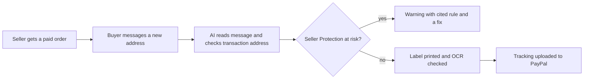

# #23 Seller Protection Preflight

> [!tldr] In one breath
> Before a seller ships, AI checks every PayPal Seller Protection condition and catches the "please ship to my cousin's address" scam. Desk 97, post deep dive 89. Verdict: **advance with changes**. It is a strong, concrete idea, but a near duplicate repo exists in the live scan.

> [!example] Picture this
> Rosa sells handmade candles on PayPal. A buyer pays, then messages "can you ship to my cousin's place instead? I am in a hurry." Rosa agrees. The package is delivered, the buyer disputes the payment, and PayPal says "Seller Protection is void, you shipped to a different address than the one on file." Rosa loses the money and the candles. Now imagine a pilot's preflight checklist that flags the cousin message and the address mismatch before the box is taped shut.

> [!warning] Crowd check, Oct 23 2026
> Closest match in the whole scan: preflight-for-paypal, a SELLER PROTECTION CHECKER, is a near duplicate of this idea. The wider dispute area is also crowded (about 16 dispute and chargeback copilots such as witness, dispute-defender, dispute-copilot, and close cousins subguard, returngate, clippay). The earlier Devpost check found no overlap in about 144 entries, so this changed since then. Plan a clear difference (scam message reading, label OCR, tracking upload that releases holds) or expect a side by side comparison.

**Theme:** E3 Evidence economy · **Group:** Evidence economy · **Crowding on Devpost:** none (at the time of the first check)

## The problem
**Seller Protection is voided if the seller ships anywhere other than the address on the Transaction Details page, or if a buyer arranged shipment is redirected.** Scammers exploit this by messaging new addresses. Sellers often learn the rules only after losing.

## The idea
For each paid order the tool:
* pulls the transaction address
* reads buyer messages for address change or off platform requests
* checks the proof of delivery needed for the carrier and value
* flags violations
* uploads tracking when the label is created

**Who it is for:** small sellers on PayPal (marketplace and social commerce).

**What the AI does:** detects message intent (address change, urgency, paying off platform), reasons over the rules with cited policy clauses, and reads labels with OCR.

## How PayPal is used
Orders and transaction details (shipping address). Tracking API. Disputes evidence later. Seller Protection policy.

**Building blocks used** (see [[30 Primitives Legend]]):
* `P32` Seller Protection policy rules
* `P17` Shipment Tracking API (add tracking, releases holds)
* `P18` Transaction Search and Reporting
* `P01` Orders v2 (create, capture, get)
* `A05` Structured decision and classification (most common)
* `A01` Document and image extraction (OCR, validation)
* `A16` Policy and rule reasoning with cited clauses

## Who else is doing this
ShipStation, Shippo.

Shipping tools check that an address can be delivered to, not whether it meets PayPal Seller Protection rules or matches scam patterns. No direct competitor was found in the desk and deep dive research (but see the crowd check above).

**Verification status:** adversarially deep dived. Full competitor table: [[D023 Seller Protection Preflight (Deep Dive)]].

## What makes it different
It turns a dense PayPal policy into an automatic preflight. It is prevention, not fighting a case after the fact.

## Can we build it?
High. The rules are public and messages can be simulated.

## Demo plan (MVP)
Three orders (clean; address change scam; high value without enough proof) with preflight verdicts and fixes.

## Risks
Policy varies by region (the US version is used). The tool must not give legal guarantees.

## Sources
* [PayPal Seller Protection Program (ship to address rule, SNAD excluded, intangibles evidence)](https://www.paypal.com/us/legalhub/paypal/seller-protection) ✅
* [PayPal Add Tracking API: "fastest way to access on hold funds"](https://developer.paypal.com/api/tracking/track-orders/integrate.md) ✅
* [UK Finance Annual Fraud Report 2026: APP £576.4M; 175,809 purchase scams](https://www.ukfinance.org.uk/system/files/2026-06/UK%20Finance%20Fraud%20Report%202026.pdf) ✅
* [FTC Consumer Sentinel Data Book 2024](https://www.ftc.gov/system/files/ftc_gov/pdf/csn-annual-data-book-2024.pdf) ✅

## Scores
"Risk⁻¹" means a higher number is a safer idea.

| Axis | Weight | Desk score | Post deep dive |
|---|---|---|---|
| Tech | ×2 | 8 | 8 |
| Design | ×2 | 8 | 8 |
| Impact | ×2 | 8 | 6 |
| Innovation | ×2 | 8 | 7 |
| Demo | ×2 | 8 | 8 |
| Feasibility | ×1 | 9 | 8 |
| Risk⁻¹ | ×1 | 8 | 7 |
| **Total /120** | | **97** | **89** |

_Why (desk):_ A concrete PayPal specific prevention tool with scam relevance. No competitor found.

**Kill codes:** none triggered.

## Deep dive verdict: advance with changes
**A before shipping gate for PayPal Seller Protection:** real API signals, plus AI that reads "ship to my cousin" messages and reads labels with OCR. Advance, paired with the tracking upload that releases holds. Drop the signature claim and fill in the scam evidence.

_What changed the score:_ Primary verified: the US (Jan 2026) and UK (Jul 2026) terms require shipping to the Transaction Details address, void protection on redirect, recommend against buyer arranged shipping, and exclude SNAD. There is NO signature or value threshold, so drop that claim. The APIs are confirmed in OpenAPI: Orders v2 purchase_units[].shipping, capture seller_protection.status and dispute_categories, Transaction Search shipping_info, protection_eligibility, address_status and transaction_note, plus Orders track. Impact is lowered: no quantified scam frequency and no verified user voices. Innovation is lowered slightly because the competitor hunt was incomplete (search budget used up) and label from order printing already enforces the address implicitly. No Devpost overlap was seen in about 144 entries.

> [!info]- Jargon decoder
> **Preflight**: a checklist run before takeoff. Here, before shipping.
> **Seller Protection**: PayPal's promise to cover a seller's loss in some disputes, but only if they follow its rules.
> **Transaction Details address**: the shipping address PayPal recorded for the payment. Shipping anywhere else voids protection.
> **SNAD**: Significantly Not As Described. These claims are excluded from Seller Protection.
> **OCR**: software that reads text from a photo of a label.
> **Proof of delivery**: a carrier record showing the parcel arrived at the right place.
> **Tracking API**: lets a seller tell PayPal where a parcel is. PayPal says it is the fastest way to free held funds.
> **APP scam**: authorised push payment scam, where the victim is tricked into sending the money themselves.
> **OpenAPI**: the official public description of an API, like its instruction manual.

## Where to next
* ⬆️ Up: [[Idea Index]]
* ⬅️ Previous: [[I022 Don't Recognize This Charge Resolver]] · ➡️ Next: [[I024 Support-Ticket Dispute Early Warning]]
* 🧭 Theme: [[Theme E3 Evidence economy]]
* 🔬 Deep dive: [[D023 Seller Protection Preflight (Deep Dive)]]
* 🔗 Related: [[I016 Dispute EV Triage]], [[00 PayPal AI Hackathon Hub]]
