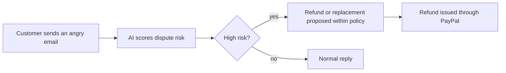

# #24 Support-Ticket Dispute Early Warning

> [!tldr] In one breath
> Reads incoming customer emails for signs that a dispute is coming, and fixes the risky cases early. Score 71. **Eliminated** with kill code K2: it sits too close to what help desk tools already do.

> [!example] Picture this
> A customer emails: "This is the third time my order is late. I am done." The shop owner is busy and does not reply. Two days later a dispute lands. This idea is a lookout who spots that angry email on day one and says "refund half now, or send a replacement," before the buyer ever opens a dispute.

> [!warning] Crowd check, Oct 23 2026
> Mixed. The dispute copilot area is busy (about 16 repos in the scan, such as witness, dispute-defender, dispute-copilot, dispute-radar), though those mostly react to disputes already filed. Early warning from support emails was not specifically seen. Real world help desk tools (Gorgias, Zendesk AI) already triage sentiment.

**Theme:** E3 Evidence economy · **Group:** Evidence economy · **Crowding on Devpost:** none

## What the kill code means
**K2 means "too crowded, or sounds like something already out there, so we cannot defend that it is new."** The "incumbent adjacent" reason here means big help desk products live right next door. See [[41 Brutal Elimination]].

## The problem
Many disputes are preceded by frustrated messages the merchant did not act on.

## The idea
Classify support messages for dispute risk. Propose refunds or replacements within policy before the buyer files.

**Who it is for:** small merchants.

**What the AI does:** classifies intent and drafts replies.

## How PayPal is used
Refunds. Orders lookup. Disputes analytics.

**Building blocks used** (see [[30 Primitives Legend]]):
* `P16` Refunds (full or partial)
* `P18` Transaction Search and Reporting
* `A05` Structured decision and classification (most common)
* `A12` Eligibility reasoning and messaging

## Who else is doing this
Gorgias, Zendesk AI. Help desk AI tools triage sentiment broadly.

**Verification status:** ⚠️ desk research only. The competitor names come from landscape and Devpost scans, not from a per idea novelty hunt. Treat "no competitor found" as unproven.

## What makes it different
A dispute risk lens.

## Can we build it?
High.

## Demo plan (MVP)
An inbox of 10 messages, triaged, with refunds issued.

## Risks
Help desk incumbents.

## Sources
* [Chargebacks911 2026 Field Report: small businesses represent only 60.3%; evidence collection is the number 1 pain](https://chargebacks911.com/chargeback-field-report/) ✅

## Scores
"Risk⁻¹" means a higher number is a safer idea.

| Axis | Weight | Desk score |
|---|---|---|
| Tech | ×2 | 6 |
| Design | ×2 | 6 |
| Impact | ×2 | 6 |
| Innovation | ×2 | 4 |
| Demo | ×2 | 5 |
| Feasibility | ×1 | 9 |
| Risk⁻¹ | ×1 | 8 |
| **Total /120** | | **71** |

_Why (desk):_ Incumbent adjacent.

**Kill codes triggered:** `K2` Crowded cluster or derivative headline; innovation cannot be defended. See [[41 Brutal Elimination]].

> [!info]- Jargon decoder
> **Support ticket**: a customer's message to a shop's help team.
> **Intent classification**: AI deciding what a message is really about, such as "angry and about to dispute".
> **Triage**: sorting by urgency, like an emergency room.
> **Help desk tools**: software for managing customer support, such as Gorgias and Zendesk.
> **Dispute analytics**: statistics about a shop's disputes.
> **Within policy**: following the shop's own refund rules.

## Where to next
* ⬆️ Up: [[Idea Index]]
* ⬅️ Previous: [[I023 Seller Protection Preflight]] · ➡️ Next: [[I025 Hold Release Copilot]]
* 🧭 Theme: [[Theme E3 Evidence economy]]
* 🔗 Related: [[41 Brutal Elimination]], [[00 PayPal AI Hackathon Hub]]
