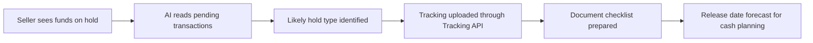

# #25 Hold Release Copilot

> [!tldr] In one breath
> Explains why a seller's PayPal funds are held, lists exactly what will release them, and forecasts the release date so the seller can plan their cash. Score 79 (desk only). It targets the biggest PayPal specific pain, but the sandbox cannot create real holds.

> [!example] Picture this
> Ana just started selling vintage jackets online. She made $2,000 this week, but PayPal shows "funds on hold" and she cannot pay her supplier. She has no idea why or for how long. Think of a patient waiting for test results with nobody explaining anything. The copilot is the friendly nurse: "Your hold is because you are a new seller and tracking is missing. I uploaded the tracking for you. Expect release around the 14th."

> [!success] Crowd check, Oct 23 2026
> Looked empty or thin in the 266 repo scan (partial coverage): no repo was seen explaining or releasing seller fund holds. The earlier Devpost check did find an entry called HoldWatch, so it is not fully empty. The repos named holdfast and trustrail-hold are escrow tools, not hold explainers.

**Theme:** E4 Locked money & cash-flow · **Group:** Locked money · **Crowding on Devpost:** HoldWatch on Devpost

## The problem
**"Trouble accessing funds" was the number 1 issue in 2025 CFPB complaints about PayPal** (1,276 of 7,464). Trustpilot sits at 1.4 out of 5. Sellers do not know what will release a hold.

## The idea
The copilot reads pending transactions, identifies the likely hold type (new seller, risk, tracking missing), and automatically uploads tracking through the Tracking API (PayPal's own docs call this the fastest way to release on hold funds). It prepares document checklists and forecasts release dates.

**Who it is for:** new and fast growing sellers.

**What the AI does:** guesses the hold type, explains it in plain words, forecasts cash, and writes document checklists.

## How PayPal is used
Tracking API. Transaction Search (status). Shipment tracking. Disputes context.

**Building blocks used** (see [[30 Primitives Legend]]):
* `P17` Shipment Tracking API (add tracking, releases holds)
* `P18` Transaction Search and Reporting
* `A04` Forecasting and pricing suggestion
* `A12` Eligibility reasoning and messaging
* `A01` Document and image extraction (OCR, validation)

## Who else is doing this
Resolution services and consultants. No software product was found. Sellers rely on forums, CFPB complaints and consultants.

**Verification status:** ⚠️ desk research only. The competitor names come from landscape and Devpost scans, not from a per idea novelty hunt. Treat "no competitor found" as unproven.

## What makes it different
It is framed to reduce PayPal's own support load, and it tackles PayPal's biggest pain.

## Can we build it?
Medium. Holds cannot be created in the sandbox, so hold states must be modelled.

## Demo plan (MVP)
Simulated held transactions, real tracking uploads and a forecast.

## Risks
A sensitive topic for PayPal judges. Part of the demo is simulated.

## Sources
* [CFPB complaint database: PayPal 2025 had 7,464; number 1 was "trouble accessing funds" at 1,276](https://www.consumerfinance.gov/data-research/consumer-complaints/) ✅
* [Trustpilot paypal.com: 1.4 out of 5, 41,843 reviews](https://www.trustpilot.com/review/www.paypal.com) ✅
* [PayPal funds availability: holds up to 21 days](https://www.paypal.com/us/brc/article/funds-availability) ✅
* [PayPal Add Tracking API: "fastest way to access on hold funds"](https://developer.paypal.com/api/tracking/track-orders/integrate.md) ✅

## Scores
"Risk⁻¹" means a higher number is a safer idea.

| Axis | Weight | Desk score |
|---|---|---|
| Tech | ×2 | 6 |
| Design | ×2 | 7 |
| Impact | ×2 | 9 |
| Innovation | ×2 | 6 |
| Demo | ×2 | 6 |
| Feasibility | ×1 | 6 |
| Risk⁻¹ | ×1 | 5 |
| **Total /120** | | **79** |

_Why (desk):_ The strongest PayPal specific pain, held back by sandbox realism.

**Kill codes:** none triggered.

> [!info]- Jargon decoder
> **Hold (on funds)**: PayPal keeps a seller's money locked for a while, like a bank holding a big cheque until it clears.
> **CFPB**: the US Consumer Financial Protection Bureau, where people file complaints about financial companies.
> **Tracking API**: lets a seller tell PayPal where a parcel is. This is the fastest way to free held funds.
> **Transaction Search**: PayPal's lookup for past payments and their status.
> **Cash flow forecast**: a prediction of when money will arrive, like knowing exactly when payday lands.
> **Sandbox**: PayPal's practice playground with fake money. It cannot create real holds, so we model them.
> **OCR**: software that reads text from documents and photos.

## Where to next
* ⬆️ Up: [[Idea Index]]
* ⬅️ Previous: [[I024 Support-Ticket Dispute Early Warning]] · ➡️ Next: [[I026 Tracking Courier]]
* 🧭 Theme: [[Theme E4 Locked money & cash-flow]]
* 🔗 Related: [[00 PayPal AI Hackathon Hub]]
