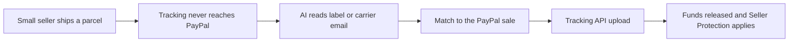

# #26 Tracking Courier

> [!tldr] In one breath
> Reads shipping labels and carrier emails and pushes tracking to PayPal automatically, so holds release and Seller Protection applies. It is a useful small tool, but on its own it is not a hackathon winner (desk score 72 out of 120).

> [!example] Picture this
> Maya sells handmade candles from her kitchen. She ships a box, but forgets to tell PayPal the tracking number. Her $180 stays locked for days, and when a buyer says "never arrived", she has no proof. Tracking Courier is like a helpful assistant who watches her inbox, spots the shipping email, and slips the tracking number to PayPal before she even thinks about it.

> [!success] Crowd check, Oct 23 2026
> In a scan of 266 live hackathon repos (partial coverage), nothing matched this idea. The closest areas are the dispute helpers and invoicing tools, which do something different. The area looked empty.

**Theme:** [[Theme E4 Locked money & cash-flow|E4 Locked money and cash flow]] · **Group:** Locked money · **Crowding on Devpost:** none

## The problem
Sellers who do not add tracking wait longer for held funds. They also lose cases where they cannot prove the item was delivered.

## The idea
Read the label or email, match it to the right PayPal sale, upload the tracking, and keep watching until it says delivered. **The key point: zero setup for small sellers who ship without a big platform.**

## Who it is for
Small sellers shipping without integrated platforms.

## What the AI does
OCR (reading text from a photo) and extraction, plus matching each parcel to the right transaction.

## What PayPal does
Tracking API and Transaction Search.

**Building blocks used** (see [[30 Primitives Legend]]):
* `P17` Shipment Tracking API (add tracking; releases holds)
* `P18` Transaction Search / Reporting
* `A01` Document / image extraction (OCR, validation)

## Who else is doing this
ShipStation, Shippo, Veeqo. Shipping platforms sync tracking for stores that use them. Long tail sellers without them do it by hand.

⚠️ **Verification status:** desk research only. Competitor names come from the landscape and Devpost scans, not from a per idea novelty hunt. Treat "no competitor found" as unproven.

## What makes it different
A zero integration path and a small scope.

## Can we build it?
High feasibility.

## Smallest demo
Forward a label email, and the tracking gets uploaded in the sandbox (PayPal's practice environment).

## Risks
It is feature sized, and integrated platforms already do it.

## Sources
* [PayPal Add Tracking API: "fastest way to access on-hold funds"](https://developer.paypal.com/api/tracking/track-orders/integrate.md) ✅
* [PayPal funds availability, holds up to 21 days](https://www.paypal.com/us/brc/article/funds-availability) ✅

## Scores
| Axis | Weight | Desk score |
|---|---|---|
| Tech | ×2 | 6 |
| Design | ×2 | 6 |
| Impact | ×2 | 6 |
| Innovation | ×2 | 4 |
| Demo | ×2 | 5 |
| Feasibility | ×1 | 9 |
| Risk⁻¹ | ×1 | 9 |
| **Total /120** | | **72** |

_Why (desk):_ Useful utility, not a hackathon winner alone.

**Kill criteria:** none triggered. This idea survived the culling round.

> [!info]- Jargon decoder
> **Tracking API**: a doorway where software hands PayPal a parcel number. Like giving the receptionist your delivery receipt so she knows the package is on its way.
> **Hold on funds**: PayPal keeps your sale money for a while until it trusts the sale. Like a shop that keeps a deposit until the item is safely handed over.
> **Seller Protection**: PayPal's promise to back a seller in some disputes, if the seller can prove delivery.
> **OCR**: software that reads printed text in a photo, like a scanner that can read a label out loud.
> **Transaction Search**: a lookup tool for past sales, like a search bar on your bank history.
> **Sandbox**: a pretend PayPal where no real money moves, like a flight simulator.
> **Long tail sellers**: the huge crowd of small shops that no big platform serves.

## Where to next
* ⬆️ Up: [[Idea Index]]
* ⬅️ Previous: [[I025 Hold Release Copilot]] · ➡️ Next: [[I027 Account Health Sentinel]]
* 🧭 Theme: [[Theme E4 Locked money & cash-flow]]
* 🔗 Related: [[30 Primitives Legend]], [[17 Live Competition Scan (Oct 23)]], [[Jargon Decoder]], [[00 PayPal AI Hackathon Hub]]
