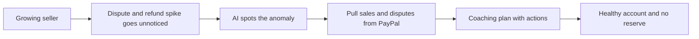

# #27 Account Health Sentinel

> [!tldr] In one breath
> Watches dispute, refund and volume signals and coaches a seller back to healthy before PayPal's risk systems step in. Plausible, but speculative, because nobody outside PayPal knows its real thresholds (desk score 78 out of 120).

> [!example] Picture this
> Dev runs a growing sneaker shop. One busy week brings a spike in refunds and three disputes. Two weeks later PayPal puts a reserve on his money and he cannot pay his supplier. Account Health Sentinel is like a fitness watch for his account. It buzzes when his heart rate climbs and says "slow down, add tracking, fix your refund policy".

> [!success] Crowd check, Oct 23 2026
> In a scan of 266 live hackathon repos (partial coverage), no repo watched seller account health. The nearest neighbours are dispute helpers such as dispute-radar (LightGBM), which react to disputes rather than prevent limits. The area looked thin.

**Theme:** [[Theme E4 Locked money & cash-flow|E4 Locked money and cash flow]] · **Group:** Locked money · **Crowding on Devpost:** none

## The problem
Limitations and reserves often follow spikes in disputes or volume that sellers did not notice.

## The idea
The tool computes rolling dispute and refund ratios and volume spikes from PayPal data. It explains which behaviours raise risk and suggests fixes such as adding tracking, clearer descriptors and a better refund policy. **The key point: it prevents the freeze instead of reacting after it.**

## Who it is for
Growing small business sellers.

## What the AI does
Anomaly detection and a coaching narrative.

## What PayPal does
Transaction Search, the Disputes list and merchant insights.

**Building blocks used** (see [[30 Primitives Legend]]):
* `P18` Transaction Search / Reporting
* `P14` Disputes API (get, messages, make-offer, accept-offer, provide-evidence)
* `P19` Merchant insights / balances
* `A15` Anomaly detection
* `A12` Eligibility reasoning and messaging

## Who else is doing this
Chargeflow Insights. Card ratio monitors exist (VAMP and ECM tools), but none for PayPal account health.

⚠️ **Verification status:** desk research only. Competitor names come from the landscape and Devpost scans, not from a per idea novelty hunt. Treat "no competitor found" as unproven.

## What makes it different
It is preventive. But scoring PayPal's hidden risk model is speculative.

## Can we build it?
Medium.

## Smallest demo
Seeded data with a spike, then alerts, then actions.

## Risks
We cannot know PayPal's real thresholds, so the advice could mislead.

## Sources
* [CFPB complaint DB: PayPal 2025 had 7,464 complaints; the top one, "trouble accessing funds", had 1,276](https://www.consumerfinance.gov/data-research/consumer-complaints/) ✅
* [Chargeflow: agent disputes do not fit reason codes; VAMP thresholds](https://www.chargeflow.io/blog/agentic-commerce-regulation-what-merchants-need-to-know) ⚠️

## Scores
| Axis | Weight | Desk score |
|---|---|---|
| Tech | ×2 | 6 |
| Design | ×2 | 7 |
| Impact | ×2 | 7 |
| Innovation | ×2 | 6 |
| Demo | ×2 | 6 |
| Feasibility | ×1 | 8 |
| Risk⁻¹ | ×1 | 6 |
| **Total /120** | | **78** |

_Why (desk):_ Plausible but speculative.

**Kill criteria:** none triggered. This idea survived the culling round.

> [!info]- Jargon decoder
> **Limitation or reserve**: PayPal restricts an account or holds back part of the money. Like a bank freezing your card after odd activity.
> **Dispute ratio**: disputes divided by sales. Like the share of restaurant meals sent back to the kitchen.
> **Velocity**: how fast your sales volume changes. A sudden jump looks suspicious, like a quiet shop with a queue round the block.
> **Anomaly detection**: software that notices when today looks unlike normal. Like a smoke alarm for numbers.
> **VAMP / ECM**: card network programs that watch merchants' dispute levels.
> **Descriptor**: the name that shows on a buyer's card statement. A confusing one causes "I don't recognise this" disputes.
> **Transaction Search**: a lookup for past sales.

## Where to next
* ⬆️ Up: [[Idea Index]]
* ⬅️ Previous: [[I026 Tracking Courier]] · ➡️ Next: [[I028 Early-Pay Discount Optimizer]]
* 🧭 Theme: [[Theme E4 Locked money & cash-flow]]
* 🔗 Related: [[30 Primitives Legend]], [[17 Live Competition Scan (Oct 23)]], [[Jargon Decoder]], [[00 PayPal AI Hackathon Hub]]
