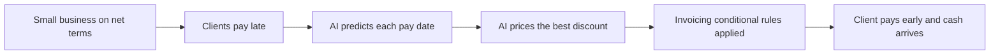

# #28 Early-Pay Discount Optimizer

> [!tldr] In one breath
> Sets a different early payment discount for each client on PayPal invoices, priced against what waiting really costs the merchant. It survived a deep dive with changes, dropping from 93 to 85 out of 120.

> [!example] Picture this
> Priya designs logos. Client A always pays in 10 days, Client B takes 60. She needs cash now for rent. The tool offers Client A nothing (no need) and offers Client B 3 percent off if they pay within a week. Client B takes it, and Priya has rent money. It is like a shop giving a bigger "pay now" discount to the customer who would otherwise take forever.

> [!warning] Crowd check, Oct 23 2026
> The invoice chasing area is busy: about 25 repos in a 266 repo scan (partial coverage), such as chaser, owed, duespilot (an AR agent that negotiates with a client's AP agent), ledgerbird and invoicepilot. Most chase late payers. None found optimise a per client discount, so this angle looks less crowded than the cluster around it.

**Theme:** [[Theme E4 Locked money & cash-flow|E4 Locked money and cash flow]] · **Group:** Locked money · **Crowding on Devpost:** Invoice chasing cluster (about 4) nearby

## The problem
59% of US small businesses have invoices 30+ days overdue and are owed $17.7K on average. 26% delayed their own salary because of processing delays.

## The idea
The AI predicts when each client will pay and works out the discount that gives the merchant the best expected result, given how badly the merchant needs cash. It writes that discount into the PayPal invoice using conditional rules (early payment discount and auto cancel), then explains the trade to the client. **The key point: enterprise style dynamic discounting, brought to small invoices.**

## Who it is for
Small B2B businesses and freelancers on net terms.

## What the AI does
Pay date forecasting, discount optimisation and client specific messages.

## What PayPal does
Invoicing v2, including create_conditional_rules_for_invoice, auto reminders and record_payment. Pay Later on invoice payments. Webhooks.

**Building blocks used** (see [[30 Primitives Legend]]):
* `P08` Invoicing v2 (create, send, partial payment)
* `P09` Invoicing conditional rules (early-payment discount, auto-cancel)
* `P10` Invoicing recurring series / record payment
* `P23` Pay Later messaging
* `P20` Webhooks (events, retries, verification)
* `A04` Forecasting / pricing suggestion
* `A12` Eligibility reasoning and messaging

## Who else is doing this
C2FO, Taulia, Upflow, Chaser. Dynamic discounting exists for big company supply chains (C2FO, Taulia). Small business AR tools send reminders but do not optimise conditional discounts on PayPal invoices.

**Verification status:** adversarially deep dived (6+ differently phrased searches per idea). Full competitor table: [[D028 Early-Pay Discount Optimizer (Deep Dive)]].

## What makes it different
It brings enterprise dynamic discounting to small invoices through a PayPal feature almost nobody uses.

## Can we build it?
High. Conditional rules are in agent toolkit v1.11.

## Smallest demo
Three clients with different histories get three different discounts. One pays early, and the cash gap chart updates.

## Risks
AG Grid suggests an "unpaid invoice nudge bot", so invoice chasing will be common. Conditional rule behaviour must be verified in the sandbox.

## Deep dive verdict: advance with changes
It survives as an AI priced, per client early pay discount (cost of waiting maths) written natively into PayPal invoice conditional rules. It must pass a day 1 payer view test.

_Why the score changed:_ The conditional rules endpoint is confirmed in public Invoicing v2 docs and agent toolkit v1.11 (EARLY_PAYMENT_DISCOUNT and AUTO_CANCEL, PERCENT or AMOUNT, expiry enums). But an "invoicing/internal" scope is listed, and what the payer sees and whether the discount applies automatically is undocumented, so day 1 means a sandbox test. Chaser already applies per debtor automatic discounts in its portal. Zoho, Upflow, C2FO, Taulia and AP side AI discount agents exist, so innovation went down. The core loop is Invoicing only, so tech went down. Evidence that discounts get taken is from vendor or snippet sources only.

## Sources
* [QuickBooks 2026 Late Payments Report: 59% have 30+ day overdue; $17.7K owed](https://quickbooks.intuit.com/r/small-business-data/small-business-late-payments-report-2026/) ✅
* [paypal/agent-toolkit (46 tools, v1.11.0)](https://github.com/paypal/agent-toolkit) ✅
* [Devpost AG Grid sponsor page (criteria, suggested ideas)](https://paypalaihackathon.devpost.com/details/aggrid) ✅

## Scores
| Axis | Weight | Desk score | After deep dive |
|---|---|---|---|
| Tech | ×2 | 8 | 7 |
| Design | ×2 | 8 | 8 |
| Impact | ×2 | 8 | 7 |
| Innovation | ×2 | 7 | 6 |
| Demo | ×2 | 7 | 7 |
| Feasibility | ×1 | 9 | 8 |
| Risk⁻¹ | ×1 | 8 | 7 |
| **Total /120** | | **93** | **85** |

_Why (desk):_ Strong evidence and an underused PayPal capability.

**Kill criteria:** none triggered. This idea survived the culling round.

> [!info]- Jargon decoder
> **Net terms**: "pay within 30 days" type deals. Like a tab at a cafe that you settle at month end.
> **Dynamic discounting**: the discount shrinks the longer you wait. Like a "buy today, save more" sale.
> **Conditional rules (Invoicing)**: if this, then that, written into an invoice. Like a coupon that expires on a date.
> **AR / AP**: accounts receivable is money owed to you; accounts payable is money you owe.
> **Pay Later**: lets the payer split the cost over time while the merchant still gets paid in full.
> **Webhooks**: PayPal texting your app "that invoice was paid". Like a doorbell for software.
> **Sandbox**: a pretend PayPal for testing.
> **Cost of waiting**: what a late payment costs you, such as missed rent or a loan fee.

## Where to next
* ⬆️ Up: [[Idea Index]]
* ⬅️ Previous: [[I027 Account Health Sentinel]] · ➡️ Next: [[I029 Payer-Side Pay Later Collections]]
* 🧭 Theme: [[Theme E4 Locked money & cash-flow]]
* 🔬 Deep dive: [[D028 Early-Pay Discount Optimizer (Deep Dive)]]
* 🔗 Related: [[30 Primitives Legend]], [[17 Live Competition Scan (Oct 23)]], [[Jargon Decoder]], [[00 PayPal AI Hackathon Hub]]
