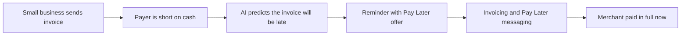

# #29 Payer-Side Pay Later Collections

> [!tldr] In one breath
> When an invoice looks likely to go late, the payer gets a Pay Later offer. The merchant is paid in full now, and the payer spreads the cost. It overlaps idea 28 and scored 69 out of 120.

> [!example] Picture this
> A dog groomer sends a $400 invoice to a customer who is short on cash this month. Normally she waits six weeks. With this tool, the reminder says "you can pay this in smaller steps". The customer agrees, the groomer gets all $400 right away, and the customer pays in pieces. It is like a shop saying "take it home today, pay over time" while the shop still gets its full price.

> [!warning] Crowd check, Oct 23 2026
> Invoicing is a crowded area: about 25 repos in a 266 repo scan (partial coverage), such as invoicepilot, chaser, duespilot, ledgerbird and docket. Pay Later as a core feature was thin (triad and subscription-killer only). Chasing is common, and offering Pay Later to payers is less common.

**Theme:** [[Theme E4 Locked money & cash-flow|E4 Locked money and cash flow]] · **Group:** Locked money · **Crowding on Devpost:** Invoice cluster

## The problem
Late payments starve small business cash flow, and payers are often short on cash too. 37% of US adults could not cover $400 in cash.

## The idea
A late risk model triggers a reminder with Pay Later options. The merchant receives full payment. **The key point: the payer's cash squeeze becomes the merchant's solution.**

## Who it is for
Small businesses that invoice consumers.

## What the AI does
Late risk prediction and personalised messages.

## What PayPal does
Invoicing, Pay Later messaging and webhooks.

**Building blocks used** (see [[30 Primitives Legend]]):
* `P08` Invoicing v2 (create, send, partial payment)
* `P23` Pay Later messaging
* `P20` Webhooks (events, retries, verification)
* `A05` Structured decision / classification (most common)
* `A12` Eligibility reasoning and messaging

## Who else is doing this
Resolve, Mondu, Affirm. Business to business buy now pay later players exist. Consumer invoice buy now pay later through PayPal is less common.

⚠️ **Verification status:** desk research only. Competitor names come from the landscape and Devpost scans, not from a per idea novelty hunt. Treat "no competitor found" as unproven.

## What makes it different
Moderate.

## Can we build it?
Medium. The sandbox does not simulate installments.

## Smallest demo
An invoice with a Pay Later message and a "predicted late" flag.

## Risks
Buy now pay later framing is sensitive, and the sandbox has limits.

## Sources
* [QuickBooks 2026 Late Payments Report: 59% have 30+ day overdue; $17.7K owed](https://quickbooks.intuit.com/r/small-business-data/small-business-late-payments-report-2026/) ✅
* [Fed SHED 2025: 37% could not cover $400 with cash](https://www.federalreserve.gov/newsevents/pressreleases/other20260513a.htm) ✅
* [CFPB BNPL report Jan 2025: 63% simultaneous loans](https://files.consumerfinance.gov/f/documents/cfpb_BNPL_Report_2025_01.pdf) ✅

## Scores
| Axis | Weight | Desk score |
|---|---|---|
| Tech | ×2 | 6 |
| Design | ×2 | 6 |
| Impact | ×2 | 6 |
| Innovation | ×2 | 5 |
| Demo | ×2 | 5 |
| Feasibility | ×1 | 7 |
| Risk⁻¹ | ×1 | 6 |
| **Total /120** | | **69** |

_Why (desk):_ OK, overlaps 28.

**Kill criteria:** none triggered. This idea survived the culling round.

> [!info]- Jargon decoder
> **Pay Later / BNPL**: buy now, pay in installments. Like a layaway plan where you take the item first.
> **Late risk model**: a guess, based on past behaviour, of who will pay late. Like a teacher who knows which student hands in homework last.
> **Invoicing API**: PayPal's tool for creating and sending bills from code.
> **Webhooks**: PayPal pinging your app when something happens. Like a doorbell for software.
> **Sandbox**: a pretend PayPal for testing.
> **Installments**: a big bill cut into smaller payments.

## Where to next
* ⬆️ Up: [[Idea Index]]
* ⬅️ Previous: [[I028 Early-Pay Discount Optimizer]] · ➡️ Next: [[I030 Cash Application Matcher]]
* 🧭 Theme: [[Theme E4 Locked money & cash-flow]]
* 🔗 Related: [[30 Primitives Legend]], [[17 Live Competition Scan (Oct 23)]], [[Jargon Decoder]], [[00 PayPal AI Hackathon Hub]]
