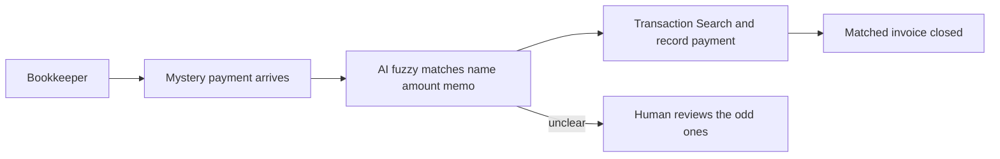

# #30 Cash Application Matcher

> [!tldr] In one breath
> Matches unidentified incoming PayPal payments to the right open invoices and records them, so the accounts team stops guessing. It was cut (kill code K6) because the demo is just a table (desk score 71 out of 120).

> [!example] Picture this
> A bookkeeper opens PayPal and sees $240 from "J. Smith". Three open invoices are near that amount, and the memo says "thx". She spends twenty minutes digging. This tool is like a sharp assistant who says "that is invoice 1042 from Jane Smith, 94 percent sure" and only asks her about the truly unclear ones.

> [!warning] Crowd check, Oct 23 2026
> Reconciliation is a small but real cluster in a 266 repo scan (partial coverage): settlesight, settleproof, cleared-settle and creatorsettle. Invoicing repos nearby (about 25) such as ledgerbird and invoicepilot sit close. Moderately crowded.

**Theme:** [[Theme E4 Locked money & cash-flow|E4 Locked money and cash flow]] · **Group:** Locked money · **Crowding on Devpost:** Reconciliation cluster (about 6)

## The problem
Remittance data (the "what is this payment for" details) travels separately from the payment itself (KC Fed). Small business finance teams spend hours matching.

## The idea
Pull incoming transactions, fuzzy match payer names, amounts and memos to open invoices, record the payment on the invoice, and ask a human only about the unclear cases. **The key point: it does the boring matching and keeps humans for the hard calls.**

## Who it is for
Small business bookkeepers.

## What the AI does
Entity resolution with a confidence score, and explanations for exceptions.

## What PayPal does
Transaction Search, Invoicing record_payment_for_invoice and search_invoicing.

**Building blocks used** (see [[30 Primitives Legend]]):
* `P18` Transaction Search / Reporting
* `P10` Invoicing recurring series / record payment
* `P08` Invoicing v2 (create, send, partial payment)
* `A06` Entity matching and narrative drafting
* `A05` Structured decision / classification (most common)

## Who else is doing this
HighRadius, Billtrust, QuickBooks bank feeds. Enterprise cash application exists. Small business tools rely on bank feed rules.

⚠️ **Verification status:** desk research only. Competitor names come from the landscape and Devpost scans, not from a per idea novelty hunt. Treat "no competitor found" as unproven.

## What makes it different
A PayPal native version for small businesses.

## Can we build it?
High.

## Smallest demo
20 payments, 15 invoices, and the matches get recorded.

## Risks
The demo is a table, and the reconciliation cluster is busy.

## Sources
* [KC Fed: B2B payments still about 90% use checks](https://www.kansascityfed.org/research/payments-system-research-briefings/b2b-payments-business-processing-and-challenges-to-achieving-straight-through-processing/) ⚠️
* [paypal/agent-toolkit (46 tools, v1.11.0)](https://github.com/paypal/agent-toolkit) ✅

## Scores
| Axis | Weight | Desk score |
|---|---|---|
| Tech | ×2 | 7 |
| Design | ×2 | 6 |
| Impact | ×2 | 5 |
| Innovation | ×2 | 5 |
| Demo | ×2 | 4 |
| Feasibility | ×1 | 9 |
| Risk⁻¹ | ×1 | 8 |
| **Total /120** | | **71** |

_Why (desk):_ Useful, not watchable.

## Why it was cut
Kill code `K6`: infrastructure with no watchable demo. In plain words, it is a good plumbing job, but a judge watching a 3 minute video would see rows in a table, not a story. See [[41 Brutal Elimination]].

> [!info]- Jargon decoder
> **Cash application**: the finance job of working out which invoice each incoming payment pays off. Like sorting a pile of cheques into the right envelopes.
> **Remittance data**: the note saying what a payment is for. Like the memo line on a cheque.
> **Fuzzy matching**: matching names that are close but not identical. "J Smith" and "Jane Smith" count as a likely pair.
> **Entity resolution**: deciding that two messy records are the same real person or company.
> **AR**: accounts receivable, money people owe you.
> **Transaction Search**: PayPal's lookup for past payments.
> **Bank feed rules**: simple automatic rules in accounting software.

## Where to next
* ⬆️ Up: [[Idea Index]]
* ⬅️ Previous: [[I029 Payer-Side Pay Later Collections]] · ➡️ Next: [[I031 Cash-Gap Forecaster]]
* 🧭 Theme: [[Theme E4 Locked money & cash-flow]]
* 🔗 Related: [[41 Brutal Elimination]], [[30 Primitives Legend]], [[17 Live Competition Scan (Oct 23)]], [[Jargon Decoder]], [[00 PayPal AI Hackathon Hub]]
