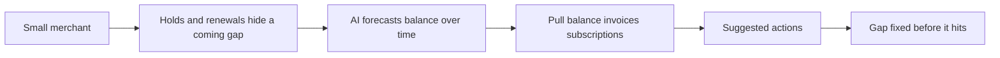

# #31 Cash-Gap Forecaster

> [!tldr] In one breath
> Forecasts a merchant's PayPal cash, including holds, renewals and payout timing, and suggests actions before a gap hits. It was cut (kill codes K2 and K6) because cash flow forecasting is crowded and the demo is a chart (desk score 67 out of 120).

> [!example] Picture this
> Sam runs an online course business. He knows rent is due on the 1st, but PayPal is holding $2,000 until the 4th, and three subscription renewals land on the 5th. This tool is like a weather forecast for his bank balance: "storm on the 1st, pay your supplier after the 4th".

> [!warning] Crowd check, Oct 23 2026
> Budget and analytics style agents show up in a 266 repo scan (partial coverage): budget-guardian, two paypal-budget-agent repos and Monetra. Reconciliation repos (settlesight and others) are close cousins. Outside tools such as Float, Fathom and QuickBooks Cash Flow also own this category. Crowded.

**Theme:** [[Theme E4 Locked money & cash-flow|E4 Locked money and cash flow]] · **Group:** Locked money · **Crowding on Devpost:** Analytics cluster

## The problem
49% of small businesses say processing times create cash gaps.

## The idea
Build a time line from the balance, scheduled subscription renewals, open invoices and expected captures, then show scenario actions. **The key point: see the gap before it arrives.**

## Who it is for
Small businesses.

## What the AI does
Forecasting and action suggestions.

## What PayPal does
Transaction Search, merchant insights, Subscriptions and Invoicing.

**Building blocks used** (see [[30 Primitives Legend]]):
* `P18` Transaction Search / Reporting
* `P19` Merchant insights / balances
* `P07` Subscriptions (revise, suspend, payment-failed events)
* `P08` Invoicing v2 (create, send, partial payment)
* `A04` Forecasting / pricing suggestion

## Who else is doing this
Float, Fathom, QuickBooks Cash Flow. Cash flow forecasting is a crowded small business category.

⚠️ **Verification status:** desk research only. Competitor names come from the landscape and Devpost scans, not from a per idea novelty hunt. Treat "no competitor found" as unproven.

## What makes it different
PayPal data as the only source.

## Can we build it?
High.

## Smallest demo
A forecast chart plus actions.

## Risks
The analytics cluster is busy, and a chart only demo is thin.

## Sources
* [QuickBooks 2026 Late Payments Report: 59% have 30+ day overdue; $17.7K owed](https://quickbooks.intuit.com/r/small-business-data/small-business-late-payments-report-2026/) ✅

## Scores
| Axis | Weight | Desk score |
|---|---|---|
| Tech | ×2 | 6 |
| Design | ×2 | 6 |
| Impact | ×2 | 6 |
| Innovation | ×2 | 3 |
| Demo | ×2 | 4 |
| Feasibility | ×1 | 9 |
| Risk⁻¹ | ×1 | 8 |
| **Total /120** | | **67** |

_Why (desk):_ Crowded and chart shaped.

## Why it was cut
Two kill codes fired. `K2`: a crowded cluster or derivative headline, so we cannot defend that it is new. `K6`: infrastructure with no watchable demo, because the result is a chart. See [[41 Brutal Elimination]].

> [!info]- Jargon decoder
> **Cash gap**: the days when bills are due but your money has not arrived. Like running out of petrol between two filling stations.
> **Holds**: PayPal keeping some of your sale money for a while.
> **Time series**: numbers tracked over time, like a heart monitor line.
> **Subscriptions renewals**: repeat charges that come around on a schedule.
> **Captures**: the moment a promised payment is actually taken.
> **Merchant insights**: PayPal's summary numbers for a seller, such as balances.

## Where to next
* ⬆️ Up: [[Idea Index]]
* ⬅️ Previous: [[I030 Cash Application Matcher]] · ➡️ Next: [[I032 F&F Scam Interrupter]]
* 🧭 Theme: [[Theme E4 Locked money & cash-flow]]
* 🔗 Related: [[41 Brutal Elimination]], [[30 Primitives Legend]], [[17 Live Competition Scan (Oct 23)]], [[Jargon Decoder]], [[00 PayPal AI Hackathon Hub]]
