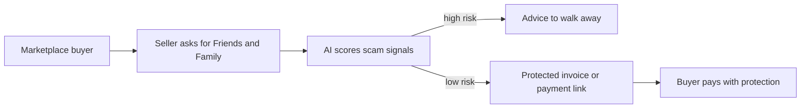

# #32 F&F Scam Interrupter

> [!tldr] In one breath
> Before you send money to a stranger, paste the listing or chat. AI spots purchase scam patterns and turns the payment into a protected Goods and Services request. A deep dive demoted it (89 down to 71 out of 120) because PayPal, Starling and Lloyds already ship AI scam checks.

> [!example] Picture this
> Leo finds a used games console for half price on a marketplace. The seller says "pay by Friends and Family, it is faster". Leo pastes the listing and chat into the tool. It says "high risk: too cheap, pushy, wants off platform payment". It offers a protected payment request instead. If the seller refuses, that refusal tells Leo everything. It is like a friend looking over your shoulder who says "walk away".

> [!warning] Crowd check, Oct 23 2026
> Scam and elder fraud protection is a busy area: about 7 repos in a 266 repo scan (partial coverage), including scam-shield-paypal, Haven, guardianpay, nonna-mode, safesend and kincart. Escrow cousins (about 28 repos) also overlap. The deep dive adds that PayPal's own AI alerts, Starling and Lloyds already cover the headline. High crowding.

**Theme:** [[Theme E5 Moment-of-send scams|E5 Moment of send scams]] · **Group:** Moment of send scams · **Crowding on Devpost:** High. PayPal native F&F AI alerts, Starling and Lloyds listing screenshot checks, and Devpost scam checkers.

## The problem
US consumers lost $15.9B to fraud in 2025. UK purchase scams hit 175,809 cases, and 66% of APP fraud starts online. Friends and Family (F&F) payments for goods carry no purchase protection, and they are the scammer's favourite request.

## The idea
A share sheet or web tool. The buyer pastes the listing, the seller handle and the chat. AI scores scam signals (price anomaly, urgency, an F&F request, reused images, an off platform push). It then creates a Goods and Services payment request or invoice from the seller with the protections explained, or advises walking away. **The key point: detection plus a protected payment path, at the exact moment of send.**

## Who it is for
Marketplace buyers (Facebook Marketplace, forums, social commerce).

## What the AI does
Multimodal scam pattern detection (text and images), price plausibility checks, and plain language warnings.

## What PayPal does
Invoicing and Payment Links for Goods and Services requests, Orders, buyer protection framing, and Disputes as a fallback.

**Building blocks used** (see [[30 Primitives Legend]]):
* `P08` Invoicing v2 (create, send, partial payment)
* `P22` Payment Links
* `P01` Orders v2 (create / capture / get)
* `P32` Seller Protection policy rules
* `A05` Structured decision / classification (most common)
* `A02` Classification with explanation / vision estimation
* `A11` Translation / tone

## Who else is doing this
Bitdefender Scamio, Norton Genie, F-Secure Scam Protection. Consumer scam checkers read messages and links in general, but none convert the transaction into a protected PayPal payment.

**Verification status:** adversarially deep dived (6+ differently phrased searches per idea). Full competitor table: [[D032 F&F Scam Interrupter (Deep Dive)]].

## What makes it different
Detection plus a protected payment path, at the exact moment of send.

## Can we build it?
Medium. PayPal has no public person to person send API, so the tool checks before sending instead of intercepting inside the PayPal app.

## Smallest demo
Paste a scam listing, see high risk, and get a protected invoice. Paste a genuine one, see low risk, and get a Goods and Services link.

## Risks
A "meaningful PayPal" risk at Stage 1 if the PayPal step feels thin. Real world reach depends on PayPal embedding it.

## Deep dive verdict: demote
It is a real problem, but PayPal, Starling and Lloyds already ship AI scam checks at the moment of send. Only the "seller protection handshake" survives (a payment routed to the payee by authorize then capture, where a refusal is the verdict). Salvage it as a module, not a finalist.

_Why the score changed:_ Incumbents with the exact mechanism were found. PayPal's own AI scam alerts on F&F sends are live worldwide on PayPal and across the US on Venmo since 2025-07-21, scaled by risk, with high risk sends auto declined. Starling Scam Intelligence (Oct 2025) lets you upload listing or chat images and returns a Gemini risk verdict. Lloyds Scam Check (Jun 2026) uses screenshots and AI at payment to a new payee. Marketplace scam checker sites, a Chrome extension and Devpost entries (TrustGate, Red Flag) also exist. Innovation went from 6 to 3. PayPal has no person to person or Request Money API, and Invoicing or Payment Links cannot be issued from the seller side without partner permissions. So the tech is Orders with payee.email_address plus Log in with PayPal (5). A third party payee for non partners is unverified, and onboarding after payment needs an approved partner (feasibility 6, risk 5). The impact evidence stays top tier but reach is weaker (8).

## Sources
* [FTC: $15.9B reported fraud losses 2025](https://www.ftc.gov/news-events/news/press-releases/2026/03/ftc-testifies-joint-economic-committee-agencys-efforts-combat-fraud) ✅
* [UK Finance Annual Fraud Report 2026: APP £576.4M; 175,809 purchase scams](https://www.ukfinance.org.uk/system/files/2026-06/UK%20Finance%20Fraud%20Report%202026.pdf) ✅
* [FTC Consumer Sentinel Data Book 2024](https://www.ftc.gov/system/files/ftc_gov/pdf/csn-annual-data-book-2024.pdf) ✅
* [CFPB complaint DB: PayPal 2025 had 7,464 complaints; the top one, "trouble accessing funds", had 1,276](https://www.consumerfinance.gov/data-research/consumer-complaints/) ✅

## Scores
| Axis | Weight | Desk score | After deep dive |
|---|---|---|---|
| Tech | ×2 | 7 | 5 |
| Design | ×2 | 8 | 7 |
| Impact | ×2 | 9 | 8 |
| Innovation | ×2 | 6 | 3 |
| Demo | ×2 | 8 | 7 |
| Feasibility | ×1 | 7 | 6 |
| Risk⁻¹ | ×1 | 6 | 5 |
| **Total /120** | | **89** | **71** |

_Why (desk):_ Excellent evidence and social impact. PayPal integration depth is limited by the API surface.

**Kill criteria:** none triggered. It survived the culling round, then lost points in the deep dive.

> [!info]- Jargon decoder
> **F&F (Friends and Family)**: sending money as a gift between people. No buyer protection, like handing cash to a stranger.
> **G&S (Goods and Services)**: a payment for a purchase, with protection. Like paying by credit card, where you can complain if it goes wrong.
> **APP fraud**: authorised push payment fraud. You send the money yourself because you were tricked.
> **Multimodal**: the AI reads text and pictures together.
> **Payment Links / Invoicing**: ways to ask for money with a shareable link or bill.
> **Authorize then capture**: like a hotel holding $200 on your card at check in, then charging only the real amount at check out.
> **Seller protection handshake**: the seller must accept a protected payment. If they refuse, that is a red flag.
> **Orders / payee.email_address**: PayPal's basic purchase object, and the field that says who gets paid.

## Where to next
* ⬆️ Up: [[Idea Index]]
* ⬅️ Previous: [[I031 Cash-Gap Forecaster]] · ➡️ Next: [[I033 Marketplace Safe-Deal Link]]
* 🧭 Theme: [[Theme E5 Moment-of-send scams]]
* 🔬 Deep dive: [[D032 F&F Scam Interrupter (Deep Dive)]]
* 🔗 Related: [[30 Primitives Legend]], [[17 Live Competition Scan (Oct 23)]], [[Jargon Decoder]], [[00 PayPal AI Hackathon Hub]]
