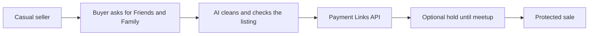

# #33 Marketplace Safe-Deal Link

> [!tldr] In one breath
> Honest sellers generate a protected PayPal deal link with an AI verified listing summary, so buyers stop asking for Friends and Family payments. It is a good partner to idea 32 (desk score 79 out of 120).

> [!example] Picture this
> Ana sells her old bike online. Buyers keep asking "can you take Friends and Family to avoid fees?", and she does not want to look shady. She pastes her listing into the tool and gets one link with a tidy summary and plain protection terms. For a local pickup, the buyer's money is held and only taken once they have the bike. It is like a deposit box at a flea market that both sides trust.

> [!warning] Crowd check, Oct 23 2026
> Escrow style ideas are crowded: about 28 repos in a 266 repo scan (partial coverage), such as ProofPay (three of them), holdfast, TrustLock, escrowease, handback and fairdeal. Scam cousins like safesend also exist. Medium to high crowding, though a seller started trust link is less common.

**Theme:** [[Theme E5 Moment-of-send scams|E5 Moment of send scams]] · **Group:** Moment of send scams · **Crowding on Devpost:** Escrow adjacent

## The problem
Goods and Services fees push people toward Friends and Family, and scammers exploit that.

## The idea
The seller pastes the listing. AI cleans up the item details and checks plausibility. The seller gets a protected PayPal payment link with plain language protection terms, plus an optional "authorise at meetup" for local pickup. **The key point: the honest seller starts the trust, so the buyer is never pushed toward the risky option.**

## Who it is for
Casual sellers.

## What the AI does
Listing normalisation and a trust summary.

## What PayPal does
Payment Links API and AUTHORIZE for meetups.

**Building blocks used** (see [[30 Primitives Legend]]):
* `P22` Payment Links
* `P02` AUTHORIZE intent (hold funds)
* `A01` Document / image extraction (OCR, validation)
* `A11` Translation / tone

## Who else is doing this
Trustap, Escrow.com. Marketplace escrow apps exist.

⚠️ **Verification status:** desk research only. Competitor names come from the landscape and Devpost scans, not from a per idea novelty hunt. Treat "no competitor found" as unproven.

## What makes it different
A seller started trust link.

## Can we build it?
High.

## Smallest demo
A listing becomes a link, and the buyer pays.

## Risks
It is escrow adjacent and overlaps idea 32.

## Sources
* [UK Finance Annual Fraud Report 2026: APP £576.4M; 175,809 purchase scams](https://www.ukfinance.org.uk/system/files/2026-06/UK%20Finance%20Fraud%20Report%202026.pdf) ✅
* [FTC Consumer Sentinel Data Book 2024](https://www.ftc.gov/system/files/ftc_gov/pdf/csn-annual-data-book-2024.pdf) ✅

## Scores
| Axis | Weight | Desk score |
|---|---|---|
| Tech | ×2 | 6 |
| Design | ×2 | 7 |
| Impact | ×2 | 7 |
| Innovation | ×2 | 5 |
| Demo | ×2 | 6 |
| Feasibility | ×1 | 9 |
| Risk⁻¹ | ×1 | 8 |
| **Total /120** | | **79** |

_Why (desk):_ A good complement to 32.

**Kill criteria:** none triggered. This idea survived the culling round.

> [!info]- Jargon decoder
> **F&F vs G&S**: Friends and Family is a gift style payment with no protection. Goods and Services is a purchase payment with protection.
> **Payment Links**: a web link that asks for a set amount, like a QR code on a market stall.
> **AUTHORIZE intent**: hold the money first and take it later. Like a hotel holding $200 on your card at check in, then charging only what you used.
> **Escrow**: a neutral third party holds the money until the deal is done, like a friend holding the bet money.
> **Normalisation**: tidying messy details into a standard format.
> **OCR**: reading text from a photo.

## Where to next
* ⬆️ Up: [[Idea Index]]
* ⬅️ Previous: [[I032 F&F Scam Interrupter]] · ➡️ Next: [[I034 Guardian Mode]]
* 🧭 Theme: [[Theme E5 Moment-of-send scams]]
* 🔗 Related: [[30 Primitives Legend]], [[17 Live Competition Scan (Oct 23)]], [[Jargon Decoder]], [[00 PayPal AI Hackathon Hub]]
