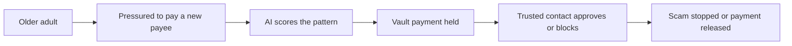

# #34 Guardian Mode

> [!tldr] In one breath
> A consent based co pilot for older adults. A first time, high value payee triggers a cooling off wait, and a trusted contact sees oddities, not everything. Strong evidence, but a tight fit with PayPal's APIs (desk score 78 out of 120).

> [!example] Picture this
> Grandpa Ray gets a call: "Your grandson is in jail, send $5,000 now." He opens his payment app. Because this is a new payee and a huge amount, the app pauses the payment and pings his daughter. She calls him, and the scam dies. It is like a seat belt that only locks when the car brakes hard.

> [!warning] Crowd check, Oct 23 2026
> Scam and elder protection is busy: about 7 repos in a 266 repo scan (partial coverage), including guardianpay, nonna-mode, Haven and kincart (an elderly relative with family approval). Spend limit and family approval repos such as the "allowance" and "leash" ones are close too. High crowding.

**Theme:** [[Theme E5 Moment-of-send scams|E5 Moment of send scams]] · **Group:** Moment of send scams · **Crowding on Devpost:** none

## The problem
Older adults reported $2.4B in fraud losses in 2024 (FTC), which rises to as much as $81.5B once you adjust for under reporting. Losses over $100K rose 351% since 2020.

## The idea
Payments run through an app level wallet (a vaulted PayPal) with AI anomaly scoring. A new payee plus a large amount plus an unusual pattern triggers a delay and trusted contact approval. **The key point: protection that is agreed in advance, and shows the helper only the odd moments.**

## Who it is for
Older adults and family caregivers.

## What the AI does
Anomaly detection, scam script detection in pasted messages, and explanations.

## What PayPal does
Vault (payer not present payments through the app), Orders and Log in with PayPal.

**Building blocks used** (see [[30 Primitives Legend]]):
* `P06` Vault v3 (saved payment tokens, payer-not-present charges)
* `P01` Orders v2 (create / capture / get)
* `P25` Log in with PayPal
* `A15` Anomaly detection
* `A05` Structured decision / classification (most common)

## Who else is doing this
EverSafe, Carefull, True Link. Bank feed monitoring services exist for older adults.

⚠️ **Verification status:** desk research only. Competitor names come from the landscape and Devpost scans, not from a per idea novelty hunt. Treat "no competitor found" as unproven.

## What makes it different
Built on the PayPal wallet, and scoped by consent.

## Can we build it?
Medium. PayPal does not expose consumer person to person activity to third parties, so the app itself must be the payment path.

## Smallest demo
The senior's app sends payments. A scam pattern triggers a hold and caregiver approval.

## Risks
People must route payments through the app, and the competitors are established.

## Sources
* [FTC Protecting Older Consumers 2024 to 2025: $2.4B reported; $10.1B to $81.5B adjusted](https://www.ftc.gov/system/files/ftc_gov/pdf/P144400-OlderAdultsReportDec2025.pdf) ✅
* [FinCEN elder financial exploitation analysis](https://www.fincen.gov/news/news-releases/fincen-issues-analysis-elder-financial-exploitation) ✅

## Scores
| Axis | Weight | Desk score |
|---|---|---|
| Tech | ×2 | 6 |
| Design | ×2 | 7 |
| Impact | ×2 | 8 |
| Innovation | ×2 | 5 |
| Demo | ×2 | 7 |
| Feasibility | ×1 | 6 |
| Risk⁻¹ | ×1 | 6 |
| **Total /120** | | **78** |

_Why (desk):_ Strong evidence, constrained integration.

**Kill criteria:** none triggered. This idea survived the culling round.

> [!info]- Jargon decoder
> **Vault (payer not present)**: PayPal safely stores your payment permission so an app can charge you later. Like leaving a card on file at a restaurant tab.
> **Cooling off period**: a forced pause before a risky payment, like a 24 hour wait before a big purchase.
> **Payee**: the person or business being paid.
> **Anomaly scoring**: a number for how unusual a payment looks. Like a smoke alarm for odd behaviour.
> **Log in with PayPal**: the "sign in with" button, tied to your PayPal account.
> **Orders**: PayPal's basic object for a purchase.

## Where to next
* ⬆️ Up: [[Idea Index]]
* ⬅️ Previous: [[I033 Marketplace Safe-Deal Link]] · ➡️ Next: [[I035 Vendor Change Verifier]]
* 🧭 Theme: [[Theme E5 Moment-of-send scams]]
* 🔗 Related: [[30 Primitives Legend]], [[17 Live Competition Scan (Oct 23)]], [[Jargon Decoder]], [[00 PayPal AI Hackathon Hub]]
