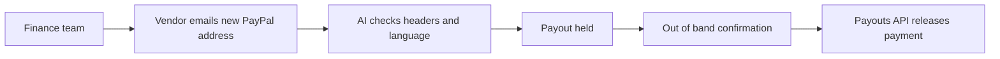

# #35 Vendor Change Verifier

> [!tldr] In one breath
> Before a business pays a vendor whose payment details "changed", AI checks the request for business email compromise patterns and holds the payout until it is verified. A solid business side scam angle (desk score 85 out of 120).

> [!example] Picture this
> A small agency pays its freelance designer every month through PayPal. One day an email arrives: "I changed my PayPal address, please use this one." It looks real, but it came from a crook who hacked the designer's inbox. The tool spots odd email headers and urgent wording, freezes the payout, and asks the finance team to phone the designer. It is like a bank teller who says "this signature looks different, let me call you first".

> [!success] Crowd check, Oct 23 2026
> In a scan of 266 live hackathon repos (partial coverage), no repo checked vendor detail changes before a payout. Payout repos (payday-agent, Burmalda, takken, routewell) pay people but do not verify changes. Agent guardrail repos limit spending instead. The area looked empty.

**Theme:** [[Theme E5 Moment-of-send scams|E5 Moment of send scams]] · **Group:** Moment of send scams · **Crowding on Devpost:** none

## The problem
Business email compromise (BEC) is one of the costliest cybercrime categories reported to the FBI IC3.

## The idea
Keep a vendor list and pay through Payouts. When a vendor's PayPal email changes through an emailed request, AI analyses the headers and language, requires confirmation through a different channel, and only then releases the payout. **The key point: a changed bank detail is guilty until confirmed.**

## Who it is for
Small business finance teams paying vendors and contractors through PayPal Payouts.

## What the AI does
BEC language and header analysis, with a risk explanation.

## What PayPal does
Payouts, and Payouts failure handling.

**Building blocks used** (see [[30 Primitives Legend]]):
* `P11` Payouts (batch)
* `P13` Payouts failure handling and test values (UNCLAIMED, cancel, RETURNED, ERRPYO codes)
* `A05` Structured decision / classification (most common)

## Who else is doing this
Eftsure, Trustpair. Vendor verification platforms exist for bank payments, aimed at mid size and large companies.

⚠️ **Verification status:** desk research only. Competitor names come from the landscape and Devpost scans, not from a per idea novelty hunt. Treat "no competitor found" as unproven.

## What makes it different
Aimed at small business and native to PayPal Payouts.

## Can we build it?
High.

## Smallest demo
A spoofed change request email, then a hold, then verification, then the payout.

## Risks
Incumbents exist, and fresh IC3 figures still need checking.

## Sources
* [FBI IC3 2024 report (BEC losses)](https://www.ic3.gov/AnnualReport/Reports/2024_IC3Report.pdf) ⚠️
* [PayPal Payouts sandbox test values (ERRPYO0xx)](https://developer.paypal.com/api/payouts/test-go-live.md) ✅

## Scores
| Axis | Weight | Desk score |
|---|---|---|
| Tech | ×2 | 7 |
| Design | ×2 | 7 |
| Impact | ×2 | 7 |
| Innovation | ×2 | 6 |
| Demo | ×2 | 7 |
| Feasibility | ×1 | 9 |
| Risk⁻¹ | ×1 | 8 |
| **Total /120** | | **85** |

_Why (desk):_ A solid business side scam angle.

**Kill criteria:** none triggered. This idea survived the culling round.

> [!info]- Jargon decoder
> **BEC (business email compromise)**: a crook pretends to be a trusted contact by email to redirect money. Like someone forging a note from your landlord with new bank details.
> **FBI IC3**: the FBI's internet crime complaint center, which publishes yearly scam statistics.
> **Payouts**: PayPal's tool for sending many payments at once, like a payroll run.
> **Out of band confirmation**: confirming through a different channel, such as a phone call, rather than replying to the suspicious email.
> **Email headers**: the hidden routing details of an email, like postmarks on an envelope.
> **UNCLAIMED / RETURNED / ERRPYO codes**: the statuses and error codes a Payout can come back with, when nobody collects it or it bounces.

## Where to next
* ⬆️ Up: [[Idea Index]]
* ⬅️ Previous: [[I034 Guardian Mode]] · ➡️ Next: [[I036 Invoice-Scam Detector]]
* 🧭 Theme: [[Theme E5 Moment-of-send scams]]
* 🔗 Related: [[30 Primitives Legend]], [[17 Live Competition Scan (Oct 23)]], [[Jargon Decoder]], [[00 PayPal AI Hackathon Hub]]
