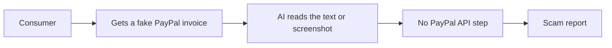

# #36 Invoice-Scam Detector

> [!tldr] In one breath
> Paste a "PayPal invoice" or payment request you received, and AI tells you if it is a known scam pattern and what to do. It was cut (kill code K3) because PayPal is not central to the loop (desk score 60 out of 120).

> [!example] Picture this
> Nina gets an email: "PayPal invoice for $499, call this number to cancel." She pastes it into the tool, which says "classic fake invoice scam, do not call". It is useful, like a friend who knows scams. But the same friend could check any email, so PayPal itself plays almost no part.

> [!warning] Crowd check, Oct 23 2026
> Scam checkers are a busy area: about 7 repos in a 266 repo scan (partial coverage), including scam-shield-paypal, Haven and safesend. Outside tools like Norton Genie and Bitdefender Scamio already do this for any message. High crowding.

**Theme:** [[Theme E5 Moment-of-send scams|E5 Moment of send scams]] · **Group:** Moment of send scams · **Crowding on Devpost:** none

## The problem
Fake invoices sent from real PayPal accounts are a common phishing route. Commerce phishing more than doubled in early 2026 (Akamai).

## The idea
Analyse text or screenshots for scam patterns and create a report. **The key point: it is a generic scam checker wearing a PayPal label.**

## Who it is for
Consumers.

## What the AI does
Classification and explanation.

## What PayPal does
Weak. It mostly analyses PayPal branded content, with no API action.

**Building blocks used** (see [[30 Primitives Legend]]):
* `A05` Structured decision / classification (most common)
* `A02` Classification with explanation / vision estimation

## Who else is doing this
Norton Genie, Bitdefender Scamio. Generic scam checkers already do this.

⚠️ **Verification status:** desk research only. Competitor names come from the landscape and Devpost scans, not from a per idea novelty hunt. Treat "no competitor found" as unproven.

## What makes it different
Low.

## Can we build it?
High.

## Smallest demo
Screenshot analysis.

## Risks
The PayPal integration is not meaningful, which is a Stage 1 fail risk.

## Sources
* [Akamai SOTI 2026: commerce is 47.9% of AI bot traffic; agent hijacking](https://www.akamai.com/newsroom/press-release/akamai-research-commerce-becomes-the-epicenter-for-ai-bot-attacks-and-agentic-fraud-in-2026) ✅

## Scores
| Axis | Weight | Desk score |
|---|---|---|
| Tech | ×2 | 3 |
| Design | ×2 | 6 |
| Impact | ×2 | 6 |
| Innovation | ×2 | 3 |
| Demo | ×2 | 6 |
| Feasibility | ×1 | 9 |
| Risk⁻¹ | ×1 | 3 |
| **Total /120** | | **60** |

_Why (desk):_ PayPal not central.

## Why it was cut
Kill code `K3`: PayPal is not central to the loop. In plain words, if you swapped PayPal for any other brand, the tool would work the same. The hackathon wants PayPal at the heart of the product. See [[41 Brutal Elimination]].

> [!info]- Jargon decoder
> **Phishing**: a fake message that tricks you into giving up money or passwords. Like a fisherman using bait.
> **Classification**: sorting something into a category, such as "scam" or "safe". Like a mail room sorting letters.
> **Vision estimation**: the AI judging what it sees in an image.
> **Stage 1**: the first judging round, which checks that the project really uses PayPal.
> **AI bot traffic / agent hijacking**: automated visitors, and attackers taking control of an AI agent.

## Where to next
* ⬆️ Up: [[Idea Index]]
* ⬅️ Previous: [[I035 Vendor Change Verifier]] · ➡️ Next: [[I037 Overpayment & Refund-Scam Shield]]
* 🧭 Theme: [[Theme E5 Moment-of-send scams]]
* 🔗 Related: [[41 Brutal Elimination]], [[30 Primitives Legend]], [[17 Live Competition Scan (Oct 23)]], [[Jargon Decoder]], [[00 PayPal AI Hackathon Hub]]
