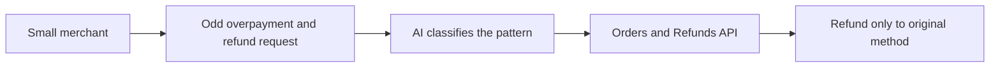

# #37 Overpayment & Refund-Scam Shield

> [!tldr] In one breath
> Flags orders that look like overpayment or "refund to a different account" scams before the merchant ships or refunds. It was cut (kill code K4) for weak evidence and low impact (desk score 62 out of 120).

> [!example] Picture this
> A small shop gets an order for $300 but the buyer "accidentally" pays $900 and asks for the extra $600 back to a different account. If the shop sends it, the crook keeps the goods and the money. The tool is like a cashier who says "we only ever refund to the card that paid".

> [!success] Crowd check, Oct 23 2026
> In a scan of 266 live hackathon repos (partial coverage), nothing targeted overpayment or refund redirect scams. Nearby are scam checkers (about 7, such as scam-shield-paypal and safesend) and refund cousins (clippay for partial refunds, returngate). The exact area looked thin.

**Theme:** [[Theme E5 Moment-of-send scams|E5 Moment of send scams]] · **Group:** Moment of send scams · **Crowding on Devpost:** none

## The problem
Small merchants get targeted by overpayment and refund redirect scams.

## The idea
Analyse orders and messages, block refunds to anything other than the original payment method, and explain why. **The key point: PayPal already refunds to the original method, so the tool adds little.**

## Who it is for
Small business merchants.

## What the AI does
Pattern classification.

## What PayPal does
Orders, Refunds (original method only) and messages.

**Building blocks used** (see [[30 Primitives Legend]]):
* `P01` Orders v2 (create / capture / get)
* `P16` Refunds (full / partial)
* `A05` Structured decision / classification (most common)

## Who else is doing this
Signifyd, Riskified. Fraud tools cover parts of this.

⚠️ **Verification status:** desk research only. Competitor names come from the landscape and Devpost scans, not from a per idea novelty hunt. Treat "no competitor found" as unproven.

## What makes it different
Low to moderate.

## Can we build it?
High.

## Smallest demo
Scenario based.

## Risks
The evidence is thin, and PayPal already refunds to the original method.

## Sources
* [FTC Consumer Sentinel Data Book 2024](https://www.ftc.gov/system/files/ftc_gov/pdf/csn-annual-data-book-2024.pdf) ✅

## Scores
| Axis | Weight | Desk score |
|---|---|---|
| Tech | ×2 | 5 |
| Design | ×2 | 5 |
| Impact | ×2 | 4 |
| Innovation | ×2 | 4 |
| Demo | ×2 | 5 |
| Feasibility | ×1 | 9 |
| Risk⁻¹ | ×1 | 7 |
| **Total /120** | | **62** |

_Why (desk):_ Weak evidence.

## Why it was cut
Kill code `K4`: weak evidence or low impact. In plain words, we could not show this problem is big enough, and PayPal already blocks the main trick. See [[41 Brutal Elimination]].

> [!info]- Jargon decoder
> **Overpayment scam**: a buyer pays too much, then asks for the extra back. The original payment later bounces, but your refund is gone.
> **Refund to original method**: money goes back to where it came from, like returning change to the same wallet.
> **Pattern classification**: the AI sorts orders into "looks normal" and "looks like a known trick".
> **Fraud tools (Signifyd, Riskified)**: services that score orders for fraud risk.
> **Orders v2 / Refunds**: PayPal's tools for purchases and giving money back.

## Where to next
* ⬆️ Up: [[Idea Index]]
* ⬅️ Previous: [[I036 Invoice-Scam Detector]] · ➡️ Next: [[I038 Household Delegated Agent]]
* 🧭 Theme: [[Theme E5 Moment-of-send scams]]
* 🔗 Related: [[41 Brutal Elimination]], [[30 Primitives Legend]], [[17 Live Competition Scan (Oct 23)]], [[Jargon Decoder]], [[00 PayPal AI Hackathon Hub]]
