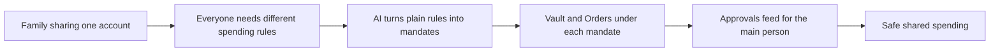

# #38 Household Delegated Agent

> [!tldr] In one breath
> A family wallet where each member's shopping agent spends from one PayPal account under its own scoped rules. It is "UPI Circle, for PayPal". It scored 81 out of 120 but was cut (kill code K2) for sitting inside a crowded cluster.

> [!example] Picture this
> The Garcia family has one PayPal account. Mum lets her teenage son's agent spend up to $30 a month on books only. Dad's agent can pay the electricity bill. Grandma's helper can buy groceries but nothing over $100. Each person has a different key that opens only some doors, and Mum sees a feed of what happened.

> [!warning] Crowd check, Oct 23 2026
> This is the most crowded area in the scan. About 30 repos (in a 266 repo scan, partial coverage) are agent spending mandates and guardrails: permit, mandate, Warden, paypal-agent-firewall, four named "leash", three named "allowance", payguard (three), mandateguard and more. kincart is a family approval cousin. Very high crowding.

**Theme:** [[Theme E6 Human delegation|E6 Human delegation]] · **Group:** Human delegation · **Crowding on Devpost:** Spend gate cluster (about 13)

## The problem
Western wallets have one boss. India's UPI Circle lets a main user delegate to a second user or an agent. Families share accounts or cards in unsafe ways.

## The idea
The primary person vaults their PayPal. Each delegate (a teen or adult child, a partner, a caregiver, or their agent) gets a scoped mandate covering merchants, categories and caps. AI enforces and explains the rules, and the primary person sees an approvals feed. **The key point: many people under one account, each with their own limits.**

## Who it is for
Households and caregivers.

## What the AI does
Compiles plain language policy into rules, categorises purchases, and raises anomaly alerts.

## What PayPal does
Vault (payer not present), Orders, Log in with PayPal for delegates, and webhooks.

**Building blocks used** (see [[30 Primitives Legend]]):
* `P06` Vault v3 (saved payment tokens, payer-not-present charges)
* `P01` Orders v2 (create / capture / get)
* `P25` Log in with PayPal
* `P20` Webhooks (events, retries, verification)
* `A16` Policy / rule reasoning with cited clauses
* `A05` Structured decision / classification (most common)

## Who else is doing this
UPI Circle, Greenlight, Ramp Agent Cards. Family cards exist (Greenlight) and agent spend controls exist. The multi person PayPal angle is new, but it reads as a spend gate.

⚠️ **Verification status:** desk research only. Competitor names come from the landscape and Devpost scans, not from a per idea novelty hunt. Treat "no competitor found" as unproven.

## What makes it different
Many principals delegating, rather than single agent limits.

## Can we build it?
High.

## Smallest demo
A primary account plus 2 delegates, with agent purchases under different rules.

## Risks
The spend gate cluster is crowded. PayPal requires account holders to be 18 or older, so delegates must be adults.

## Sources
* [Razorpay: agentic payments and NPCI (UPI Reserve Pay)](https://razorpay.com/blog/agentic-payments-and-npci/) ✅
* [Devpost "Built with PayPal" listing (early entry clustering, about 72 reviewed)](https://devpost.com/software/built-with/paypal) ⚠️

## Scores
| Axis | Weight | Desk score |
|---|---|---|
| Tech | ×2 | 8 |
| Design | ×2 | 7 |
| Impact | ×2 | 6 |
| Innovation | ×2 | 5 |
| Demo | ×2 | 7 |
| Feasibility | ×1 | 8 |
| Risk⁻¹ | ×1 | 7 |
| **Total /120** | | **81** |

_Why (desk):_ Interesting framing inside a crowded cluster.

## Why it was cut
Kill code `K2`: a crowded cluster or derivative headline, where innovation cannot be defended. In plain words, many teams are building spend limit tools for agents, so judges would see "one more". See [[41 Brutal Elimination]].

> [!info]- Jargon decoder
> **Delegation**: letting someone else act for you within limits, like giving a babysitter a house key but not the safe code.
> **Mandate**: a written permission slip with limits on who, where and how much.
> **UPI Circle**: India's feature that lets a main user let others pay from their account.
> **Vault (payer not present)**: PayPal stores your approval so an app can charge later without you being there.
> **Spend gate**: a checkpoint that blocks payments breaking the rules.
> **Webhooks**: PayPal pinging your app when something happens.
> **Principal**: the real owner whose money and rules matter.

## Where to next
* ⬆️ Up: [[Idea Index]]
* ⬅️ Previous: [[I037 Overpayment & Refund-Scam Shield]] · ➡️ Next: [[I039 Caregiver Bill Desk]]
* 🧭 Theme: [[Theme E6 Human delegation]]
* 🔗 Related: [[41 Brutal Elimination]], [[30 Primitives Legend]], [[17 Live Competition Scan (Oct 23)]], [[Jargon Decoder]], [[00 PayPal AI Hackathon Hub]]
