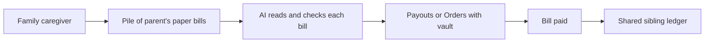

# #39 Caregiver Bill Desk

> [!tldr] In one breath
> Adult children photograph a parent's bills. AI reads them, checks for oddities and pays through PayPal, with a shared ledger for siblings. A real need, but PayPal cannot reach many billers (desk score 73 out of 120).

> [!example] Picture this
> Carla looks after her mum, who keeps a shoebox of bills. Carla snaps each bill on her phone. The tool reads the amount, notices that the water bill is triple the usual, and flags it. She approves the normal ones, they get paid, and her brother can see everything in a shared list. It is like a family accountant who never forgets.

> [!warning] Crowd check, Oct 23 2026
> Related repos in a 266 repo scan (partial coverage): kincart (elderly relative plus family approval), plainpay and plainbill (medical bills explained and paid), caresplit and guardianpay. Medium crowding, though none cover general bill desks for caregivers.

**Theme:** [[Theme E6 Human delegation|E6 Human delegation]] · **Group:** Human delegation · **Crowding on Devpost:** none

## The problem
Caregivers manage their parents' money informally, and elder exploitation losses are large.

## The idea
Capture the bill, extract the details, check for anomalies against history, pay (PayPal invoice payment or payouts), and show a ledger the siblings can see. **The key point: one shared, checked place for a parent's bills.**

## Who it is for
Family caregivers.

## What the AI does
Extraction and anomaly detection.

## What PayPal does
Payouts or Orders, and Vault.

**Building blocks used** (see [[30 Primitives Legend]]):
* `P11` Payouts (batch)
* `P06` Vault v3 (saved payment tokens, payer-not-present charges)
* `A01` Document / image extraction (OCR, validation)
* `A15` Anomaly detection

## Who else is doing this
SilverBills, Carefull, Doxo. Bill pay concierge services exist.

⚠️ **Verification status:** desk research only. Competitor names come from the landscape and Devpost scans, not from a per idea novelty hunt. Treat "no competitor found" as unproven.

## What makes it different
Moderate.

## Can we build it?
Medium. Many billers do not accept PayPal.

## Smallest demo
Two bills paid in the sandbox.

## Risks
Biller acceptance, and an overlap with idea 34.

## Sources
* [FTC Protecting Older Consumers 2024 to 2025: $2.4B reported; $10.1B to $81.5B adjusted](https://www.ftc.gov/system/files/ftc_gov/pdf/P144400-OlderAdultsReportDec2025.pdf) ✅

## Scores
| Axis | Weight | Desk score |
|---|---|---|
| Tech | ×2 | 6 |
| Design | ×2 | 7 |
| Impact | ×2 | 6 |
| Innovation | ×2 | 5 |
| Demo | ×2 | 6 |
| Feasibility | ×1 | 7 |
| Risk⁻¹ | ×1 | 6 |
| **Total /120** | | **73** |

_Why (desk):_ A real need, with limited PayPal reach to billers.

**Kill criteria:** none triggered. This idea survived the culling round.

> [!info]- Jargon decoder
> **Extraction (OCR)**: software that reads a photo of a bill and pulls out the numbers, like a very fast typist.
> **Anomaly check**: spotting a bill that looks unlike the usual ones. Like noticing a $300 electric bill in a house that always pays $60.
> **Payouts**: PayPal's tool for sending money to many people or businesses.
> **Vault**: PayPal safely saving a payment permission for later use.
> **Ledger**: a running list of money in and out.
> **Sandbox**: a pretend PayPal for testing.

## Where to next
* ⬆️ Up: [[Idea Index]]
* ⬅️ Previous: [[I038 Household Delegated Agent]] · ➡️ Next: [[I040 Purpose-Bound Family Support]]
* 🧭 Theme: [[Theme E6 Human delegation]]
* 🔗 Related: [[30 Primitives Legend]], [[17 Live Competition Scan (Oct 23)]], [[Jargon Decoder]], [[00 PayPal AI Hackathon Hub]]
