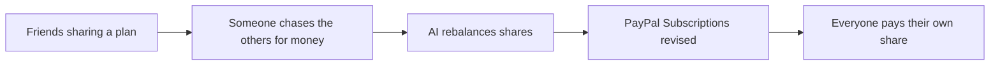

# #41 Shared Subscription Steward

> [!tldr] In one breath
> Family plan members each pay their share through their own PayPal subscription, and AI handles joins, leaves and price changes. It was cut (kill codes K2 and K4) as crowded and weak (desk score 60 out of 120).

> [!example] Picture this
> Four friends share a streaming plan. Every month someone chases the others for their $4. With this tool each friend has their own small subscription for their share. When a fifth friend joins, the AI quietly re splits the bill. It is like a group tab at a bar that updates itself.

> [!warning] Crowd check, Oct 23 2026
> Group splitting and pooling is a smaller cluster (3 to 6 repos) in a 266 repo scan (partial coverage): caresplit, potluck, purser, sarafupay, WePay and homeward. Subscriptions as a core feature were thin (triad, subscription-killer). Medium crowding.

**Theme:** [[Theme E6 Human delegation|E6 Human delegation]] · **Group:** Human delegation · **Crowding on Devpost:** Group pay cluster

## The problem
Shared plans create awkward reimbursement chasing.

## The idea
An organiser creates the plan, members subscribe to their share, and AI rebalances when members change. **The key point: it automates a small annoyance, not a large pain.**

## Who it is for
Friend groups and households.

## What the AI does
Rebalancing and messages.

## What PayPal does
Subscriptions (revise quantity or price).

**Building blocks used** (see [[30 Primitives Legend]]):
* `P07` Subscriptions (revise, suspend, payment-failed events)
* `A12` Eligibility reasoning and messaging

## Who else is doing this
Splitwise, Spliiit, Together Price. Subscription sharing marketplaces exist, and they have terms of service issues.

⚠️ **Verification status:** desk research only. Competitor names come from the landscape and Devpost scans, not from a per idea novelty hunt. Treat "no competitor found" as unproven.

## What makes it different
Low.

## Can we build it?
High.

## Smallest demo
A plan with 3 members.

## Risks
The group pay cluster is busy, and streaming services have terms of service limits on sharing.

## Sources
* [Devpost "Built with PayPal" listing (early entry clustering, about 72 reviewed)](https://devpost.com/software/built-with/paypal) ⚠️

## Scores
| Axis | Weight | Desk score |
|---|---|---|
| Tech | ×2 | 6 |
| Design | ×2 | 6 |
| Impact | ×2 | 3 |
| Innovation | ×2 | 3 |
| Demo | ×2 | 5 |
| Feasibility | ×1 | 8 |
| Risk⁻¹ | ×1 | 6 |
| **Total /120** | | **60** |

_Why (desk):_ Weak.

## Why it was cut
Two kill codes fired. `K2`: a crowded cluster or derivative headline, so innovation cannot be defended. `K4`: weak evidence or low impact, because the problem is a minor nuisance. See [[41 Brutal Elimination]].

> [!info]- Jargon decoder
> **Subscriptions API**: PayPal's tool for repeating payments, like a gym membership that bills itself monthly.
> **Revise**: change the amount or quantity of a running subscription.
> **Rebalancing**: re splitting a shared cost when people join or leave.
> **Terms of service (ToS)**: the rules a service says you must follow. Many ban sharing one plan across households.
> **Group pay cluster**: the many projects built around splitting bills.

## Where to next
* ⬆️ Up: [[Idea Index]]
* ⬅️ Previous: [[I040 Purpose-Bound Family Support]] · ➡️ Next: [[I042 Pre-Checkout Injection Firewall]]
* 🧭 Theme: [[Theme E6 Human delegation]]
* 🔗 Related: [[41 Brutal Elimination]], [[30 Primitives Legend]], [[17 Live Competition Scan (Oct 23)]], [[Jargon Decoder]], [[00 PayPal AI Hackathon Hub]]
