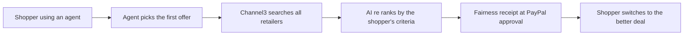

# #43 First-Offer Bias Auditor

> [!tldr] In one breath
> Before you approve an agent's purchase in PayPal, see whether it simply picked the first offer it saw, re ranked against the full multi retailer market. A good research hook with shallow PayPal use (desk score 81 out of 120).

> [!example] Picture this
> You ask your agent for a blender. It buys the first one it finds for $120. The auditor shows a "fairness receipt": the same blender is $85 at another store. It is like a friend who sees you about to buy the first thing on the shelf and says "wait, try the next aisle".

> [!warning] Crowd check, Oct 23 2026
> Conversational shopping and checkout agents are a busy area: about 25 repos in a 266 repo scan (partial coverage), including at least 10 named "PayPilot", plus errand (Channel3), buyguy, agentic-cart, gofer and checkout-agent. None found audit the agent's own pick for first offer bias. Medium crowding.

**Theme:** [[Theme E1 Agent purchase liability & integrity|E1 Agent purchase liability and integrity]] · **Group:** Agent integrity · **Crowding on Devpost:** Shopping agent cluster adjacent

## The problem
Microsoft's Magentic Marketplace found 60 to 100% first proposal bias, and welfare collapse as options grow.

## The idea
Ask Channel3 for the same product across retailers, re rank it with the user's own criteria, and show a "fairness receipt" at the PayPal approval step. Offer the better option. **The key point: it audits the agent, not just the price.**

## Who it is for
Consumers using shopping agents, and agent builders.

## What the AI does
Counterfactual re ranking and explanation.

## What PayPal does
Orders approval step, and Vault.

**Building blocks used** (see [[30 Primitives Legend]]):
* `P01` Orders v2 (create / capture / get)
* `S03` Sponsor tool: Channel3 (⚠ inferred)
* `A06` Entity matching and narrative drafting
* `A13` Vision verification / evidence narrative

## Who else is doing this
Honey, Google Shopping, Perplexity Shopping. Price comparison is mature. Auditing an agent's selection bias is not.

⚠️ **Verification status:** desk research only. Competitor names come from the landscape and Devpost scans, not from a per idea novelty hunt. Treat "no competitor found" as unproven.

## What makes it different
It audits the agent, not just the price.

## Can we build it?
High, with Channel3 credits.

## Smallest demo
The agent picks the first result, the auditor shows a cheaper equivalent, and the user switches.

## Risks
It may read as price comparison (a crowded area), and the PayPal integration is shallow.

## Sources
* [Magentic Marketplace: 60 to 100% first proposal bias (arXiv 2510.25779)](https://arxiv.org/html/2510.25779v1) ✅
* [Channel3 docs (search by text, image or URL, MCP, UCP; no checkout)](https://docs.trychannel3.com/) ✅

## Scores
| Axis | Weight | Desk score |
|---|---|---|
| Tech | ×2 | 6 |
| Design | ×2 | 7 |
| Impact | ×2 | 6 |
| Innovation | ×2 | 7 |
| Demo | ×2 | 7 |
| Feasibility | ×1 | 8 |
| Risk⁻¹ | ×1 | 7 |
| **Total /120** | | **81** |

_Why (desk):_ A good research hook, with shallow PayPal use.

**Kill criteria:** none triggered. This idea survived the culling round.

> [!info]- Jargon decoder
> **First proposal bias**: an agent choosing the first option shown, like a tired shopper grabbing the nearest item.
> **Re ranking**: sorting the options again using the shopper's real priorities.
> **Counterfactual**: "what would have happened if the agent had looked at everything?"
> **Fairness receipt**: a short note showing the agent's pick next to better options.
> **Channel3**: a sponsor tool that searches products across many retailers.
> **Welfare collapse**: shoppers getting worse results as the number of options grows.
> **Orders approval step**: the moment a human says yes to a PayPal purchase.
> **Vault**: PayPal safely storing a payment permission.

## Where to next
* ⬆️ Up: [[Idea Index]]
* ⬅️ Previous: [[I042 Pre-Checkout Injection Firewall]] · ➡️ Next: [[I044 Agent Price-Parity Checker]]
* 🧭 Theme: [[Theme E1 Agent purchase liability & integrity]]
* 🔗 Related: [[30 Primitives Legend]], [[17 Live Competition Scan (Oct 23)]], [[Jargon Decoder]], [[00 PayPal AI Hackathon Hub]]
