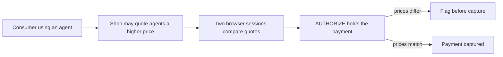

# #44 Agent Price-Parity Checker

> [!tldr] In one breath
> Compares the price a merchant quotes a signed agent with what a human session sees, before payment. It was cut (kill code K4) as novel but speculative, and thin on PayPal (desk score 72 out of 120).

> [!example] Picture this
> Your shopping agent carries a digital ID badge that shops can read. A shop sees the badge and quotes $110, while a person walking in sees $95. The checker sends two browsers, one with a badge and one without, to the same page, compares prices, and holds your payment if they differ. It is like sending a friend to the shop to ask the price without telling them you sent them.

> [!success] Crowd check, Oct 23 2026
> In a scan of 266 live hackathon repos (partial coverage), nothing matched. The nearest is breakpoint, which red teams a shop's AI checkout assistant, but it does not compare prices. The area looked empty, though the problem itself is also hypothetical today.

**Theme:** [[Theme E1 Agent purchase liability & integrity|E1 Agent purchase liability and integrity]] · **Group:** Agent integrity · **Crowding on Devpost:** none

## The problem
Signed agent identity makes it easy for shops to price discriminate, and no consumer tool audits it.

## The idea
Run parallel KERNEL browser sessions (an agent profile and a human profile) to capture quotes. Flag any difference before PayPal capture. **The key point: a spot check on whether agents get charged more.**

## Who it is for
Consumers, regulators and researchers.

## What the AI does
Browser agents and price extraction.

## What PayPal does
Holds payment until the parity check is done.

**Building blocks used** (see [[30 Primitives Legend]]):
* `S04` Sponsor tool: KERNEL browser infrastructure (⚠ inferred)
* `A09` Browser agents
* `P02` AUTHORIZE intent (hold funds)

## Who else is doing this
Academic audits only. No product found.

⚠️ **Verification status:** desk research only. Competitor names come from the landscape and Devpost scans, not from a per idea novelty hunt. Treat "no competitor found" as unproven.

## What makes it different
Novel.

## Can we build it?
Low to medium (bot detection and flaky sites).

## Smallest demo
Two demo merchants with differing prices.

## Risks
Thin PayPal integration, and the problem is hypothetical today.

## Sources
* [Cloudflare: signed agents, Visa TAP, Web Bot Auth](https://blog.cloudflare.com/secure-agentic-commerce/) ✅
* [Training LMs for bilateral trade, price discrimination (arXiv 2604.16472)](https://econpapers.repec.org/paper/arxpapers/2604.16472.htm) ✅
* [KERNEL payments doc (Stripe Link, AgentCard; no PayPal)](https://www.kernel.sh/docs/browsers/payments) ✅

## Scores
| Axis | Weight | Desk score |
|---|---|---|
| Tech | ×2 | 5 |
| Design | ×2 | 6 |
| Impact | ×2 | 4 |
| Innovation | ×2 | 9 |
| Demo | ×2 | 7 |
| Feasibility | ×1 | 5 |
| Risk⁻¹ | ×1 | 5 |
| **Total /120** | | **72** |

_Why (desk):_ Novel but speculative and thin on PayPal.

## Why it was cut
Kill code `K4`: weak evidence or low impact. In plain words, nobody has shown shops really do this yet, and PayPal plays only a small holding role. See [[41 Brutal Elimination]].

> [!info]- Jargon decoder
> **Price discrimination**: charging different people different prices for the same thing, like a taxi that quotes tourists more.
> **Signed agent**: an AI agent that carries a verifiable digital ID so websites know it is a bot.
> **KERNEL**: a sponsor tool that runs real web browsers in the cloud for agents.
> **Browser agent**: an AI that clicks and types on websites like a person.
> **AUTHORIZE intent**: hold the money now, take it later. Like a hotel holding $200 on your card at check in.
> **Capture**: actually taking the held money.
> **Parity**: the same price for everyone.

## Where to next
* ⬆️ Up: [[Idea Index]]
* ⬅️ Previous: [[I043 First-Offer Bias Auditor]] · ➡️ Next: [[I045 Agent Payment Eval Harness]]
* 🧭 Theme: [[Theme E1 Agent purchase liability & integrity]]
* 🔗 Related: [[41 Brutal Elimination]], [[30 Primitives Legend]], [[17 Live Competition Scan (Oct 23)]], [[Jargon Decoder]], [[00 PayPal AI Hackathon Hub]]
