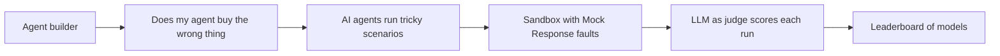

# #45 Agent Payment Eval Harness

> [!tldr] In one breath
> A benchmark that measures how often payment agents buy the wrong item, double charge, or fall for injection, run against the PayPal sandbox. It was cut (kill code K6) because it is valuable but not demo shaped (desk score 76 out of 120).

> [!example] Picture this
> Before a new driver gets a licence, they take a driving test with traps: a stop sign half hidden, a pedestrian stepping out. This harness is the driving test for payment agents. It throws 30 tricky shopping scenarios at each model and scores how many wrong purchases and double charges happen.

> [!success] Crowd check, Oct 23 2026
> In a scan of 266 live hackathon repos (partial coverage), no benchmark for payment agents appeared. The nearest are paypal-webhook-simulator and breakpoint (which red teams a shop's AI checkout assistant), plus guardrail repos that block rather than measure. The area looked thin.

**Theme:** [[Theme E1 Agent purchase liability & integrity|E1 Agent purchase liability and integrity]] · **Group:** Agent integrity · **Crowding on Devpost:** none

## The problem
Shopping benchmarks exist, but none measure wrong purchase rates with money at stake, or the cost of the disputes that follow.

## The idea
A suite of scenarios, sandbox fixtures (Mock Response declines, injected listings, ambiguous instructions), and a scorecard across models and frameworks. **The key point: money at stake metrics, not just "did it find the product".**

## Who it is for
Agent builders and PayPal DevRel.

## What the AI does
LLM agents under test, and an LLM as judge.

## What PayPal does
Agent toolkit, Orders, Mock Response and Disputes.

**Building blocks used** (see [[30 Primitives Legend]]):
* `P27` Agent Toolkit / MCP
* `P21` PayPal-Mock-Response header (sandbox fault injection)
* `P01` Orders v2 (create / capture / get)
* `A13` Vision verification / evidence narrative

## Who else is doing this
tau-bench, WebShop, ShoppingBench. Academic benchmarks exist without payment rails.

⚠️ **Verification status:** desk research only. Competitor names come from the landscape and Devpost scans, not from a per idea novelty hunt. Treat "no competitor found" as unproven.

## What makes it different
Money at stake metrics.

## Can we build it?
High.

## Smallest demo
30 scenarios times 3 models, shown as a leaderboard.

## Risks
The demo is a leaderboard.

## Sources
* [Magentic Marketplace: 60 to 100% first proposal bias (arXiv 2510.25779)](https://arxiv.org/html/2510.25779v1) ✅
* [paypal/agent-toolkit (46 tools, v1.11.0)](https://github.com/paypal/agent-toolkit) ✅
* [paypaldev/getting-started-with-paypal-sandbox (PayPal-Mock-Response)](https://github.com/paypaldev/getting-started-with-paypal-sandbox) ✅

## Scores
| Axis | Weight | Desk score |
|---|---|---|
| Tech | ×2 | 8 |
| Design | ×2 | 5 |
| Impact | ×2 | 5 |
| Innovation | ×2 | 8 |
| Demo | ×2 | 4 |
| Feasibility | ×1 | 8 |
| Risk⁻¹ | ×1 | 8 |
| **Total /120** | | **76** |

_Why (desk):_ Valuable, not demo shaped.

## Why it was cut
Kill code `K6`: infrastructure with no watchable demo. In plain words, it is a useful test rig, but a 3 minute video of a scoreboard is hard to make exciting. See [[41 Brutal Elimination]].

> [!info]- Jargon decoder
> **Eval harness / benchmark**: a standard test that scores AI systems, like an exam with an answer key.
> **Sandbox**: a pretend PayPal with no real money, like a flight simulator.
> **Mock Response header**: a switch that makes the sandbox pretend a payment was declined, so you can test failures on purpose.
> **Prompt injection**: hidden text that tricks an AI.
> **LLM as judge**: an AI grading another AI's answers.
> **Agent Toolkit / MCP**: a plug standard that lets AI agents use tools such as PayPal.
> **Double charge**: the same payment taken twice.
> **Fixtures**: prepared test data.

## Where to next
* ⬆️ Up: [[Idea Index]]
* ⬅️ Previous: [[I044 Agent Price-Parity Checker]] · ➡️ Next: [[I046 Protection-Aware Payment Selector]]
* 🧭 Theme: [[Theme E1 Agent purchase liability & integrity]]
* 🔗 Related: [[41 Brutal Elimination]], [[30 Primitives Legend]], [[17 Live Competition Scan (Oct 23)]], [[Jargon Decoder]], [[00 PayPal AI Hackathon Hub]]
