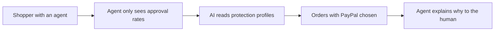

# #46 Protection-Aware Payment Selector

> [!tldr] In one breath
> Agents choose a payment method by weighing buyer protection, not just approval rate, and explain the choice to the human. It was cut (kill code K4) as a strategy deck, not a product (desk score 66 out of 120).

> [!example] Picture this
> You tell your agent to buy a $400 camera from a new shop. A card can be approved faster, but PayPal gives you stronger protection if the camera never arrives. The agent says "I picked PayPal, because if this seller disappears you can get your money back". It is like choosing the lock with the better warranty, even if the cheap one clicks shut faster.

> [!success] Crowd check, Oct 23 2026
> In a scan of 266 live hackathon repos (partial coverage), no repo made agents compare payment methods by protection. Shopping and checkout agents (about 25, including the "PayPilot" repos) simply pay with PayPal. The area looked empty.

**Theme:** [[Theme E5 Moment-of-send scams|E5 Moment of send scams]] · **Group:** Agent integrity · **Crowding on Devpost:** none

## The problem
Agents optimise for signals like approval and post purchase handling, and Klarna markets exactly those signals to agents. PayPal's protection advantage is invisible to agents.

## The idea
A machine readable protection profile for each method, merchant and category. The agent picks a method and explains why. **The key point: it makes PayPal's protection something an agent can read.**

## Who it is for
Agent builders, and PayPal (for branded checkout).

## What the AI does
Reasoning over protection terms.

## What PayPal does
Orders, and Purchase Protection terms.

**Building blocks used** (see [[30 Primitives Legend]]):
* `P01` Orders v2 (create / capture / get)
* `A16` Policy / rule reasoning with cited clauses

## Who else is doing this
Klarna's agentic APP. Klarna pitches agent facing signals.

⚠️ **Verification status:** desk research only. Competitor names come from the landscape and Devpost scans, not from a per idea novelty hunt. Treat "no competitor found" as unproven.

## What makes it different
Strategic for PayPal, but weak user pain.

## Can we build it?
High.

## Smallest demo
An agent choosing among payment methods.

## Risks
The end user problem is weak.

## Sources
* [Klarna agentic commerce: "signals agents rely on to choose a payment provider"](https://www.klarna.com/international/enterprise/agentic-commerce/) ✅
* [Nasdaq/Zacks: PayPal agentic meaningful "from 2028"; branded checkout +2%](https://www.nasdaq.com/articles/paypal-agentic-payments-can-they-reshape-future-commerce) ⚠️
* [Visa: Earning Consumer Trust in Agentic Commerce (PayPal top 3 trusted)](https://corporate.visa.com/en/products/intelligent-commerce/earning-trust-report.html) ✅

## Scores
| Axis | Weight | Desk score |
|---|---|---|
| Tech | ×2 | 5 |
| Design | ×2 | 5 |
| Impact | ×2 | 4 |
| Innovation | ×2 | 6 |
| Demo | ×2 | 5 |
| Feasibility | ×1 | 9 |
| Risk⁻¹ | ×1 | 7 |
| **Total /120** | | **66** |

_Why (desk):_ Strategy deck, not a product.

## Why it was cut
Kill code `K4`: weak evidence or low impact. In plain words, ordinary people do not feel this pain today, so it works better as a pitch to PayPal than as a product. See [[41 Brutal Elimination]].

> [!info]- Jargon decoder
> **Buyer protection**: a promise that you get your money back if the item never arrives or is not as described. Like a warranty on a purchase.
> **Approval rate**: how often a payment method gets accepted at checkout.
> **Machine readable profile**: a fact sheet written so software can read it, not just humans.
> **Branded checkout**: the PayPal button flow customers recognise.
> **Agentic commerce**: AI agents shopping and paying for you.
> **Policy reasoning with cited clauses**: the AI reading the rules and pointing to the exact line that applies.

## Where to next
* ⬆️ Up: [[Idea Index]]
* ⬅️ Previous: [[I045 Agent Payment Eval Harness]] · ➡️ Next: [[I047 WebMCP Storefront Kit]]
* 🧭 Theme: [[Theme E5 Moment-of-send scams]]
* 🔗 Related: [[41 Brutal Elimination]], [[30 Primitives Legend]], [[17 Live Competition Scan (Oct 23)]], [[Jargon Decoder]], [[00 PayPal AI Hackathon Hub]]
