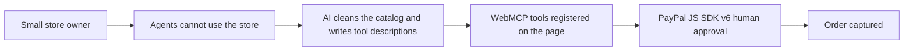

# #47 WebMCP Storefront Kit

> [!tldr] In one breath
> One script tag makes any small store agent callable: WebMCP tools for search, cart and checkout that hand off to PayPal JS SDK v6 for human approval. A deep dive demoted it from 95 to 72 out of 120 because Shopify, Stripe and WordPress plugins already ship the same thing.

> [!example] Picture this
> Rosa runs a small online tea shop on WooCommerce. AI assistants cannot easily shop there because the site was built for human eyes. She pastes one script tag and her shop suddenly has a "menu" an agent can read: search, add to cart, check out. When the agent reaches payment, a PayPal window asks Rosa's customer to approve. It is like putting braille labels on a shop so a new kind of customer can use it.

> [!warning] Crowd check, Oct 23 2026
> Agent ready storefronts are a medium crowded area: about 11 repos in a 266 repo scan (partial coverage), including suede-shelf, paypal-webmcp-shop, leafline-agent-store, shopfront-agent, AgentBaazar, ShopGenie, vendorapay, mrstockd, uamarket, atlas-order-agent and paypal-agent-shop. The deep dive also found Shopify, Stripe and a WordPress plugin ship the idea already. Crowded on the merchant side too.

**Theme:** [[Theme E7 Agent-ready long tail|E7 Agent ready long tail]] · **Group:** Agent ready long tail · **Crowding on Devpost:** The shopping agent cluster is buyer side. Merchant side tooling is rare.

## The problem
Under 1% of product pages are LLM ready (Mirakl). Merchants that are not on Shopify are invisible to agents unless they build UCP or ACP endpoints. PayPal's own WebMCP support is limited to Store Sync merchants, and Store Sync is US only, physical goods only, and needs an access form.

## The idea
A drop in kit reads the store's catalog (HTML, JSON-LD or CSV) and registers WebMCP tools (search_products, get_product, add_to_cart, start_checkout) through navigator.modelContext. It completes payment through a PayPal v6 session where the human approves, plus a fallback MCP endpoint for agents that are not in a browser. **The key point: an open, installable preview of where PayPal is heading, for merchants PayPal cannot reach yet.**

## Who it is for
Long tail merchants on WooCommerce, Squarespace and static sites, and agent builders.

## What the AI does
Catalog normalisation and enrichment with an LLM, tool descriptions generated from the catalog, and an in browser agent demo.

## What PayPal does
JS SDK v6 (PayPal, Venmo and Pay Later messaging), Orders v2 and webhooks. It mirrors PayPal's announced WebMCP flow.

**Building blocks used** (see [[30 Primitives Legend]]):
* `P24` JS SDK v6
* `P01` Orders v2 (create / capture / get)
* `P23` Pay Later messaging
* `P20` Webhooks (events, retries, verification)
* `A01` Document / image extraction (OCR, validation)
* `A03` Intent and rationale reasoning (LLM-as-judge)

## Who else is doing this
PayPal Store Sync and WebMCP, Shopify Agentic Storefronts, Firmly.ai. PayPal's official WebMCP is gated to Store Sync. Shopify serves its own merchants. Agent checkout APIs integrate merchant by merchant.

**Verification status:** adversarially deep dived (6+ differently phrased searches per idea). Full competitor table: [[D047 WebMCP Storefront Kit (Deep Dive)]].

## What makes it different
An open, merchant installable preview of where PayPal is going, for the merchants PayPal cannot reach yet.

## Can we build it?
Medium. WebMCP is an early preview Chrome API (flagged), so the demo needs a polyfill or an agent harness as a fallback.

## Smallest demo
A plain HTML store plus a script tag. An agent finds an item, adds it to the cart, PayPal approval happens, and the order is captured. The same store works through MCP for a Claude or ChatGPT agent.

## Risks
WebMCP spec churn and browser availability. The agentic commerce prize will attract many shopping agent entries, so differentiate on the merchant side.

## Deep dive verdict: demote
Merchant side WebMCP is already shipped by Shopify, Stripe and WordPress plugins. Only an ungated "PayPal v6 checkout as WebMCP tools" sliver remains. Demote it, and salvage it as a component.

_Why the score changed:_ Shopify turned on 10 WebMCP tools (including checkout) by default on all Liquid and Hydrogen stores (Aug 2026). Stripe ships WebMCP tools in its payment UIs. The WebMCP Bridge WordPress plugin (600+ installs) already exposes WooCommerce cart tools. PayPal announced the same concept (gated to Store Sync). Agent demand is about zero, because no mainstream agent calls modelContext tools (Gemini in Chrome is "soon"). The PayPal loop is checkout centred. The only narrow survivor is open PayPal v6 WebMCP checkout tools for sites outside Store Sync.

## Sources
* [PayPal blog: WebMCP support via JS SDK (Store Sync merchants only)](https://developer.paypal.com/community/blog/WebMCP_PayPal_Agent_Ready) ✅
* [PayPal Store Sync overview (US, physical goods, access form)](https://developer.paypal.com/store-sync/overview.md) ✅
* [Mirakl via Beet.TV: under 1% of product pages LLM ready](https://www.beet.tv/2026/08/fewer-than-1-of-product-pages-are-llm-ready-mirakls-meadon.html) ⚠️
* [eWeek: Chrome launches WebMCP early preview](https://www.eweek.com/de/news/google-webmcp-chrome-ai-web-standard-preview/) ⚠️
* [Patrick Brosset: WebMCP updates (navigator.modelContext, registerTool)](https://patrickbrosset.com/articles/2026-02-23-webmcp-updates-clarifications-and-next-steps/) ⚠️
* [Modern Retail: what went wrong with ChatGPT Instant Checkout](https://www.modernretail.co/technology/what-went-wrong-with-chatgpts-instant-checkout/) ⚠️

## Scores
| Axis | Weight | Desk score | After deep dive |
|---|---|---|---|
| Tech | ×2 | 8 | 6 |
| Design | ×2 | 8 | 7 |
| Impact | ×2 | 7 | 6 |
| Innovation | ×2 | 9 | 4 |
| Demo | ×2 | 9 | 7 |
| Feasibility | ×1 | 7 | 7 |
| Risk⁻¹ | ×1 | 6 | 5 |
| **Total /120** | | **95** | **72** |

_Why (desk):_ High novelty and a strong agentic commerce fit. Spec maturity is the main risk.

**Kill criteria:** none triggered. This idea survived the culling round, then lost points in the deep dive.

> [!info]- Jargon decoder
> **WebMCP**: a browser feature where a web page lists what an AI agent can do on it, like a menu of buttons for robots.
> **MCP**: a plug standard that lets AI agents use tools and data.
> **Long tail merchants**: the huge number of small shops outside the big platforms.
> **UCP / ACP**: shared formats for describing a store's products and checkout to agents, like a standard shop menu.
> **JSON-LD**: hidden labels in a web page that describe its content for machines.
> **PayPal JS SDK v6**: PayPal's code kit that adds checkout buttons to a web page.
> **Store Sync**: PayPal's program that syncs a merchant's catalog, open only to some merchants.
> **Pay Later messaging**: a note showing "pay in installments" options.
> **Polyfill**: a stand in code that fakes a feature missing from the browser, like a temporary ramp.
> **Webhooks**: PayPal pinging your app when something happens.
> **Human approval**: the person must confirm the payment, even if the agent did the shopping.

## Where to next
* ⬆️ Up: [[Idea Index]]
* ⬅️ Previous: [[I046 Protection-Aware Payment Selector]] · ➡️ Next: [[I048 Catalog-to-UCPACP Manifest Generator]]
* 🧭 Theme: [[Theme E7 Agent-ready long tail]]
* 🔬 Deep dive: [[D047 WebMCP Storefront Kit (Deep Dive)]]
* 🔗 Related: [[30 Primitives Legend]], [[17 Live Competition Scan (Oct 23)]], [[Jargon Decoder]], [[00 PayPal AI Hackathon Hub]]
