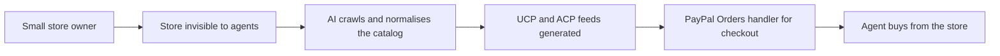

# #48 Catalog-to-UCP/ACP Manifest Generator

> [!tldr] In one breath
> Crawls a small store, normalises its catalog with AI, and emits UCP and ACP feeds plus a PayPal backed checkout handler. It overlaps idea 47 with a weaker demo (desk score 72 out of 120).

> [!example] Picture this
> Omar sells leather bags on his own website. AI shopping agents expect a product "menu" in a standard format, and his site has none. The tool crawls his store, tidies the messy descriptions, writes the standard menu files, and adds a checkout that ends in PayPal. It is like a translator who turns a handwritten menu into the one format every delivery app can read.

> [!warning] Crowd check, Oct 23 2026
> Agent ready storefronts are a medium crowded area: about 11 repos in a 266 repo scan (partial coverage), including shopfront-agent, paypal-agent-shop, AgentBaazar, atlas-order-agent and uamarket. At the platform level Shopify Catalog, PayPal Store Sync and Google Merchant Center already syndicate feeds. Crowded.

**Theme:** [[Theme E7 Agent-ready long tail|E7 Agent ready long tail]] · **Group:** Agent ready long tail · **Crowding on Devpost:** Feed syndication market crowded

## The problem
Merchants not on Shopify must build their own UCP manifests and handlers to be visible to agents.

## The idea
A crawler, an LLM normaliser, a manifest and feed generator, and a PayPal Orders handler. **The key point: automatic "agent readiness" for stores outside the big platforms.**

## Who it is for
Long tail merchants and agencies.

## What the AI does
Extraction and enrichment.

## What PayPal does
Orders and webhooks.

**Building blocks used** (see [[30 Primitives Legend]]):
* `P01` Orders v2 (create / capture / get)
* `P20` Webhooks (events, retries, verification)
* `A01` Document / image extraction (OCR, validation)

## Who else is doing this
Shopify Catalog, PayPal Store Sync, Klarna APP, Google Merchant Center. Feed syndication is crowded at the platform level.

⚠️ **Verification status:** desk research only. Competitor names come from the landscape and Devpost scans, not from a per idea novelty hunt. Treat "no competitor found" as unproven.

## What makes it different
Moderate.

## Can we build it?
Medium.

## Smallest demo
A store becomes a manifest, and an agent buys.

## Risks
Feed syndication is over served, per the landscape research.

## Sources
* [Google Developers: Under the hood, Universal Commerce Protocol](https://developers.googleblog.com/under-the-hood-universal-commerce-protocol-ucp/) ✅
* [Mirakl via Beet.TV: under 1% of product pages LLM ready](https://www.beet.tv/2026/08/fewer-than-1-of-product-pages-are-llm-ready-mirakls-meadon.html) ⚠️
* [PayPal Store Sync overview (US, physical goods, access form)](https://developer.paypal.com/store-sync/overview.md) ✅

## Scores
| Axis | Weight | Desk score |
|---|---|---|
| Tech | ×2 | 7 |
| Design | ×2 | 6 |
| Impact | ×2 | 6 |
| Innovation | ×2 | 5 |
| Demo | ×2 | 5 |
| Feasibility | ×1 | 7 |
| Risk⁻¹ | ×1 | 7 |
| **Total /120** | | **72** |

_Why (desk):_ Overlaps 47 with a weaker demo.

**Kill criteria:** none triggered. This idea survived the culling round.

> [!info]- Jargon decoder
> **UCP / ACP**: standard formats that let a store describe its products and checkout to AI agents. Like a shared restaurant menu format.
> **Manifest**: a file that lists what a store offers and how to buy, like a table of contents for robots.
> **Feed syndication**: pushing product data out to many shopping channels.
> **Catalog normalisation**: cleaning messy product details into one tidy format.
> **Crawler**: software that walks through a website page by page.
> **Orders handler**: code that creates and captures PayPal orders.
> **Long tail merchants**: small shops outside big platforms.
> **Store Sync**: PayPal's catalog sync program, open to limited merchants.

## Where to next
* ⬆️ Up: [[Idea Index]]
* ⬅️ Previous: [[I047 WebMCP Storefront Kit]] · ➡️ Next: [[I049 Agent-Buyability Audit]]
* 🧭 Theme: [[Theme E7 Agent-ready long tail]]
* 🔗 Related: [[30 Primitives Legend]], [[17 Live Competition Scan (Oct 23)]], [[Jargon Decoder]], [[00 PayPal AI Hackathon Hub]]
