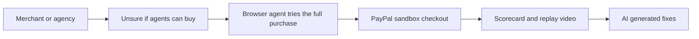

# #49 Agent-Buyability Audit

> [!tldr] In one breath
> Lighthouse for agents. A browser agent tries to buy from your store in the PayPal sandbox and reports exactly where agents fail, with fixes. Fresh, but PayPal is not the core (desk score 82 out of 120).

> [!example] Picture this
> Lena's online shop looks lovely to people, but the "Add to cart" button is an unlabeled image, and checkout needs a hidden pop up. She runs the audit. A robot shopper tries to buy a mug, gets stuck at step 3, and a replay video shows exactly where. The report says "label this button, fix this form". It is like a secret shopper who films their visit and hands you a to do list.

> [!success] Crowd check, Oct 23 2026
> In a scan of 266 live hackathon repos (partial coverage), no repo audits whether agents can buy from a store. Nearby are storefront builders (about 11, such as shopfront-agent and paypal-agent-shop) and breakpoint, which red teams a shop's AI checkout assistant. The audit angle looked thin.

**Theme:** [[Theme E7 Agent-ready long tail|E7 Agent ready long tail]] · **Group:** Agent ready long tail · **Crowding on Devpost:** none

## The problem
Merchants cannot tell whether agents can complete a purchase on their sites.

## The idea
A KERNEL browser agent tries discovery, then cart, then PayPal checkout. It records a replay video, makes a scorecard, and generates fixes (structured data, labels, steps). **The key point: a transaction level test, not just "does the AI mention my brand".**

## Who it is for
Merchants and agencies.

## What the AI does
A browser agent, failure diagnosis and fix generation.

## What PayPal does
Checkout in the sandbox, and JS SDK v6.

**Building blocks used** (see [[30 Primitives Legend]]):
* `S04` Sponsor tool: KERNEL browser infrastructure (⚠ inferred)
* `A09` Browser agents
* `A14` Diagnosis / code transformation
* `P24` JS SDK v6

## Who else is doing this
Profound, Scrunch AI, Bluefish. "AI visibility" tools track brand mentions in AI answers, not whether a purchase can be completed.

⚠️ **Verification status:** desk research only. Competitor names come from the landscape and Devpost scans, not from a per idea novelty hunt. Treat "no competitor found" as unproven.

## What makes it different
A transaction level audit.

## Can we build it?
Medium (browser flakiness).

## Smallest demo
Audit two demo stores, one good and one broken.

## Risks
PayPal is incidental unless the fixes focus on checkout.

## Sources
* [Mirakl via Beet.TV: under 1% of product pages LLM ready](https://www.beet.tv/2026/08/fewer-than-1-of-product-pages-are-llm-ready-mirakls-meadon.html) ⚠️
* [KERNEL payments doc (Stripe Link, AgentCard; no PayPal)](https://www.kernel.sh/docs/browsers/payments) ✅
* [WebAIM Million 2026: 95.9% of home pages fail WCAG](https://webaim.org/projects/million/) ✅

## Scores
| Axis | Weight | Desk score |
|---|---|---|
| Tech | ×2 | 6 |
| Design | ×2 | 7 |
| Impact | ×2 | 6 |
| Innovation | ×2 | 8 |
| Demo | ×2 | 8 |
| Feasibility | ×1 | 6 |
| Risk⁻¹ | ×1 | 6 |
| **Total /120** | | **82** |

_Why (desk):_ Fresh, but PayPal is not the core.

**Kill criteria:** none triggered. This idea survived the culling round.

> [!info]- Jargon decoder
> **Lighthouse**: Google's tool that scores how well a web page performs. This idea is the same kind of report card, but for agents.
> **Browser agent**: an AI that clicks and types on websites like a person.
> **KERNEL**: a sponsor tool that runs real browsers in the cloud for agents.
> **Sandbox**: a pretend PayPal with no real money, like a flight simulator.
> **Structured data**: labels in a web page that machines can read.
> **JS SDK v6**: PayPal's code kit for checkout buttons.
> **WCAG**: the web accessibility rules. Pages that fail them are often hard for agents too.
> **AI visibility tools**: services that count how often AI answers mention your brand.

## Where to next
* ⬆️ Up: [[Idea Index]]
* ⬅️ Previous: [[I048 Catalog-to-UCPACP Manifest Generator]] · ➡️ Next: [[I050 Promo & Loyalty-Aware Agent Checkout]]
* 🧭 Theme: [[Theme E7 Agent-ready long tail]]
* 🔗 Related: [[30 Primitives Legend]], [[17 Live Competition Scan (Oct 23)]], [[Jargon Decoder]], [[00 PayPal AI Hackathon Hub]]
