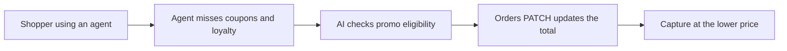

# #50 Promo & Loyalty-Aware Agent Checkout

> [!tldr] In one breath
> Lets agents apply coupons and loyalty at checkout by patching the PayPal order before capture. It is feature sized, more a feature than a product (desk score 71 out of 120).

> [!example] Picture this
> Sam's agent buys a jacket. Sam has a 15 percent loyalty reward, but the agent never knew, so he pays full price. With this tool, the agent asks the shop's promo engine "what does Sam get?", then edits the open PayPal order to the lower total before money is taken. It is like a cashier who remembers to scan your loyalty card before you pay.

> [!success] Crowd check, Oct 23 2026
> In a scan of 266 live hackathon repos (partial coverage), no repo focused on coupons or loyalty for agent checkout. Chat to checkout agents (about 25, including the "PayPilot" repos) pay but do not handle promos. The area looked empty.

**Theme:** [[Theme E7 Agent-ready long tail|E7 Agent ready long tail]] · **Group:** Agent ready long tail · **Crowding on Devpost:** none

## The problem
Missing promotions and loyalty sank ChatGPT Instant Checkout.

## The idea
A promo engine, plus a PATCH to the order before capture. **The key point: the agent gets the real discount a human would have got.**

## Who it is for
Merchants.

## What the AI does
Eligibility reasoning.

## What PayPal does
Orders PATCH, and capture.

**Building blocks used** (see [[30 Primitives Legend]]):
* `P05` Orders PATCH (change an order before capture)
* `P01` Orders v2 (create / capture / get)
* `A16` Policy / rule reasoning with cited clauses

## Who else is doing this
Shopify discounts, Talon.One. Promotion engines exist. Agent facing ones are new.

⚠️ **Verification status:** desk research only. Competitor names come from the landscape and Devpost scans, not from a per idea novelty hunt. Treat "no competitor found" as unproven.

## What makes it different
Moderate.

## Can we build it?
High.

## Smallest demo
An agent applies loyalty to an order.

## Risks
It is feature sized.

## Sources
* [Modern Retail: what went wrong with ChatGPT Instant Checkout](https://www.modernretail.co/technology/what-went-wrong-with-chatgpts-instant-checkout/) ⚠️

## Scores
| Axis | Weight | Desk score |
|---|---|---|
| Tech | ×2 | 6 |
| Design | ×2 | 6 |
| Impact | ×2 | 5 |
| Innovation | ×2 | 6 |
| Demo | ×2 | 5 |
| Feasibility | ×1 | 8 |
| Risk⁻¹ | ×1 | 7 |
| **Total /120** | | **71** |

_Why (desk):_ Feature, not product.

**Kill criteria:** none triggered. This idea survived the culling round.

> [!info]- Jargon decoder
> **Orders PATCH**: editing an open PayPal order before it is paid, like changing your restaurant order before the kitchen cooks it.
> **Capture**: actually taking the money for an order.
> **Promo engine**: software that decides which coupons and offers apply to a basket.
> **Loyalty**: points or rewards for repeat customers.
> **Eligibility reasoning**: the AI checking the rules to see if someone qualifies, and pointing to the rule used.
> **ChatGPT Instant Checkout**: OpenAI's in chat buying feature, which struggled partly for lacking promos.

## Where to next
* ⬆️ Up: [[Idea Index]]
* ⬅️ Previous: [[I049 Agent-Buyability Audit]] · ➡️ Next: [[I051 Micro-Merchant Instant Storefront]]
* 🧭 Theme: [[Theme E7 Agent-ready long tail]]
* 🔗 Related: [[30 Primitives Legend]], [[17 Live Competition Scan (Oct 23)]], [[Jargon Decoder]], [[00 PayPal AI Hackathon Hub]]
