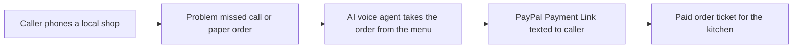

# #52 Voice Phone-Order Taker

> [!tldr] In one breath
> A voice agent picks up a local shop's phone, takes the order and texts the caller a PayPal payment link. **It is a known pattern with existing vendors, so it scores 72 out of 120.**

> [!example] Picture this
> It is Friday rush at a small pizza place. The phone rings six times while the owner has flour to the elbows, and the caller hangs up. Now a friendly voice answers, repeats the order back, and a minute later the customer's phone buzzes with a link to pay.

> [!warning] Crowd check, Oct 23 2026
> The scan found about 25 chat to checkout repos, including two voice ones: sahaya and shopvoice-pay. Phone ordering for shops is not named in the scan, but voice plus PayPal is not empty. The note's own Devpost scan counts about 4 booking or front desk entries.

**Theme:** [[Theme E7 Agent-ready long tail|E7 Agent-ready long tail]] · **Group:** Agent-ready long tail · **Crowding on Devpost:** booking and front desk (about 4)

## The problem
Small restaurants and shops miss calls and take orders on paper.

## The idea
A voice agent, a menu it can check answers against (so it does not invent dishes), a payment link sent by SMS and an order ticket for the kitchen.

## Who it is for
Local small businesses.

## What the AI does
Talks and listens (voice) and keeps its answers tied to the real menu (grounding).

## What PayPal does
Payment Links, Orders and webhooks (PayPal's automatic "it happened" messages).

**Building blocks used** (see [[30 Primitives Legend]]):
* `P22` Payment Links
* `P20` Webhooks (events, retries, verification)
* `A08` Speech / voice

## Who else is doing this
ConverseNow, Slang.ai. **Voice ordering vendors exist.**

⚠️ Verification: desk research only. The competitor names come from the landscape and Devpost scans, not from a hunt for each idea. Treat "no competitor found" as unproven.

## How it stands out
Low.

## Can we build it?
Medium.

## Smallest demo
Call, then order, then a paid link.

## Risks
The front desk booking cluster is busy, and voice can be unreliable.

## Sources
* [Devpost 'Built with PayPal' listing (early entry clustering, about 72 reviewed)](https://devpost.com/software/built-with/paypal) ⚠️

## Scores
| Axis | Weight | Desk score | 
|---|---|---|
| Tech | ×2 | 6 | 
| Design | ×2 | 7 | 
| Impact | ×2 | 5 | 
| Innovation | ×2 | 4 | 
| Demo | ×2 | 7 | 
| Feasibility | ×1 | 7 | 
| Risk⁻¹ | ×1 | 7 | 
| **Total /120** | | **72** | 

_Why (desk):_ Known pattern.

**Kill codes:** none triggered.

> [!info]- Jargon decoder
> **Voice agent**: software that talks on a phone call like a person. Like a receptionist who never sleeps.
> **Menu grounding**: forcing the AI to answer only from the real menu. Like a waiter who must read from the card.
> **Payment Link**: a web address that opens PayPal checkout for one order.
> **Webhook**: PayPal knocking on your door to say "that payment just landed". Like a delivery doorbell.
> **SMS**: a plain text message.
> **Primitives**: Lego brick style building blocks listed in [[30 Primitives Legend]]. More terms in [[Jargon Decoder]].

## Where to next
* ⬆️ Up: [[Idea Index]]
* ⬅️ Previous: [[I051 Micro-Merchant Instant Storefront]] · ➡️ Next: [[I053 Livestream Checkout Agent]]
* 🎯 Theme: [[Theme E7 Agent-ready long tail]]
* 🔗 Related: [[30 Primitives Legend]], [[Jargon Decoder]], [[00 PayPal AI Hackathon Hub]]
