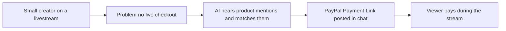

# #53 Livestream Checkout Agent

> [!tldr] In one breath
> AI listens to a creator's livestream, spots product mentions and drops PayPal payment links into the chat as it happens. **It was cut under kill code K4 (weak evidence of demand) despite a 74 desk score.**

> [!example] Picture this
> Jo sells candles on a live video. Viewers type "how much is the lavender one?" while Jo is mid sentence. A helper bot hears "lavender" and posts a pay link in chat before the question is even finished.

> [!success] Crowd check, Oct 23 2026
> The area looked thin in a 266 repo GitHub scan (partial coverage). The only close hit was answertab (pay per answer on live streams). Live commerce platforms such as Whatnot exist outside the hackathon.

**Theme:** [[Theme E7 Agent-ready long tail|E7 Agent-ready long tail]] · **Group:** Agent-ready long tail · **Crowding on Devpost:** none

## The problem
Small creators cannot run live commerce infrastructure.

## The idea
Speech to text, product matching, and payment links posted in chat.

## Who it is for
Small creators.

## What the AI does
Speech recognition and entity linking (matching a spoken phrase to a real product).

## What PayPal does
Payment Links and Orders.

**Building blocks used** (see [[30 Primitives Legend]]):
* `P22` Payment Links
* `A08` Speech / voice
* `A06` Entity matching and narrative drafting

## Who else is doing this
Whatnot, CommentSold, TikTok Shop. **Live commerce platforms exist.**

⚠️ Verification: desk research only. The competitor names come from the landscape and Devpost scans, not from a hunt for each idea. Treat "no competitor found" as unproven.

## How it stands out
Moderate for small creators.

## Can we build it?
Medium.

## Smallest demo
A recorded stream that produces links.

## Risks
Weak evidence of demand.

## Sources
No sources were recorded for this idea.

## Scores
| Axis | Weight | Desk score | 
|---|---|---|
| Tech | ×2 | 6 | 
| Design | ×2 | 7 | 
| Impact | ×2 | 4 | 
| Innovation | ×2 | 6 | 
| Demo | ×2 | 7 | 
| Feasibility | ×1 | 7 | 
| Risk⁻¹ | ×1 | 7 | 
| **Total /120** | | **74** | 

_Why (desk):_ Weak evidence.

## Why it was cut
**K4, weak evidence or low impact.** In plain words: nobody showed real proof that small creators need this, so the story is hard to defend. See [[41 Brutal Elimination]]. Eliminated ideas keep their notes and scores, they just cannot be finalists.

> [!info]- Jargon decoder
> **Livestream**: a live video broadcast with a chat box beside it.
> **Speech to text**: software that types what it hears. Like a court stenographer.
> **Entity linking**: matching "the lavender one" to the exact item in the product list.
> **Payment Link**: a web address that opens PayPal checkout for one item.
> **K4**: the kill code for weak evidence or low impact, explained above. More terms in [[Jargon Decoder]].

## Where to next
* ⬆️ Up: [[Idea Index]]
* ⬅️ Previous: [[I052 Voice Phone-Order Taker]] · ➡️ Next: [[I054 Decline Whisperer]]
* 🎯 Theme: [[Theme E7 Agent-ready long tail]]
* 🔗 Related: [[41 Brutal Elimination]], [[30 Primitives Legend]], [[Jargon Decoder]]
