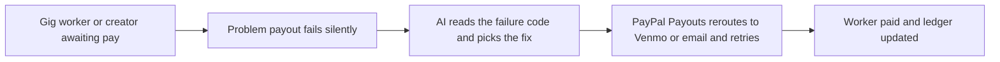

# #55 Payout Failure Triage

> [!tldr] In one breath
> For platforms that pay creators and gig workers, AI reads PayPal's payout failure codes and turns them into fixes. It contacts the recipient, reroutes to Venmo or email, and retries. **A finalist: desk score 95, down to 86 after a deep dive, verdict "advance with changes".**

> [!example] Picture this
> A creator platform pays 10 people on Friday. Four payments bounce. One person typed an email PayPal has never seen, one tripped a risk check. Normally those four wait silently for days and then flood support. With triage, each person gets a text that says exactly what to fix, and a retry goes out the moment they do.

> [!warning] Crowd check, Oct 23 2026
> Payouts to workers and bounties is a small cluster (payday-agent, Burmalda, takken, routewell, and mergepay for GitHub bounties). The scan found only 1 to 2 repos per area for Payouts at scale, and none that focus on failure recovery. PayPal's own inspiration list mentions paying gig workers on approval, so the payout itself is common. The twist is the failure triage.

**Theme:** [[Theme E8 Failure-path intelligence|E8 Failure-path intelligence]] · **Group:** Failure-path intelligence · **Crowding on Devpost:** payout on approval appears in the official inspiration list

## The problem
Over half of gig workers report slow or late payments, and 81% would prioritise instant payout platforms (Worldpay). **Failed payouts silently strand earnings and create support tickets.**

## The idea
Send a batch of payments with the Payouts API. When one item fails (RECEIVER_UNREGISTERED, RISK_DECLINE, CIP_NOT_VERIFIED and others), an agent:
* classifies the cause,
* messages the worker with exact fix steps,
* offers another way to receive money (a Venmo handle or phone number),
* retries,
* keeps an auditable payout ledger (a record anyone can check later).

It uses PayPal's sandbox failure test values so every branch can be shown the same way each time.

## Who it is for
Marketplaces, creator platforms, bounty and hackathon organisers, and gig platforms.

## What the AI does
Classifies the failure and picks the next best action, writes to the recipient and plans the batch.

## What PayPal does
Payouts batch and item status, Venmo handle payouts, sandbox ERRPYO test values, webhooks and Transaction Search.

**Building blocks used** (see [[30 Primitives Legend]]):
* `P11` Payouts (batch)
* `P12` Payouts to Venmo handles
* `P13` Payouts failure handling and test values (UNCLAIMED, cancel, RETURNED, ERRPYO codes)
* `P20` Webhooks (events, retries, verification)
* `P18` Transaction Search / Reporting
* `A05` Structured decision / classification (most common)
* `A12` Eligibility reasoning and messaging
* `A03` Intent and rationale reasoning (LLM-as-judge)

## Who else is doing this
Tipalti, Trolley, Hyperwallet. **Payout platforms handle onboarding and compliance. AI driven failure repair per recipient is not their headline.** Hyperwallet is a PayPal company, so that is positioning, not competition.

Verification: adversarially deep dived (6 or more differently phrased searches per idea). Full competitor table: [[D055 Payout Failure Triage (Deep Dive)]].

## How it stands out
It treats payout failures as a conversation that can be recovered. It fills a gap in PayPal's agent tooling (the Payouts tools are an open pull request).

## Can we build it?
High. The Payouts sandbox test values cover about 50 failure modes. Live Payouts access needs approval, the sandbox does not.

## Smallest demo
A batch of 10 creator payouts with 4 seeded failures. Triage runs, 3 are recovered by reroute or retry, and the ledger shows it all.

## Risks
"Pay gig workers on approval" is in PayPal's own inspiration list. The payout is common, the failure triage is the twist.

## Sources
* [Worldpay gig workers: 81% prefer instant payout platforms](https://www.worldpay.com/en/insights/articles/gig-workers-payments-imperative) ✅
* [PayPal Payouts sandbox test values (ERRPYO0xx)](https://developer.paypal.com/api/payouts/test-go-live.md) ✅
* [agent-toolkit PR #107, add Payouts tools (open)](https://github.com/paypal/agent-toolkit/pulls) ✅
* [Hackathon resources and inspiration list](https://paypalaihackathon.devpost.com/resources) ✅

## Scores
| Axis | Weight | Desk score | Post-deep-dive |
|---|---|---|---|
| Tech | ×2 | 9 | 8 |
| Design | ×2 | 8 | 8 |
| Impact | ×2 | 7 | 6 |
| Innovation | ×2 | 7 | 6 |
| Demo | ×2 | 8 | 7 |
| Feasibility | ×1 | 9 | 9 |
| Risk⁻¹ | ×1 | 8 | 7 |
| **Total /120** | | **95** | **86** |

_Why (desk):_ Deep PayPal use with deterministic failure demo; solid evidence.

**Kill codes:** none triggered.

## What the deep dive said: advance with changes
It is a recoverable payout workflow with compliance guardrails. **Build the hero loop on a real UNCLAIMED state, not on mock codes.**

_Why the score dropped from 95 to 86:_ The sandbox failure branches are mostly canned mock responses. The classification is a lookup table. There is no primary data on payout failure rates. Payouts are used by 10 or more Devpost entries, and HoldWatch explains ONHOLD events. It survives as a real loop: UNCLAIMED, contact the worker, cancel, RETURNED, re-issue, with visible compliance refusals.

> [!info]- Jargon decoder
> **Payout**: PayPal sending money out to many people at once. Like payday at a factory.
> **Batch**: many payments sent as one bundle.
> **Triage**: sorting problems by what to do first. Like an ER nurse at the door.
> **UNCLAIMED**: the money was sent to an email with no PayPal account yet, so it waits. Like a cheque nobody has cashed.
> **RETURNED**: unclaimed money that bounced back to the sender after waiting.
> **Webhook**: PayPal knocking to say something happened. Like a doorbell.
> **Sandbox and test values**: a pretend PayPal with magic inputs that trigger set failures. Like a driving test course.
> **Ledger**: a running record of who was paid what.
> **LLM as judge**: using an AI to decide and explain a call. More terms in [[Jargon Decoder]].

## Where to next
* ⬆️ Up: [[Idea Index]]
* ⬅️ Previous: [[I054 Decline Whisperer]] · ➡️ Next: [[I056 Integration Chaos Monkey]]
* 🎯 Theme: [[Theme E8 Failure-path intelligence]]
* 🔬 Deep dive: [[D055 Payout Failure Triage (Deep Dive)]]
* 🔗 Related: [[30 Primitives Legend]], [[Jargon Decoder]]
