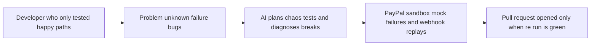

# #56 Integration Chaos Monkey

> [!tldr] In one breath
> An agent attacks a merchant's PayPal integration with every sandbox failure mode, watches what breaks, and opens a pull request with the fix. **A finalist: desk score 90, down to 80 after a deep dive, verdict "advance with changes".**

> [!example] Picture this
> A shop owner's checkout works perfectly when everything goes right. Then a card gets declined, a webhook arrives twice, and a customer double clicks Pay. The shop breaks in three places nobody tested. The chaos agent runs all those bad days on purpose, shows the broken orders on screen, and proposes the code fixes.

> [!success] Crowd check, Oct 23 2026
> Developer tooling for PayPal integrators looked thin in a 266 repo GitHub scan (partial coverage). Only cutover (legacy API migration) and paypal-webhook-simulator showed up. The deep dive found closer rivals, listed below, including PayPal's own /paypal:doctor.

**Theme:** [[Theme E8 Failure-path intelligence|E8 Failure-path intelligence]] · **Group:** Failure-path intelligence · **Crowding on Devpost:** none

## The problem
PayPal's own developer advocates told entrants to "test the unhappy paths". Developer pain shows webhook, vault and v6 SDK failures. **Most integrations only test the happy flows.**

## The idea
It uses PayPal-Mock-Response codes (a header that tells the sandbox to fake a failure), webhook replays (re-sending PayPal's messages) and a KERNEL browser that walks the checkout. It exercises declines, duplicates, cancellations and timeouts. An AI analyses the failures, maps them to PayPal docs, proposes code fixes as a pull request and produces a resilience score.

## Who it is for
Developers integrating PayPal, and agencies.

## What the AI does
Plans the tests, diagnoses failures and repairs the code.

## What PayPal does
Mock-Response negative testing, Orders and Payments, webhooks and JS SDK v6.

**Building blocks used** (see [[30 Primitives Legend]]):
* `P21` PayPal-Mock-Response header (sandbox fault injection)
* `P01` Orders v2 (create / capture / get)
* `P20` Webhooks (events, retries, verification)
* `P24` JS SDK v6
* `S04` Sponsor tool: KERNEL browser infrastructure (⚠ inferred)
* `A14` Diagnosis / code transformation
* `A09` Browser agents

## Who else is doing this
Stripe test clocks, Postman monitors, Gremlin. **General chaos and API testing tools exist, but none know PayPal's failure taxonomy or write fixes.**

Verification: adversarially deep dived (6 or more differently phrased searches per idea). Full competitor table: [[D056 Integration Chaos Monkey (Deep Dive)]].

## How it stands out
PayPal specific resilience testing with AI repair. It speaks directly to the developer relations judges.

## Can we build it?
Medium to high.

## Smallest demo
A sample shop with 3 bugs. Chaos run finds 3 failures, a pull request fixes them, and the re run is green.

## Risks
The audience is developers, so impact is harder to quantify. Stage 1 judging is fine because PayPal is the subject.

## Sources
* [Kickoff: Set Up PayPal's Sandbox and AI Toolkit From Scratch (transcript)](https://www.youtube.com/watch?v=FFJfCW9z3Do) ✅
* [paypaldev/getting-started-with-paypal-sandbox (PayPal-Mock-Response)](https://github.com/paypaldev/getting-started-with-paypal-sandbox) ✅
* [PayPal Webhooks overview (25 retries over 3 days)](https://developer.paypal.com/api/webhooks/overview) ✅
* [agent-toolkit #98: PayPal-Request-Id never set per call (no idempotency)](https://github.com/paypal/agent-toolkit/issues/98) ✅

## Scores
| Axis | Weight | Desk score | Post-deep-dive |
|---|---|---|---|
| Tech | ×2 | 8 | 8 |
| Design | ×2 | 7 | 7 |
| Impact | ×2 | 6 | 5 |
| Innovation | ×2 | 8 | 6 |
| Demo | ×2 | 8 | 7 |
| Feasibility | ×1 | 8 | 7 |
| Risk⁻¹ | ×1 | 8 | 7 |
| **Total /120** | | **90** | **80** |

_Why (desk):_ Novel dev tool aligned with judges' stated values.

**Kill codes:** none triggered.

## What the deep dive said: advance with changes
**Position it as the live partner of /paypal:doctor.** Make PayPal actually fail at the running app (mock codes plus real signed webhook replays), show the broken order, and open a pull request only when the re run goes green.

_Why the score dropped from 90 to 80:_ PayPal's own AI Toolkit command /paypal:doctor already scans code for the same failure types (INSTRUMENT_DECLINED, webhook verification and idempotency, PayPal-Request-Id, retries) and applies fixes automatically. Also crowding the space: payfuzz (webhook delivery fuzzing), MockGateway (PayPal mock outcomes), Autonoma (agentic checkout end to end tests), Stripe audit and fix skills, and PayPal's announced Merchant AI Integration Agent. Pain evidence is anecdotal. Mock responses do not change PayPal state. Injecting the header into a merchant's SDK calls needs a proxy. What survives as novel: dynamic sandbox fault injection, signed webhook replay, and a pull request gated on a green re run.

> [!info]- Jargon decoder
> **Chaos monkey**: a tool that breaks things on purpose to see if they survive. Like a fire drill for software.
> **Sandbox**: PayPal's pretend world for testing.
> **Mock-Response header**: a note attached to a test request saying "pretend this fails". Like asking an actor to faint on cue.
> **Webhook and replay**: PayPal's doorbell messages, and re sending an old one to see how your shop reacts.
> **Idempotency**: sending the same request twice has the same effect as once. Like pressing an elevator button twice.
> **Pull request**: a proposed code change someone must approve.
> **Static scan vs dynamic test**: reading the code for mistakes versus running it and watching it break.
> **KERNEL browser**: a cloud browser the agent drives to click through checkout. More terms in [[Jargon Decoder]].

## Where to next
* ⬆️ Up: [[Idea Index]]
* ⬅️ Previous: [[I055 Payout Failure Triage]] · ➡️ Next: [[I057 Webhook Drift Doctor]]
* 🎯 Theme: [[Theme E8 Failure-path intelligence]]
* 🔬 Deep dive: [[D056 Integration Chaos Monkey (Deep Dive)]]
* 🔗 Related: [[30 Primitives Legend]], [[Jargon Decoder]]
