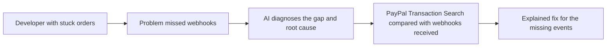

# #57 Webhook Drift Doctor

> [!tldr] In one breath
> It finds missed or unverifiable PayPal webhooks by checking them against Transaction Search, then explains the root cause. **Cut under K6: a useful tool but a boring demo.**

> [!example] Picture this
> A shop gets paid, but the "payment arrived" message never reaches its system, so the order stays stuck. Nobody notices for a week. The doctor compares PayPal's own record to what the shop heard, spots the gap and says "this webhook was never delivered, here is why".

> [!success] Crowd check, Oct 23 2026
> Developer tooling for PayPal integrators looked thin in a 266 repo GitHub scan (partial coverage). paypal-webhook-simulator is the closest repo, and it simulates webhooks rather than diagnosing missed ones.

**Theme:** [[Theme E8 Failure-path intelligence|E8 Failure-path intelligence]] · **Group:** Failure-path intelligence · **Crowding on Devpost:** none

## The problem
Webhook delivery and verification problems are recurring developer pain.

## The idea
A monitor, a reconciliation step (matching two records to find gaps) and an AI diagnosis.

## Who it is for
Developers.

## What the AI does
Diagnosis.

## What PayPal does
Webhooks and Transaction Search.

**Building blocks used** (see [[30 Primitives Legend]]):
* `P20` Webhooks (events, retries, verification)
* `P18` Transaction Search / Reporting
* `A14` Diagnosis / code transformation

## Who else is doing this
Hookdeck, Svix. **Webhook infrastructure tools exist.**

⚠️ Verification: desk research only. The competitor names come from the landscape and Devpost scans, not from a hunt for each idea. Treat "no competitor found" as unproven.

## How it stands out
PayPal specific reconciliation.

## Can we build it?
High.

## Smallest demo
Drop events, detect the gap, explain it.

## Risks
It is narrow, and the demo is a dashboard.

## Sources
* [PayPal Webhooks overview (25 retries over 3 days)](https://developer.paypal.com/api/webhooks/overview) ✅
* [PayPal Transaction Search v1 (lag of up to 3 hours, 31 day window)](https://developer.paypal.com/docs/api/transaction-search/v1/) ✅

## Scores
| Axis | Weight | Desk score | 
|---|---|---|
| Tech | ×2 | 7 | 
| Design | ×2 | 5 | 
| Impact | ×2 | 4 | 
| Innovation | ×2 | 5 | 
| Demo | ×2 | 4 | 
| Feasibility | ×1 | 9 | 
| Risk⁻¹ | ×1 | 8 | 
| **Total /120** | | **67** | 

_Why (desk):_ Narrow dev utility.

## Why it was cut
**K6, infrastructure with no watchable demo.** In plain words: it works behind the scenes, so a 3 minute video would show a dashboard and little else. See [[41 Brutal Elimination]]. Eliminated ideas keep their notes and scores.

> [!info]- Jargon decoder
> **Webhook**: PayPal knocking on your app's door to say something happened. Like a doorbell.
> **Transaction Search**: PayPal's record book of past payments you can look up.
> **Reconciliation**: comparing two lists to find what is missing. Like checking a receipt against your bag.
> **Drift**: two records slowly falling out of agreement.
> **K6**: the kill code for no watchable demo, explained above. More terms in [[Jargon Decoder]].

## Where to next
* ⬆️ Up: [[Idea Index]]
* ⬅️ Previous: [[I056 Integration Chaos Monkey]] · ➡️ Next: [[I058 Exactly-Once Agent Payment Proxy]]
* 🎯 Theme: [[Theme E8 Failure-path intelligence]]
* 🔗 Related: [[41 Brutal Elimination]], [[30 Primitives Legend]], [[Jargon Decoder]]
