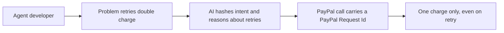

# #58 Exactly-Once Agent Payment Proxy

> [!tldr] In one breath
> An MCP proxy gives every PayPal agent tool call a repeatable ID, so an AI that retries can never double charge. **Great for a pull request, thin as a product, so it was cut under K6.**

> [!example] Picture this
> You tap "Pay" on a slow lift button, nothing seems to happen, so you tap again. Two lifts arrive. An AI agent does the same thing when a payment call times out: it retries, and the customer is charged twice. The proxy stamps each payment with a unique ticket number so the second tap is recognised as the same request.

> [!warning] Crowd check, Oct 23 2026
> This sits next to the most crowded area in the scan: agent spending mandates and guardrails (about 30 repos, such as permit, mandate, Warden, paypal-agent-firewall and others). None of those named in the scan is described as an idempotency proxy, so the exact angle looks open, but it lives in a busy neighbourhood.

**Theme:** [[Theme E8 Failure-path intelligence|E8 Failure-path intelligence]] · **Group:** Failure-path intelligence · **Crowding on Devpost:** adjacent to the policy proxy cluster

## The problem
The agent toolkit never sets PayPal-Request-Id per call (issue #98). **LLM retries can duplicate orders and refunds.**

## The idea
A proxy derives keys from intent hashes (a fingerprint of what the agent meant to do), caches outcomes and resolves "unknown outcome" errors. It also sends the fix upstream as a pull request.

## Who it is for
Agent developers.

## What the AI does
Intent hashing and retry reasoning.

## What PayPal does
Agent toolkit and MCP, with the PayPal-Request-Id header.

**Building blocks used** (see [[30 Primitives Legend]]):
* `P27` Agent Toolkit / MCP
* `A03` Intent and rationale reasoning (LLM-as-judge)

## Who else is doing this
HN "pays once" projects. **Builders hand roll their own idempotency.**

⚠️ Verification: desk research only. The competitor names come from the landscape and Devpost scans, not from a hunt for each idea. Treat "no competitor found" as unproven.

## How it stands out
Correctness for PayPal agents.

## Can we build it?
High.

## Smallest demo
A chaos retry demo: double charge without the proxy, a single charge with it.

## Risks
It is infrastructure only, with a weak design score.

## Sources
* [agent-toolkit #98: PayPal-Request-Id never set per call (no idempotency)](https://github.com/paypal/agent-toolkit/issues/98) ✅
* [HN Algolia, 2026 'agent payments' Show HN threads](https://hn.algolia.com/api/v1/search?query=agent%20payments&tags=story&numericFilters=created_at_i>1767225600) ✅

## Scores
| Axis | Weight | Desk score | 
|---|---|---|
| Tech | ×2 | 8 | 
| Design | ×2 | 4 | 
| Impact | ×2 | 5 | 
| Innovation | ×2 | 6 | 
| Demo | ×2 | 5 | 
| Feasibility | ×1 | 9 | 
| Risk⁻¹ | ×1 | 8 | 
| **Total /120** | | **73** | 

_Why (desk):_ Great PR, thin product.

## Why it was cut
**K6, infrastructure with no watchable demo.** In plain words: the best result is that nothing bad happens, which is hard to film. See [[41 Brutal Elimination]]. Eliminated ideas keep their notes and scores.

> [!info]- Jargon decoder
> **Idempotency key**: a unique ticket number on a request so repeating it does nothing new. Like a coat check ticket.
> **PayPal-Request-Id**: PayPal's header that carries that ticket number.
> **MCP**: a standard plug that lets AI agents use outside tools. Like a universal charger.
> **Proxy**: a middleman that every call passes through. Like a receptionist.
> **Hash**: a short fingerprint made from some data.
> **LLM as judge**: using an AI to decide and explain a call.
> **K6**: the kill code for no watchable demo, explained above. More terms in [[Jargon Decoder]].

## Where to next
* ⬆️ Up: [[Idea Index]]
* ⬅️ Previous: [[I057 Webhook Drift Doctor]] · ➡️ Next: [[I059 v5→v6 Migration & Certification Agent]]
* 🎯 Theme: [[Theme E8 Failure-path intelligence]]
* 🔗 Related: [[41 Brutal Elimination]], [[30 Primitives Legend]], [[Jargon Decoder]]
