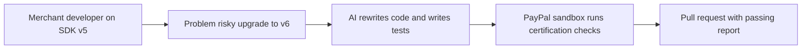

# #59 v5→v6 Migration & Certification Agent

> [!tldr] In one breath
> An agent upgrades a merchant's PayPal JS SDK v5 integration to v6, runs a test suite to prove it works, and opens a pull request. **Very sponsor aligned but not novel, because PayPal announced its own version (70 out of 120).**

> [!example] Picture this
> A bakery's website still uses PayPal's old checkout code. The developer is dreading the upgrade. The agent reads the code, rewrites the old pieces for v6, runs checkout in the sandbox, and hands over a ready to review change with a passing report.

> [!warning] Crowd check, Oct 23 2026
> Close match: cutover (jeretc/cutover), where AI migrates legacy NVP, checkout.js and IPN code to Orders v2 and JS SDK v6 and verifies it in the sandbox. Developer tooling for PayPal integrators is otherwise thin (paypal-webhook-simulator). PayPal's announced Merchant AI Integration Agent is the other big overlap.

**Theme:** [[Theme E8 Failure-path intelligence|E8 Failure-path intelligence]] · **Group:** Failure-path intelligence · **Crowding on Devpost:** none

## The problem
PayPal announced a "Merchant AI Integration Agent" (Ai4 2026) for exactly this job. **Version 6 also has known integration pitfalls.**

## The idea
Code analysis, code transformation, sandbox certification tests and a pull request.

## Who it is for
Merchants' developers and agencies.

## What the AI does
Code transformation and test generation.

## What PayPal does
JS SDK v6, Orders and the sandbox.

**Building blocks used** (see [[30 Primitives Legend]]):
* `P24` JS SDK v6
* `P01` Orders v2 (create / capture / get)
* `A14` Diagnosis / code transformation

## Who else is doing this
PayPal Merchant AI Integration Agent (announced). **PayPal itself has announced this capability.**

⚠️ Verification: desk research only. The competitor names come from the landscape and Devpost scans, not from a hunt for each idea. Treat "no competitor found" as unproven.

## How it stands out
Low, since it follows PayPal's own roadmap, but very sponsor aligned.

## Can we build it?
Medium.

## Smallest demo
Migrate a v5 demo shop.

## Risks
It competes with PayPal's announced product.

## Sources
* [PayPal at Ai4 2026: Merchant AI Integration Agent, Know Your Agent](https://newsroom.paypal-corp.com/2026-08-10-PayPal-Takes-Center-Stage-at-Ai4-2026) ✅
* [PayPal JS SDK v6 announcement](https://developer.paypal.com/community/blog/paypal-js-sdk-v6/) ✅
* [PayPal Dev Days 2025 hackathon winners](https://developer.paypal.com/community/blog/winners-dev-days-hackathon) ✅

## Scores
| Axis | Weight | Desk score | 
|---|---|---|
| Tech | ×2 | 7 | 
| Design | ×2 | 6 | 
| Impact | ×2 | 5 | 
| Innovation | ×2 | 4 | 
| Demo | ×2 | 6 | 
| Feasibility | ×1 | 7 | 
| Risk⁻¹ | ×1 | 7 | 
| **Total /120** | | **70** | 

_Why (desk):_ Aligned but not novel.

**Kill codes:** none triggered.

> [!info]- Jargon decoder
> **SDK**: a toolkit of ready made code for talking to a service. Like a Lego set with instructions.
> **v5 and v6**: the old and new versions of PayPal's JavaScript SDK.
> **Migration**: moving code from the old way to the new way. Like moving house.
> **Certification tests**: checks that prove the new setup behaves correctly.
> **Pull request**: a proposed code change that a person reviews and approves.
> **Sandbox**: PayPal's pretend world for testing.
> **Primitives**: Lego brick style building blocks listed in [[30 Primitives Legend]]. More terms in [[Jargon Decoder]].

## Where to next
* ⬆️ Up: [[Idea Index]]
* ⬅️ Previous: [[I058 Exactly-Once Agent Payment Proxy]] · ➡️ Next: [[I060 Sandbox Scenario Studio]]
* 🎯 Theme: [[Theme E8 Failure-path intelligence]]
* 🔗 Related: [[30 Primitives Legend]], [[Jargon Decoder]], [[00 PayPal AI Hackathon Hub]]
