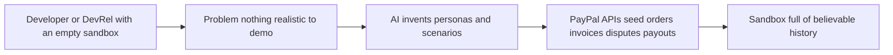

# #60 Sandbox Scenario Studio

> [!tldr] In one breath
> Describe a business in a sentence and AI fills a PayPal sandbox with realistic customers, subscriptions, invoices, disputes and payout failures. **A useful developer tool with modest impact (82 out of 120).**

> [!example] Picture this
> You are building a dashboard for an online bakery, but the test PayPal account is empty, so every screen looks blank. You type "online bakery with 3 months of history" and a minute later the sandbox holds hundreds of orders, a few angry disputes and two failed payouts. Now your demo looks alive.

> [!success] Crowd check, Oct 23 2026
> Developer tooling for PayPal integrators looked thin in a 266 repo GitHub scan (partial coverage). Only cutover and paypal-webhook-simulator showed up, and neither seeds realistic sandbox data.

**Theme:** [[Theme E8 Failure-path intelligence|E8 Failure-path intelligence]] · **Group:** Failure-path intelligence · **Crowding on Devpost:** none

## The problem
Developers demo and test on empty sandboxes. **PayPal's sandbox powers (the dispute factory, payout test values) are little known.**

## The idea
An LLM persona generator plus scripted API calls to seed realistic state, and a library of scenarios to reuse.

## Who it is for
Developers, developer relations (DevRel) staff and QA testers.

## What the AI does
Generates the personas and scenarios.

## What PayPal does
Orders, Invoicing, Subscriptions, the Disputes sandbox factory and Payouts test values.

**Building blocks used** (see [[30 Primitives Legend]]):
* `P15` Disputes sandbox factory (create, adjudicate)
* `P13` Payouts failure handling and test values (UNCLAIMED, cancel, RETURNED, ERRPYO codes)
* `P08` Invoicing v2 (create, send, partial payment)
* `P07` Subscriptions (revise, suspend, payment-failed events)
* `A12` Eligibility reasoning and messaging

## Who else is doing this
Stripe fixtures. **Stripe CLI fixtures exist, nothing comparable for PayPal.**

⚠️ Verification: desk research only. The competitor names come from the landscape and Devpost scans, not from a hunt for each idea. Treat "no competitor found" as unproven.

## How it stands out
A fresh developer tool.

## Can we build it?
High.

## Smallest demo
"Online bakery with 3 months of history" becomes a seeded sandbox.

## Risks
The audience is developers only.

## Sources
* [PayPal Disputes test and go live: sandbox create, chargeback and adjudicate endpoints](https://developer.paypal.com/disputes/test-go-live.md) ✅
* [PayPal Payouts sandbox test values (ERRPYO0xx)](https://developer.paypal.com/api/payouts/test-go-live.md) ✅

## Scores
| Axis | Weight | Desk score | 
|---|---|---|
| Tech | ×2 | 8 | 
| Design | ×2 | 6 | 
| Impact | ×2 | 5 | 
| Innovation | ×2 | 7 | 
| Demo | ×2 | 6 | 
| Feasibility | ×1 | 9 | 
| Risk⁻¹ | ×1 | 9 | 
| **Total /120** | | **82** | 

_Why (desk):_ Useful dev tool; modest impact.

**Kill codes:** none triggered.

> [!info]- Jargon decoder
> **Sandbox**: PayPal's pretend world where fake money moves. Like a flight simulator.
> **Persona**: an invented customer with habits and a history.
> **Seeding**: filling a system with starter data. Like stocking a shop before opening day.
> **Dispute factory**: a sandbox tool that creates fake disputes on demand.
> **Payout test values**: magic inputs that trigger set payout failures.
> **Fixtures**: ready made sample data sets.
> **DevRel**: the people who help developers use a product. More terms in [[Jargon Decoder]].

## Where to next
* ⬆️ Up: [[Idea Index]]
* ⬅️ Previous: [[I059 v5→v6 Migration & Certification Agent]] · ➡️ Next: [[I061 Agent Returns Concierge]]
* 🎯 Theme: [[Theme E8 Failure-path intelligence]]
* 🔗 Related: [[30 Primitives Legend]], [[Jargon Decoder]], [[00 PayPal AI Hackathon Hub]]
