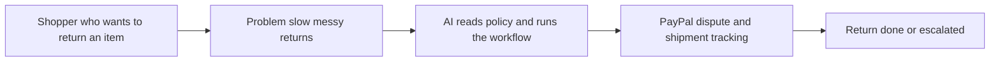

# #61 Agent Returns Concierge

> [!tldr] In one breath
> The buyer's agent handles a return end to end (policy, label, tracking) and escalates through PayPal if the merchant stalls. **Cut under K1: the real world version needs PayPal doors that are closed to outside developers.**

> [!example] Picture this
> You bought boots that are a size too small. Returning them means hunting for the policy, printing a label and chasing the shop for a week. Your agent does all of it, and when the shop goes quiet, it opens a dispute for you.

> [!warning] Crowd check, Oct 23 2026
> Returns exactly like this were not named in the scan. Close cousins in the dispute and refund area are returngate and clippay (partial refunds), inside a dispute copilot cluster of about 16 repos. Those are mostly seller side, while this idea is buyer side.

**Theme:** [[Theme E3 Evidence economy|E3 Evidence economy]] · **Group:** After the purchase · **Crowding on Devpost:** none

## The problem
Return experiences drive trust (67% would stop shopping after a bad one). **No protocol supports returns started by an agent.**

## The idea
A return agent that escalates to a dispute when needed.

## Who it is for
Consumers.

## What the AI does
Reads the return policy and runs the workflow.

## What PayPal does
Disputes (creating one as a buyer is sandbox only) and tracking.

**Building blocks used** (see [[30 Primitives Legend]]):
* `P15` Disputes sandbox factory (create, adjudicate)
* `P17` Shipment Tracking API (add tracking; releases holds)
* `A03` Intent and rationale reasoning (LLM-as-judge)

## Who else is doing this
Loop Returns, Narvar. **Merchant side returns platforms exist.**

⚠️ Verification: desk research only. The competitor names come from the landscape and Devpost scans, not from a hunt for each idea. Treat "no competitor found" as unproven.

## How it stands out
It works from the buyer's side.

## Can we build it?
Medium.

## Smallest demo
A return flow with escalation.

## Risks
Buyer side dispute creation is not open to third parties in production. The endpoint is sandbox only.

## Sources
* [NRF and Happy Returns: $890B in returns in 2024](https://nrf.com/media-center/press-releases/nrf-and-happy-returns-report-2024-retail-returns-total-890-billion) ✅
* [PayPal Disputes test and go live: sandbox create, chargeback and adjudicate endpoints](https://developer.paypal.com/disputes/test-go-live.md) ✅

## Scores
| Axis | Weight | Desk score | 
|---|---|---|
| Tech | ×2 | 6 | 
| Design | ×2 | 7 | 
| Impact | ×2 | 6 | 
| Innovation | ×2 | 6 | 
| Demo | ×2 | 6 | 
| Feasibility | ×1 | 6 | 
| Risk⁻¹ | ×1 | 4 | 
| **Total /120** | | **72** | 

_Why (desk):_ Real-world path depends on gated buyer-side APIs.

## Why it was cut
**K1, the real path depends on gated or unavailable APIs.** In plain words: the key PayPal door (opening a dispute as the buyer) only works in the practice sandbox, so a live version could not be built by outsiders. See [[41 Brutal Elimination]]. Eliminated ideas keep their notes and scores.

> [!info]- Jargon decoder
> **Agent**: an AI that takes actions for you, not just chats.
> **Escalation**: moving a stuck problem up to a higher authority.
> **Dispute**: a formal complaint filed through PayPal when a deal goes wrong.
> **Gated API**: a PayPal feature locked to approved partners. Like a staff only door.
> **Sandbox**: PayPal's pretend world for testing.
> **Shipment tracking**: attaching a parcel tracking number to a payment.
> **LLM as judge**: using an AI to decide and explain a call.
> **K1**: the gated API kill code, explained above. More terms in [[Jargon Decoder]].

## Where to next
* ⬆️ Up: [[Idea Index]]
* ⬅️ Previous: [[I060 Sandbox Scenario Studio]] · ➡️ Next: [[I062 Returns-Abuse Pattern Detector]]
* 🎯 Theme: [[Theme E3 Evidence economy]]
* 🔗 Related: [[41 Brutal Elimination]], [[30 Primitives Legend]], [[Jargon Decoder]]
