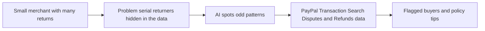

# #62 Returns-Abuse Pattern Detector

> [!tldr] In one breath
> It flags wardrobing and serial return patterns across a merchant's PayPal refunds and disputes. **Cut under K6: the demo is a table of data, and big incumbents own this space.**

> [!example] Picture this
> A customer buys a dress on Thursday, wears it to a wedding and returns it Monday. Then does the same with a jacket, and a pair of shoes. One return looks harmless. The detector sees the pattern across months and tells the owner "this buyer has returned 9 of 10 orders".

> [!success] Crowd check, Oct 23 2026
> Nothing similar showed up in a 266 repo GitHub scan (partial coverage). The nearest repos are refund focused (returngate, clippay), not abuse detection. Outside the hackathon, incumbents such as Appriss Retail and Signifyd serve large retailers.

**Theme:** [[Theme E3 Evidence economy|E3 Evidence economy]] · **Group:** After the purchase · **Crowding on Devpost:** none

## The problem
Return fraud and abuse cost US retailers about $100B (Appriss).

## The idea
Pattern detection over refunds and disputes, plus policy suggestions.

## Who it is for
Merchants.

## What the AI does
Anomaly detection (spotting what does not fit the usual pattern).

## What PayPal does
Transaction Search, Disputes and Refunds.

**Building blocks used** (see [[30 Primitives Legend]]):
* `P18` Transaction Search / Reporting
* `P14` Disputes API (get, messages, make-offer, accept-offer, provide-evidence)
* `A15` Anomaly detection

## Who else is doing this
Appriss Retail, Signifyd Abuse Prevention. **Incumbents dominate enterprise retail.**

⚠️ Verification: desk research only. The competitor names come from the landscape and Devpost scans, not from a hunt for each idea. Treat "no competitor found" as unproven.

## How it stands out
A small business PayPal version.

## Can we build it?
High.

## Smallest demo
Seeded data.

## Risks
The demo is a table.

## Sources
* [Appriss 2026: $100B of preventable return fraud and abuse](https://apprissretail.com/2026-total-retail-loss-benchmark-report/) ✅

## Scores
| Axis | Weight | Desk score | 
|---|---|---|
| Tech | ×2 | 6 | 
| Design | ×2 | 5 | 
| Impact | ×2 | 6 | 
| Innovation | ×2 | 4 | 
| Demo | ×2 | 4 | 
| Feasibility | ×1 | 9 | 
| Risk⁻¹ | ×1 | 8 | 
| **Total /120** | | **67** | 

_Why (desk):_ Incumbent space, table demo.

## Why it was cut
**K6, infrastructure with no watchable demo.** In plain words: spotting patterns in rows of data does not make a gripping 3 minute video. See [[41 Brutal Elimination]]. Eliminated ideas keep their notes and scores.

> [!info]- Jargon decoder
> **Wardrobing**: buying clothes, using them once and returning them. Like borrowing from a shop.
> **Serial returner**: someone who returns almost everything they buy.
> **Anomaly detection**: software that notices what looks unusual. Like a bank texting you about a strange purchase.
> **Transaction Search**: PayPal's record book of past payments.
> **Incumbent**: an established company that already owns the market.
> **K6**: the kill code for no watchable demo, explained above. More terms in [[Jargon Decoder]].

## Where to next
* ⬆️ Up: [[Idea Index]]
* ⬅️ Previous: [[I061 Agent Returns Concierge]] · ➡️ Next: [[I063 Price-Protection Autopilot]]
* 🎯 Theme: [[Theme E3 Evidence economy]]
* 🔗 Related: [[41 Brutal Elimination]], [[30 Primitives Legend]], [[Jargon Decoder]]
