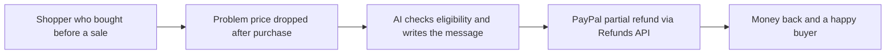

# #63 Price-Protection Autopilot

> [!tldr] In one breath
> A merchant promises 14 day price protection, and an agent watches the shop's own prices and automatically sends partial refunds when they drop. **Cut under K4: weak evidence of real demand.**

> [!example] Picture this
> You buy a jacket for $80. Three days later it goes on sale for $60. Normally you would email support and wait. Here the shop's agent notices the drop, sends you $20 back through PayPal, and emails you a polite note.

> [!success] Crowd check, Oct 23 2026
> The area looked thin in a 266 repo GitHub scan (partial coverage). The closest repo is clippay (partial refunds). Some Shopify apps already offer price drop guarantees.

**Theme:** [[Theme E3 Evidence economy|E3 Evidence economy]] · **Group:** After the purchase · **Crowding on Devpost:** none

## The problem
Shoppers delay purchases because they fear price drops. Manual price adjustment requests burden support.

## The idea
It watches catalog prices, works out eligible partial refunds, issues them through the Refunds API and emails the buyers.

## Who it is for
Merchants.

## What the AI does
Decides eligibility and writes the messages.

## What PayPal does
Partial refunds and the Catalog.

**Building blocks used** (see [[30 Primitives Legend]]):
* `P16` Refunds (full / partial)
* `P30` Catalog products / billing plans
* `A12` Eligibility reasoning and messaging

## Who else is doing this
Shopify price protection apps. **Some e-commerce apps offer price drop guarantees.**

⚠️ Verification: desk research only. The competitor names come from the landscape and Devpost scans, not from a hunt for each idea. Treat "no competitor found" as unproven.

## How it stands out
Moderate.

## Can we build it?
High.

## Smallest demo
A price drop leads to partial refunds.

## Risks
Weak evidence.

## Sources
No sources were recorded for this idea.

## Scores
| Axis | Weight | Desk score | 
|---|---|---|
| Tech | ×2 | 6 | 
| Design | ×2 | 6 | 
| Impact | ×2 | 3 | 
| Innovation | ×2 | 6 | 
| Demo | ×2 | 6 | 
| Feasibility | ×1 | 9 | 
| Risk⁻¹ | ×1 | 8 | 
| **Total /120** | | **71** | 

_Why (desk):_ Weak evidence.

## Why it was cut
**K4, weak evidence or low impact.** In plain words: nobody showed hard proof that shoppers or merchants care enough, so the story is hard to defend. See [[41 Brutal Elimination]]. Eliminated ideas keep their notes and scores.

> [!info]- Jargon decoder
> **Price protection**: a shop's promise to refund the difference if the price falls soon after you buy.
> **Partial refund**: giving back part of the money, not all of it.
> **Catalog**: PayPal's saved list of products and prices.
> **Autopilot**: it runs on its own with no human clicking.
> **K4**: the kill code for weak evidence or low impact, explained above. More terms in [[Jargon Decoder]].

## Where to next
* ⬆️ Up: [[Idea Index]]
* ⬅️ Previous: [[I062 Returns-Abuse Pattern Detector]] · ➡️ Next: [[I064 Refund Policy Compiler]]
* 🎯 Theme: [[Theme E3 Evidence economy]]
* 🔗 Related: [[41 Brutal Elimination]], [[30 Primitives Legend]], [[Jargon Decoder]]
