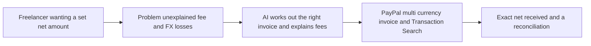

# #65 Net-Landed Quote Engine

> [!tldr] In one breath
> A freelancer states what they need to receive. AI picks the invoice currency and amount so they net exactly that after PayPal fees and currency conversion, and explains every deduction. **Practical, with a framing risk (79 out of 120).**

> [!example] Picture this
> Priya, a designer in India, wants exactly $1,000 in her pocket from a UK client. If she invoices $1,000, fees and currency conversion nibble it down to well under $1,000 and she cannot tell why. The engine works backwards: "invoice this amount in this currency and you will receive $1,000", with each deduction itemised.

> [!success] Crowd check, Oct 23 2026
> Cross border FX looked thin in a 266 repo GitHub scan (partial coverage: homeward, WePay, tradeos). Freelancer invoicing in general is busy (ledgerbird, invoicepilot, duespilot and others), but a tool that works backwards from a net amount was not named.

**Theme:** [[Theme E10 Cross-border, giving & inclusion|E10 Cross-border, giving & inclusion]] · **Group:** Cross-border clarity · **Crowding on Devpost:** none

## The problem
Cross border, cross currency PayPal sales can stack to about 8 to 9% plus fixed fees. Reddit sellers report losing 11.2% without understanding why.

## The idea
A fee and FX calculator built on PayPal's published fee schedule, the payer's location and the currency options. It generates the invoice. After payment, it reconciles the actual deductions against the expected ones.

## Who it is for
Cross border freelancers and small exporters.

## What the AI does
Fee reasoning, explanations and a reconciliation story.

## What PayPal does
Invoicing (multi currency) and the fee fields in Transaction Search.

**Building blocks used** (see [[30 Primitives Legend]]):
* `P08` Invoicing v2 (create, send, partial payment)
* `P18` Transaction Search / Reporting
* `A16` Policy / rule reasoning with cited clauses
* `A12` Eligibility reasoning and messaging

## Who else is doing this
Wise invoices, Payoneer. **Other payment routes compete on price. PayPal specific transparency tools do not exist.**

⚠️ Verification: desk research only. The competitor names come from the landscape and Devpost scans, not from a hunt for each idea. Treat "no competitor found" as unproven.

## How it stands out
It is framed as transparency, not as "PayPal is expensive".

## Can we build it?
High.

## Smallest demo
Target $1,000 net from a UK client, then the invoice, then the reconciliation.

## Risks
It could look anti sponsor if framed poorly. The fee schedule can change.

## Sources
* [PayPal merchant fees (3.49% plus $0.49; 1.5% extra international; 3 to 4% FX)](https://www.paypal.com/us/webapps/mpp/merchant-fees) ✅

## Scores
| Axis | Weight | Desk score | 
|---|---|---|
| Tech | ×2 | 7 | 
| Design | ×2 | 7 | 
| Impact | ×2 | 6 | 
| Innovation | ×2 | 6 | 
| Demo | ×2 | 6 | 
| Feasibility | ×1 | 9 | 
| Risk⁻¹ | ×1 | 6 | 
| **Total /120** | | **79** | 

_Why (desk):_ Practical; framing risk.

**Kill codes:** none triggered.

> [!info]- Jargon decoder
> **Net landed**: the money that actually arrives in your account after every cut. Like take home pay after tax.
> **FX**: foreign exchange, swapping one currency for another.
> **Cross border**: money crossing from one country to another.
> **Invoice**: a bill you send a client.
> **Reconciliation**: comparing what you expected with what happened. Like checking a receipt against your bag.
> **Transaction Search**: PayPal's record book of past payments, including fees. More terms in [[Jargon Decoder]].

## Where to next
* ⬆️ Up: [[Idea Index]]
* ⬅️ Previous: [[I064 Refund Policy Compiler]] · ➡️ Next: [[I066 Duty-Inclusive Cross-Border Checkout]]
* 🎯 Theme: [[Theme E10 Cross-border, giving & inclusion]]
* 🔗 Related: [[30 Primitives Legend]], [[Jargon Decoder]], [[00 PayPal AI Hackathon Hub]]
