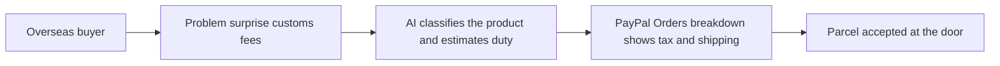

# #66 Duty-Inclusive Cross-Border Checkout

> [!tldr] In one breath
> AI estimates duties and taxes at checkout and shows the full landed cost in the PayPal order breakdown, so parcels are not refused at the door. **Cut under K2 and K4: mature providers already solve it (59 out of 120).**

> [!example] Picture this
> You order a $50 lamp from abroad. At your door the courier asks for $20 in customs fees you never saw. You refuse the parcel, and the seller loses the sale and the lamp. If checkout had shown "$50 plus $20 duty" up front, nobody would be surprised.

> [!success] Crowd check, Oct 23 2026
> Cross border looked thin in a 266 repo GitHub scan (partial coverage: homeward, WePay, tradeos). Duty and tax calculation was not named. Outside the hackathon, Zonos, Global-e and Avalara are mature providers.

**Theme:** [[Theme E10 Cross-border, giving & inclusion|E10 Cross-border, giving & inclusion]] · **Group:** Cross-border clarity · **Crowding on Devpost:** none

## The problem
Surprise duties cause refused deliveries and disputes.

## The idea
HS code classification, a duty estimate and an order breakdown.

## Who it is for
Small cross border businesses.

## What the AI does
HS classification.

## What PayPal does
The Orders breakdown (tax and shipping lines).

**Building blocks used** (see [[30 Primitives Legend]]):
* `P01` Orders v2 (create / capture / get)
* `A05` Structured decision / classification (most common)

## Who else is doing this
Zonos, Global-e, Avalara. **These are mature landed cost providers.**

⚠️ Verification: desk research only. The competitor names come from the landscape and Devpost scans, not from a hunt for each idea. Treat "no competitor found" as unproven.

## How it stands out
Low.

## Can we build it?
Medium.

## Smallest demo
Two countries.

## Risks
Incumbents, and tax accuracy.

## Sources
No sources were recorded for this idea.

## Scores
| Axis | Weight | Desk score | 
|---|---|---|
| Tech | ×2 | 5 | 
| Design | ×2 | 6 | 
| Impact | ×2 | 4 | 
| Innovation | ×2 | 3 | 
| Demo | ×2 | 5 | 
| Feasibility | ×1 | 7 | 
| Risk⁻¹ | ×1 | 6 | 
| **Total /120** | | **59** | 

_Why (desk):_ Solved by incumbents.

## Why it was cut
Two kill codes fired. See [[41 Brutal Elimination]].
* **K2, crowded cluster or derivative headline.** In plain words: others already do this well, so it cannot be called new.
* **K4, weak evidence or low impact.** In plain words: the proof of need and the size of the win were both thin.

Eliminated ideas keep their notes and scores.

> [!info]- Jargon decoder
> **Duty**: a border tax on imported goods.
> **Landed cost**: the true total price once shipping, duty and tax are added. Like the final bill at a restaurant with tip.
> **HS code**: a worldwide number code that names what a product is, so customs knows the tax rate.
> **Classification**: sorting something into the right category.
> **Incumbent**: an established company that already owns the market.
> **K2 and K4**: the kill codes for crowded market and for weak evidence, explained above. More terms in [[Jargon Decoder]].

## Where to next
* ⬆️ Up: [[Idea Index]]
* ⬅️ Previous: [[I065 Net-Landed Quote Engine]] · ➡️ Next: [[I067 Multilingual Dispute Communicator]]
* 🎯 Theme: [[Theme E10 Cross-border, giving & inclusion]]
* 🔗 Related: [[41 Brutal Elimination]], [[30 Primitives Legend]], [[Jargon Decoder]]
