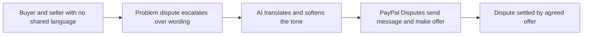

# #67 Multilingual Dispute Communicator

> [!tldr] In one breath
> A cross border buyer and seller settle a dispute in their own languages through PayPal's dispute messaging, with AI translation and tone repair. **Useful but narrow (71 out of 120).**

> [!example] Picture this
> A buyer in Spain and a seller in Ohio argue about a late package. Each uses a translation app, and the angry wording gets worse in translation. With this tool, each message is translated and softened, and a fair offer is suggested, so the two settle in an afternoon.

> [!warning] Crowd check, Oct 23 2026
> Dispute copilots are a busy area: about 16 repos (witness, dispute-defender, dispute-copilot, rebuttal, dispute-radar and others). None of those named focuses on translation and tone, so the language angle looks open, but it sits inside a crowded cluster.

**Theme:** [[Theme E10 Cross-border, giving & inclusion|E10 Cross-border, giving & inclusion]] · **Group:** Cross-border clarity · **Crowding on Devpost:** disputes cluster

## The problem
Language barriers escalate disputes that could have been resolved.

## The idea
Translation, de escalation (calming things down) and offer suggestions over PayPal's send message feature.

## Who it is for
Cross border sellers.

## What the AI does
Translation and tone.

## What PayPal does
Disputes send message and make offer.

**Building blocks used** (see [[30 Primitives Legend]]):
* `P14` Disputes API (get, messages, make-offer, accept-offer, provide-evidence)
* `A11` Translation / tone

## Who else is doing this
None found. Generic translation tools exist.

⚠️ Verification: desk research only. The competitor names come from the landscape and Devpost scans, not from a hunt for each idea. Treat "no competitor found" as unproven.

## How it stands out
Moderate.

## Can we build it?
High.

## Smallest demo
A Spanish buyer and an English seller.

## Risks
It is narrow.

## Sources
* [PayPal Disputes test and go live: sandbox create, chargeback and adjudicate endpoints](https://developer.paypal.com/disputes/test-go-live.md) ✅

## Scores
| Axis | Weight | Desk score | 
|---|---|---|
| Tech | ×2 | 6 | 
| Design | ×2 | 6 | 
| Impact | ×2 | 4 | 
| Innovation | ×2 | 5 | 
| Demo | ×2 | 6 | 
| Feasibility | ×1 | 9 | 
| Risk⁻¹ | ×1 | 8 | 
| **Total /120** | | **71** | 

_Why (desk):_ Narrow.

**Kill codes:** none triggered.

> [!info]- Jargon decoder
> **Dispute**: a formal complaint filed through PayPal when a deal goes wrong.
> **De escalation**: calming a fight before it grows. Like a referee stepping in.
> **Tone repair**: rewording a message so it keeps its meaning but loses the anger.
> **Make offer**: proposing a settlement, such as a partial refund, inside the dispute.
> **Primitives**: Lego brick style building blocks listed in [[30 Primitives Legend]]. More terms in [[Jargon Decoder]].

## Where to next
* ⬆️ Up: [[Idea Index]]
* ⬅️ Previous: [[I066 Duty-Inclusive Cross-Border Checkout]] · ➡️ Next: [[I068 PPP Price Localizer]]
* 🎯 Theme: [[Theme E10 Cross-border, giving & inclusion]]
* 🔗 Related: [[30 Primitives Legend]], [[Jargon Decoder]], [[00 PayPal AI Hackathon Hub]]
