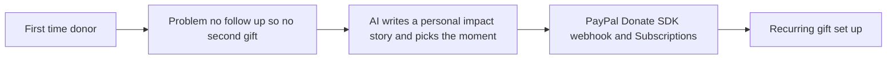

# #69 Second-Gift Engine

> [!tldr] In one breath
> It turns a first PayPal donation into a second one with an AI written impact update, timed to the donor's behaviour. **Strong evidence, moderate novelty (81 out of 120).**

> [!example] Picture this
> Maya gives $25 to a village well fund and hears nothing back. She never gives again. Now, two weeks after her gift, she gets a short note with a photo of the first bricks laid and a one tap button: "give $10 a month and keep the water flowing".

> [!success] Crowd check, Oct 23 2026
> Nonprofit and donation ideas looked thin in a 266 repo GitHub scan (partial coverage): only amanah and a classroom repo. Accessible donations are on PayPal's own inspiration list. Donor CRMs exist outside the hackathon, and AG Grid suggests a donation dashboard.

**Theme:** [[Theme E10 Cross-border, giving & inclusion|E10 Cross-border, giving & inclusion]] · **Group:** Giving & community · **Crowding on Devpost:** donation cluster (sponsor suggested)

## The problem
Overall donor retention is 43.3%. Donor counts fell 3.6% in 2025. The Fundraising Effectiveness Project (FEP) calls first to second gift conversion "the most consequential unsolved problem".

## The idea
Donation webhooks trigger an impact story drafted from the nonprofit's field updates, then a recurring gift ask at the right moment, then a one click PayPal recurring donation.

## Who it is for
Small nonprofits.

## What the AI does
Writes the personal impact message and models the best timing.

## What PayPal does
Donate SDK, Subscriptions (for recurring gifts) and webhooks.

**Building blocks used** (see [[30 Primitives Legend]]):
* `P29` Donate SDK / charity flows
* `P07` Subscriptions (revise, suspend, payment-failed events)
* `P20` Webhooks (events, retries, verification)
* `A12` Eligibility reasoning and messaging
* `A04` Forecasting / pricing suggestion

## Who else is doing this
Fundraise Up, Givebutter, Bloomerang. **Donor CRMs and AI fundraising tools exist.**

⚠️ Verification: desk research only. The competitor names come from the landscape and Devpost scans, not from a hunt for each idea. Treat "no competitor found" as unproven.

## How it stands out
Moderate, with a focus on the first to second gift step.

## Can we build it?
High.

## Smallest demo
A donation leads to an impact email, which leads to a recurring gift.

## Risks
AG Grid suggests a donation dashboard, and donor CRMs exist.

## Sources
* [Fundraising Effectiveness Project: 43.3% retention; donors down 3.6%](https://afpglobal.org/news/fundraising-effectiveness-project-reports-strongest-revenue-growth-five-years-even-fewer) ✅
* [Devpost AG Grid sponsor page (criteria, suggested ideas)](https://paypalaihackathon.devpost.com/details/aggrid) ✅

## Scores
| Axis | Weight | Desk score | 
|---|---|---|
| Tech | ×2 | 7 | 
| Design | ×2 | 7 | 
| Impact | ×2 | 7 | 
| Innovation | ×2 | 5 | 
| Demo | ×2 | 6 | 
| Feasibility | ×1 | 9 | 
| Risk⁻¹ | ×1 | 8 | 
| **Total /120** | | **81** | 

_Why (desk):_ Strong evidence; moderate novelty.

**Kill codes:** none triggered.

> [!info]- Jargon decoder
> **Donor retention**: the share of donors who give again. Like regulars coming back to a cafe.
> **Donate SDK**: PayPal's ready made donate button and flow.
> **Subscriptions**: PayPal charging a set amount on a schedule, used here for monthly gifts.
> **Webhook**: PayPal knocking to say "a donation just came in". Like a doorbell.
> **CRM**: software that keeps track of supporters and contacts.
> **FEP**: the Fundraising Effectiveness Project, which publishes giving statistics.
> **Primitives**: Lego brick style building blocks listed in [[30 Primitives Legend]]. More terms in [[Jargon Decoder]].

## Where to next
* ⬆️ Up: [[Idea Index]]
* ⬅️ Previous: [[I068 PPP Price Localizer]] · ➡️ Next: [[I070 Proof-of-Impact Field Payouts]]
* 🎯 Theme: [[Theme E10 Cross-border, giving & inclusion]]
* 🔗 Related: [[30 Primitives Legend]], [[Jargon Decoder]], [[00 PayPal AI Hackathon Hub]]
