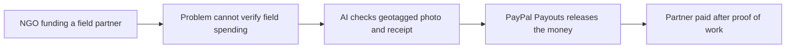

# #70 Proof-of-Impact Field Payouts

> [!tldr] In one breath
> A nonprofit pays its field partners only after AI verifies geotagged photo and receipt evidence that the work was done. **Cut under K2: it is escrow shaped, and escrow is crowded (70 out of 120).**

> [!example] Picture this
> An NGO funds a well in a remote village. The local partner uploads a photo of the finished well with a location stamp and a receipt for the pump. AI checks that the photo matches the place and the receipt matches the cost, and only then does the money go out.

> [!warning] Crowd check, Oct 23 2026
> This is the second most crowded archetype in the scan: AI verified escrow and milestone release (about 28 repos, such as handback, milestone-ai-escrow, mergepay, three named ProofPay, fairshake, holdfast and others). Nonprofit specific versions were not named, but the mechanism is the same.

**Theme:** [[Theme E10 Cross-border, giving & inclusion|E10 Cross-border, giving & inclusion]] · **Group:** Giving & community · **Crowding on Devpost:** escrow cluster

## The problem
Nonprofits struggle to verify how field money is spent.

## The idea
Evidence is submitted, AI verifies it, then Payouts releases the money.

## Who it is for
NGOs.

## What the AI does
Vision verification (checking photos and documents).

## What PayPal does
Payouts.

**Building blocks used** (see [[30 Primitives Legend]]):
* `P11` Payouts (batch)
* `A02` Classification with explanation / vision estimation
* `A13` Vision verification / evidence narrative

## Who else is doing this
GiveDirectly tooling. **Bespoke NGO tooling.**

⚠️ Verification: desk research only. The competitor names come from the landscape and Devpost scans, not from a hunt for each idea. Treat "no competitor found" as unproven.

## How it stands out
It is escrow like.

## Can we build it?
High.

## Smallest demo
Two evidence submissions.

## Risks
The escrow cluster is busy, and evidence data is weak.

## Sources
* [Hackathon resources and inspiration list](https://paypalaihackathon.devpost.com/resources) ✅

## Scores
| Axis | Weight | Desk score | 
|---|---|---|
| Tech | ×2 | 6 | 
| Design | ×2 | 6 | 
| Impact | ×2 | 5 | 
| Innovation | ×2 | 4 | 
| Demo | ×2 | 6 | 
| Feasibility | ×1 | 9 | 
| Risk⁻¹ | ×1 | 7 | 
| **Total /120** | | **70** | 

_Why (desk):_ Escrow-shaped.

## Why it was cut
**K2, crowded cluster or derivative headline.** In plain words: many teams build "release money when AI says the proof is good", so it is hard to defend as new. See [[41 Brutal Elimination]]. Eliminated ideas keep their notes and scores.

> [!info]- Jargon decoder
> **Escrow**: a neutral hold on money until a condition is met. Like a friend holding the bet until the race ends.
> **Geotagged photo**: a picture stamped with where it was taken.
> **Payouts**: PayPal sending money out to many people at once.
> **Vision verification**: AI looking at an image to confirm a claim.
> **NGO**: a nonprofit organisation that is not run by a government.
> **K2**: the kill code for a crowded market, explained above. More terms in [[Jargon Decoder]].

## Where to next
* ⬆️ Up: [[Idea Index]]
* ⬅️ Previous: [[I069 Second-Gift Engine]] · ➡️ Next: [[I071 Disaster Micro-Grant Distributor]]
* 🎯 Theme: [[Theme E10 Cross-border, giving & inclusion]]
* 🔗 Related: [[41 Brutal Elimination]], [[30 Primitives Legend]], [[Jargon Decoder]]
