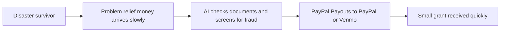

# #71 Disaster Micro-Grant Distributor

> [!tldr] In one breath
> After a disaster, AI checks submitted documents to confirm need and pays small grants instantly to PayPal or Venmo. **Cut under K4: the evidence of the problem is thin (69 out of 120).**

> [!example] Picture this
> A flood hits a town. A mutual aid group wants to send $200 to each affected family fast. Families upload a photo of the damage and an ID. AI screens for fraud and fake documents, and the money lands in their Venmo within the hour.

> [!success] Crowd check, Oct 23 2026
> Nonprofit and microloan style ideas looked empty or thin in a 266 repo GitHub scan (partial coverage). Closest was ebb (household energy bids settled with Payouts), which is a different problem. GiveDirectly and other cash transfer NGOs exist outside the hackathon.

**Theme:** [[Theme E10 Cross-border, giving & inclusion|E10 Cross-border, giving & inclusion]] · **Group:** Giving & community · **Crowding on Devpost:** none

## The problem
Relief payouts are slow, but hard numbers on payout friction are thin.

## The idea
Intake form, AI document check, then Payouts.

## Who it is for
Mutual aid groups.

## What the AI does
Document verification and fraud screening.

## What PayPal does
Payouts, and Venmo handles.

**Building blocks used** (see [[30 Primitives Legend]]):
* `P11` Payouts (batch)
* `P12` Payouts to Venmo handles
* `A01` Document / image extraction (OCR, validation)
* `A05` Structured decision / classification (most common)

## Who else is doing this
GiveDirectly. **Cash transfer NGOs exist.**

⚠️ Verification: desk research only. The competitor names come from the landscape and Devpost scans, not from a hunt for each idea. Treat "no competitor found" as unproven.

## How it stands out
Moderate.

## Can we build it?
High.

## Smallest demo
Intake, then payouts.

## Risks
Fraud, and thin evidence.

## Sources
* [World Bank Global Findex 2025](https://www.worldbank.org/en/publication/globalfindex) ✅

## Scores
| Axis | Weight | Desk score | 
|---|---|---|
| Tech | ×2 | 6 | 
| Design | ×2 | 6 | 
| Impact | ×2 | 4 | 
| Innovation | ×2 | 5 | 
| Demo | ×2 | 6 | 
| Feasibility | ×1 | 9 | 
| Risk⁻¹ | ×1 | 6 | 
| **Total /120** | | **69** | 

_Why (desk):_ Weak evidence.

## Why it was cut
**K4, weak evidence or low impact.** In plain words: nobody showed solid numbers on how bad payout delays are, so the case is hard to defend. See [[41 Brutal Elimination]]. Eliminated ideas keep their notes and scores.

> [!info]- Jargon decoder
> **Micro grant**: a small gift of money, often a few hundred dollars.
> **Mutual aid group**: neighbours organising to help each other directly.
> **Payouts**: PayPal sending money out to many people at once.
> **Venmo handle**: a person's Venmo username, which can receive money.
> **OCR**: software that reads text from a photo of a document.
> **Fraud screening**: checking for fake claims.
> **K4**: the kill code for weak evidence or low impact, explained above. More terms in [[Jargon Decoder]].

## Where to next
* ⬆️ Up: [[Idea Index]]
* ⬅️ Previous: [[I070 Proof-of-Impact Field Payouts]] · ➡️ Next: [[I072 Matching-Gift Finder]]
* 🎯 Theme: [[Theme E10 Cross-border, giving & inclusion]]
* 🔗 Related: [[41 Brutal Elimination]], [[30 Primitives Legend]], [[Jargon Decoder]]
